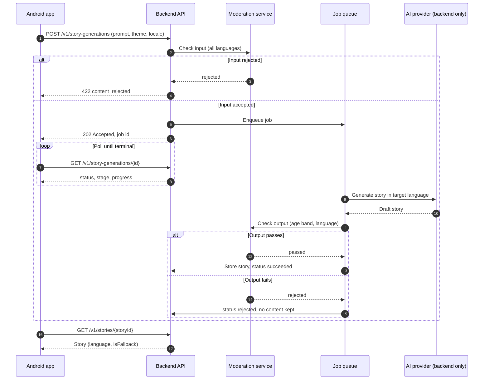

# AI story generation flow

Purpose: describe the future job-based generation flow and the safety, cost and privacy controls required before any real AI provider is used.
Status: Draft for owner review — P1, 29 Oct 2026; §7 added 30 Oct 2026 (LS-141) to record what the simulator already enforces.
Sources: master orchestrator brief §11.2, §18; design details §3.7–3.9 (SCR-07, SCR-08, SCR-09); workbook tickets LS-082, LS-141; ADR-014.

> **PROPOSED — NOT IMPLEMENTED.** The MVP uses a deterministic simulator (LS-082) that is labelled as a simulation (NFR-12). No AI provider is called from the app, now or later: provider credentials live only on the backend.

## 1. Sequence

## 2. States (shared by simulator and future backend)

| State | Screen | User-visible behaviour |
| --- | --- | --- |
| `Queued` / `Running(stage, progress)` | SCR-08 | Stages: imagining (< 38 %), writing (< 76 %), preparing narration (≥ 76 %) |
| `Succeeded(storyId)` | SCR-09 | Story ready; auto-saved to "Created by Me" (TC-029) |
| `Cancelled` | SCR-08 paused | "Story creation paused"; Try again / Back to your idea keeps the text (TC-026, TC-027) |
| `Failed(error)` | SCR-08 error | Retry; typed error → localized `UiText` |
| `Rejected` | SCR-07 | Gentle message to try a different idea; rejected text never echoed back |

## 3. Cancellation and timeouts

| Case | Behaviour |
| --- | --- |
| User taps ✕ | App calls `DELETE /v1/story-generations/{id}`; backend stops the job if possible and discards partial output |
| App backgrounded | Polling stops; on return the app re-reads the job status (no WorkManager for an interactive wait) |
| Client cap reached (e.g. 120 s) | Show paused state with Try again; backend job may still finish and is retrievable |
| Provider timeout | Backend retries once, then `failed` with `server_error` |

## 4. Safety in every supported language

- Moderate **input and output**, in English and Kannada (and every future language) — not English only. Measure moderation quality per language before launch; if Kannada quality is unproven, generation in Kannada stays disabled behind a feature flag.
- Age-band policy (3–12) applied to theme, vocabulary, violence, fear and romance; no real people other than the child's first name.
- No free-form outbound links, contact details or requests for personal data in generated text.
- Human review sample and incident process for flagged outputs; parent can report a story.

## 5. Cost and abuse controls

| Control | Proposal |
| --- | --- |
| Quotas | Per account per day; stricter on free plan |
| Rate limiting | Per account and per device; `429` with `Retry-After` |
| Prompt size | 500-character limit enforced server-side too (`AppConfig` mirrors it) |
| Output length | Bounded by requested duration (5/8/10/15 min) |
| Caching | Never cache across families; child content is private |
| Monitoring | Cost per generation, rejection rate per language, latency |

## 6. Data handling and retention

| Data | Retention (proposed, needs legal review) |
| --- | --- |
| Prompt text | Deleted after generation completes or fails; not used for provider training (contractual) |
| Generated story | Kept while saved by the family; deleted on unsave or account deletion |
| Moderation logs | Minimal metadata only (no child name, no prompt text), short retention |
| Provider credentials | Backend secret store only; never in the app, repository or logs |

See `docs/security/child-safety-requirements.md` for consent and deletion requirements.

## 7. What the MVP simulator already does (30 Oct 2026)

| Control | In the app today | What a real provider adds |
| --- | --- | --- |
| Input validation | `PromptValidator` rejects an empty or over-long prompt; the field stops at `AppConfig.Create.PROMPT_MAX_CHARS` (500) | Server-side length, language and moderation checks in every supported language (§4) |
| Labelling | The Generating screen says the story is simulated (NFR-12); Story Ready and the saved story do not repeat it | Keep the label until generation is real and reviewed |
| States | `GenerationState` Idle → InProgress (three stages) → Completed, with Paused and Failed; the screen resumes from the paused percentage | Map `queued`/`running`/`succeeded`/`failed`/`cancelled`/`rejected` onto the same states |
| Data handling | The prompt stays in memory for the request and is never written to Room, DataStore or logs (see `docs/security/security-review.md`) | Retention limits and deletion on the backend (§6) |
| Child name | Only the hero's first name and age go into the request | Same minimisation for the provider; no other profile data |
| Credentials | None in the app | Provider keys on the backend only, never in the APK |
| Cost and abuse | Local simulation, no cost | Quotas and rate limits per parent account (§5) |

