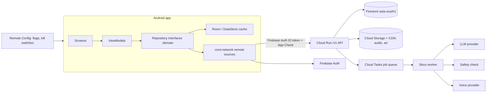
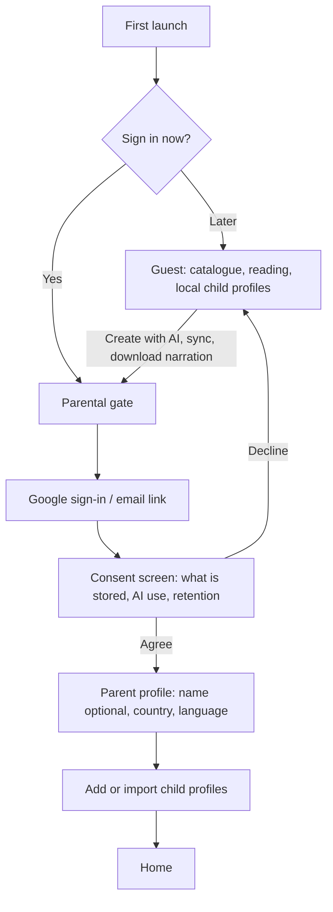

# Backend, AI, voice and accounts — design proposal

Purpose: choose how LittleStory moves from a device-only MVP to a real service: parent sign-in and logout, parent and child profiles, a story catalogue served from a backend, AI story creation, expressive narration in English and Kannada, and a subscription that can be switched on later.
Status: **Proposed — for owner decision, 31 Oct 2026.** No app code, network access or provider account is created by this document.
Related: [future-api-contracts.md](future-api-contracts.md), [ai-generation-flow.md](ai-generation-flow.md), [backend-integration-plan.md](backend-integration-plan.md), [play-families-compliance.md](../security/play-families-compliance.md), [child-safety-requirements.md](../security/child-safety-requirements.md).

> **Legal review required.** The privacy and consent notes are an engineering plan, not legal advice. Prices are list-price estimates from October 2026 and must be re-checked before any commitment.

## 1. Summary of recommendations

| # | Decision | Recommendation | Why |
|---|---|---|---|
| B1 | Backend platform | **Firebase on Google Cloud, India region (`asia-south1`, Mumbai)**: Firebase Auth, Firestore, Cloud Storage + CDN, Cloud Run for the `/v1` API and AI jobs, App Check, Remote Config | Least operations for a small team, first-class Android SDKs, data stays in India, generous free tier |
| B2 | Who signs in | **The parent only.** Children never have logins; child profiles live under the parent account | Matches Families policy, COPPA and DPDP; already assumed in `future-api-contracts.md` §1 |
| B3 | Sign-in methods | **Google sign-in (Credential Manager) at launch**, email link as a second option; phone OTP later if parents ask for it | One tap on Android, no passwords to store, no SMS cost or fraud |
| B4 | Guest use | **Decided by the owner 31 Oct 2026: keep a guest mode** (catalogue, reading, local profiles) and require sign-in for AI creation, sync and narration downloads | Lower friction, keeps today's offline app working, collects nothing until a parent opts in |
| B5 | Story AI | **Owner, 31 Oct 2026: prototype with Gemini, move to open models later.** Provider-neutral backend interface; pick the model after a Kannada bake-off** (Claude Sonnet 5.5 and Gemini as first candidates) | Kannada quality decides the product; no lock-in |
| B6 | Narration | **Catalogue: pre-generated expressive AI voice (best of a listening test), human narration for flagship stories. Created stories: AI voice generated on demand, cached** | Warm storyteller voice where it matters most, cost bounded |
| B7 | Catalogue source | **Curated public-domain retellings + CC BY stories (e.g. Pratham Books StoryWeaver, verify each licence) + AI-assisted originals, all human-reviewed in both languages** | Legal clarity, Kannada content exists, quality control |
| B8 | Subscription | **Not launched. Build entitlements and quotas server-side from day one with every family on `free`**; add Google Play Billing in a later phase | Switching on paid plans becomes a config + billing change, not a redesign |
| B9 | Launch market | **India first** | DPDP is the one regime to satisfy first; Kannada audience |

## 2. Architecture

- The app keeps its current seam: features talk to `:domain` interfaces; `:data` gains remote sources and Room becomes the offline cache (`backend-integration-plan.md` §4). No screen should change because the source moved.
- The app talks to **one API** (`/v1`, contracts in `future-api-contracts.md`). It never calls an AI or voice provider directly, and no provider key is ever in the APK (the repository is public).
- Firestore is read directly by the app only for the parent's own documents, under security rules keyed on the Firebase user id; everything that costs money or touches AI goes through Cloud Run.
- **No Firebase Analytics, Crashlytics or ads SDKs.** Only Auth, Firestore, Storage, App Check and Remote Config are added. Crash reporting, if wanted later, needs its own Families review.

### Platform options considered

| Option | Pros | Cons | Verdict |
|---|---|---|---|
| **Firebase + Cloud Run (GCP, Mumbai)** | Android SDKs, Google sign-in, App Check with Play Integrity, Remote Config for flags and kill switches, free tier, managed security rules | Vendor lock-in for auth and Firestore; Firestore query limits | **Recommended**; lock-in contained by the repository seam and the `/v1` API |
| Supabase (Postgres, Auth, Storage, Mumbai region) | SQL, open source, portable | Fewer Android-native pieces (no App Check equivalent), more custom work for attestation and flags | Good fallback |
| Custom API (Ktor or Spring) + Cloud SQL Postgres | Full control, portable | Most work and on-call for a small team; auth and attestation built by hand | Not now |

## 3. Accounts, login and logout

### 3.1 Identity model

| Entity | Fields (minimum) | Notes |
|---|---|---|
| `ParentAccount` | `uid`, sign-in provider, email (from provider), display name (optional), country, UI language, `createdAt`, consent record id, plan (`free`) | One per adult; the only identity that authenticates |
| `ChildProfile` | `id`, first name or nickname, **age band** (3–5, 6–8, 9–12) or age, avatar id, interest ids, story language, default duration | No surname, birth date, photo, school or location (CS-01). Max count from `AppConfig.Profiles` |
| `ConsentRecord` | policy version, consent text version, language, timestamp, method, withdrawn-at | Immutable log; needed to prove consent (DPDP, COPPA) |
| `Entitlement` | plan, quotas, renewal source (`none` today, `play` later) | Server is the source of truth (§7) |

### 3.2 Flows

| Flow | Behaviour |
|---|---|
| **Sign in** | Always behind the parental gate. Google sign-in via Android Credential Manager; email link as an alternative. Children never see a sign-in screen |
| **Guest → account** | Local child profiles, favourites and progress are offered for upload after consent; nothing is uploaded silently |
| **Logout** | Behind the parental gate. Signs out, revokes the refresh token and **clears that account's cached data from the device** (shared family tablets). The app returns to guest mode with the catalogue still usable |
| **Switch child** | Not a login: picked inside the app; switching to a parent area needs the gate |
| **Multiple devices** | Same parent account on each device; child profiles and progress sync (last-writer-wins, Q6) |
| **Delete account** | In the app (Privacy & parent controls, gated) **and** from a web page, as Play requires (F-14). Deletes the account, profiles, created stories, audio and consent log within a defined period (proposal: immediately disabled, purged within 30 days, except the record that deletion happened) |
| **Withdraw consent** | Same as delete for child data; AI creation stops at once |

## 4. Children's privacy and consent

| Topic | Proposal |
|---|---|
| Rules in scope | India DPDP Act 2023 + DPDP Rules 2025 (notified Nov 2025; most duties, including verifiable parental consent, apply from about May 2027 — confirm the date with the legal reviewer), Google Play Families policy, COPPA and GDPR-K only if distributed outside India |
| Who consents | The signed-in parent, after the parental gate, on a consent screen in English and Kannada. Consent is recorded (`ConsentRecord`) and can be withdrawn |
| Verifying the adult | DPDP asks that the parent be verified as an adult. Proposal for legal review: a signed-in Google or email account plus a self-declaration that the parent is an adult (a supervised Family Link child account must not pass; how to detect it is an open technical check); optional DigiLocker age token later if the reviewer requires it |
| Minimisation | First name or nickname and age band only; the parent may use a nickname |
| **Child name never reaches the AI provider** | The worker sends a placeholder (`{{HERO}}`) to the model and substitutes the real name after generation, on our server. The provider sees the prompt idea, age band, theme and language only |
| Prompt text | Kept only until the job ends, never logged, never used for training (contractual: zero-retention or no-training terms with the provider, CS-17) |
| Generated stories | Stored only while saved by the family; deleted with the account |
| Region | Firestore, Storage and Cloud Run in `asia-south1`. Note: AI and voice providers may process outside India; this must be disclosed in the policy and Data safety form |
| Security | Firebase security rules per `uid`, App Check on every API call, encryption at rest (default) and TLS, least-privilege service accounts, secrets in Secret Manager |
| Policy and Play | Rewrite the draft privacy policy, re-answer the Data safety form (data **is** now collected), add the web deletion URL, keep `FeatureFlags.draftLegalText` on until the reviewer approves |

## 5. AI story creation

Pipeline (extends `ai-generation-flow.md` §1): **input check → generate → output safety check → store → narrate on demand**.

| Step | Proposal |
|---|---|
| Input check | Length and language validation, then a cheap model pass that classifies the idea against the age-band policy (fear, violence, romance, real people, personal data, links) in **the prompt's language** |
| Generation | One structured request returning `{title, pages[], lesson}` in the target language, written natively in Kannada (not translated from English); length bounded by the chosen duration |
| Output check | A second, independent pass that scores the story against a written rubric per age band and language; failures are discarded and the child sees the gentle "try a different idea" message |
| Report | "Report this story" on Reader and Player (gated), stored for human review; reported stories hidden for that family at once (CS-15) |
| Kill switch | Remote Config flag turns AI creation off globally or for Kannada only; the app falls back to the current simulated flow |
| Quotas | Per family per week, enforced on the server from the plan (§7); proposal for `free`: 3 created stories per week |

### Story pictures (owner request, 31 Oct 2026)

Every story gets illustrations like the app's covers. Today the app draws covers in code from `paletteId` + `motifId` (ADR-010); generated pictures are added on top, and the drawn art stays as the fallback.

| Picture | Used on | Shape | Master | Served sizes (WebP) |
|---|---|---|---|---|
| Cover | Story cards, Featured, Details, Story ready, Reader page 1, Player | 1:1, subject in the centre 70 % | 1536 × 1536 | 512, 1024 |
| Page picture | Reader, above each page | 4:3 | 1600 × 1200 | 800 × 600, 1600 × 1200 |

- The story model also returns a `characters` sheet, a `cover` and a per-page `imagePrompt` and `alt` (alt text in the story language for TalkBack). An image model draws them in one house style (soft, warm picture-book illustration in the story's palette).
- **No text inside pictures**, so one set serves every language.
- Every picture goes through the same safety check as the text; a failed picture falls back to the drawn art.
- Cost: about US$0.04 per picture at list price, about US$0.25–0.35 for a cover + 6 pages. To limit cost, the cover is made with the story and page pictures are made when the child opens the Reader, then cached.
- The API grows `story.cover` and `sections[].image` (`url`, `width`, `height`, `alt`); the domain `StoryArtSpec` gains an optional image URL.
- Prototype prompts: `gemini-story-prototype-prompts.md` in the project files (Prompt 4).

### Model choice

| Option | Notes |
|---|---|
| Claude (Anthropic API) — Sonnet 5.5 for writing, Haiku 5.5 for the checks | Strong long-form writing and instruction following; structured outputs; zero-retention terms available |
| Gemini on Vertex AI | Same cloud as the backend and region choices; strong multilingual coverage |
| Sarvam (Indic-specialist LLM) | Built for Indian languages; smaller ecosystem |

**Recommendation:** keep a `StoryWriter` interface in the worker and run a **bake-off**: 20 prompts × 2 languages × 3 age bands, judged blind by the owner and a native Kannada reviewer on naturalness, age fit, warmth and safety. Choose per language if needed (for example, one model for English and another for Kannada).

## 6. Narration voice

The owner's bar: it must sound like a storyteller (warm, expressive, smooth pacing), not an assistant reading instructions — in Kannada too.

| Option | Kannada | Expressiveness | Indicative cost per 8-min story (~7,000 chars) | Fit |
|---|---|---|---|---|
| Android on-device TTS | Depends on the phone; often missing or robotic | Low | Free | Offline fallback only |
| Google Cloud TTS (Chirp 3 HD) | Yes | Good | ~US$0.20 | Solid baseline, same cloud |
| Sarvam Bulbul v3 | Yes, Indic-native voices | Good, natural Indian prosody | Low (verify current price) | Strong Kannada candidate |
| ElevenLabs (v3 / multilingual) | Yes | Very high, storyteller styles | ~US$0.50–1.50 | Best for catalogue, costly for created stories |
| Human narrator | Yes | Best | Quote per story | Flagship catalogue stories |

**Recommendation**

1. **Listening test first**: 2 stories × 2 languages × 3 providers (Google, Sarvam, ElevenLabs), same text, judged blind by the owner and a few parents.
2. **Catalogue**: narrate each story once with the winning voice per language, store the audio in Cloud Storage and stream or download it (real downloads replace the simulation). One-off cost for 50 stories × 2 languages is roughly US$20–150 depending on the provider.
3. **Created stories**: generate audio only when the child taps Listen, then cache it with the story.
4. Add simple SSML-style pacing (pauses between pages, slower rate for ages 3–5).
5. No voice cloning of family members or children.

## 7. Subscription readiness (not launched)

| Built now | Added later (when the owner decides) |
|---|---|
| `Entitlement` per parent account, every account on `free` | Google Play Billing products and the purchase flow, behind the parental gate |
| Plan definitions in server config (quotas per plan) | Server-side purchase verification and Real-time Developer Notifications |
| Quotas enforced on the server and returned to the app (`429` + friendly message) | Premium features: more created stories, premium voices, offline packs |
| `SubscriptionRepository` reads the entitlement; Subscription screen stays a demo behind `FeatureFlags.demoSubscription` | Pricing, regional prices, family sharing |

Never: ads, selling data, or upsell prompts aimed at children. Proposed trigger to start the billing phase (owner to set): for example 10,000 installs and 1,000 weekly active families.

## 8. Costs (indicative, October 2026 list prices)

| Item | Estimate |
|---|---|
| Firebase / Cloud Run / Firestore / Storage at early scale | US$0–50 per month (mostly free tier) |
| Text generation per created story (Sonnet 5.5 at US$2 / US$10 per million tokens, plus two Haiku 5.5 checks) | ~US$0.03 English, ~US$0.06–0.12 Kannada (Kannada uses more tokens) |
| Pictures per created story (cover + 6 pages) | ~US$0.25–0.35 |
| Narration per created story (only if played) | ~US$0.20 (Google) to ~US$1 (ElevenLabs) |
| Catalogue narration (one-off, 50 stories × 2 languages) | ~US$20–150 |
| Example: 1,000 families × 4 created stories per month, half narrated | ~US$500–1,000 per month with free use only |

The last row is why quotas, on-demand narration, a monthly budget alert and the kill switch are part of phase 3, and why the free quota is an owner decision.

## 9. Content (data sources)

| Source | Use | Check |
|---|---|---|
| Public-domain folk tales (Panchatantra, Jataka, Kannada folk tales) | Retold in our own words in both languages | Retelling is original text; no copied modern translations |
| Pratham Books StoryWeaver (CC BY 4.0, many Kannada titles) | Adapt or include with attribution | Licence and attribution per story; illustrations follow their own licence |
| AI-assisted originals | Drafted with the chosen model, edited by a person | Native review in Kannada before publishing |
| Licensed publishers | Later | Contract |

Content workflow: stories keep today's mock JSON schema (ADR-007) and move through `draft → reviewed → published` in Firestore, imported by a small admin script at first; a web admin tool only when volume needs it.

## 10. Phased rollout

| Phase | Scope | Gate to start |
|---|---|---|
| **P-B0** (this doc) | Decisions in §12 | Owner review |
| **P-B1 Accounts** | Firebase dev/prod projects, `INTERNET` permission, `:core:network`, Google sign-in + email link, logout, consent, parent profile, child profiles sync, in-app and web account deletion, App Check, updated policy and Data safety | Owner Approval C; legal reviewer named |
| **P-B2 Catalogue + voice** | Catalogue served from the backend with offline cache, listening test, narrated catalogue, real downloads | P-B1 merged; voice chosen |
| **P-B3 AI creation (closed beta)** | Generation pipeline, moderation, report a story, quotas, budget alerts, kill switch; behind a flag for invited families | Bake-off done; legal review of AI terms; DPA with providers |
| **P-B4 AI creation (open)** | All signed-in families; narration for created stories | Beta safety metrics reviewed by owner |
| **P-B5 Subscription** | Play Billing, entitlements beyond `free`, premium features | Owner's growth trigger (§7) |

Each phase is its own milestone PR into `development`; staging, main and store release stay with the owner.

## 11. Risks

| Risk | Impact | Mitigation |
|---|---|---|
| Kannada story or voice quality is poor | Core value fails for Kannada families | Bake-off and listening test before building; per-language provider; Kannada-only kill switch |
| Harmful or frightening story reaches a child | Trust, Play removal | Two safety passes, age rubrics, report button, human review of reports, closed beta |
| AI costs grow without revenue | Cash burn | Server quotas, on-demand audio, budget alerts, kill switch, cheap models for checks |
| Child data breach | Legal and trust | Minimal data, name never sent to AI, per-user rules, App Check, India region, deletion |
| Consent rules interpreted wrongly | Penalties under DPDP | Legal reviewer before P-B1 ships; consent log |
| Play rejects the update | Delay | Data safety and policy updated in the same release; deletion URL live first |
| Lock-in to Firebase | Migration cost later | Repository seam in the app, `/v1` API owned by us, data export scripts |

## 12. Open questions for the owner

1. ~~**Sign-in model**~~ Decided 31 Oct 2026: guest mode, with sign-in required for AI creation, sync and narration downloads.
2. **Sign-in methods at launch:** Google only, Google + email link (recommended), or also phone OTP?
3. **Backend platform:** Firebase + Cloud Run in Mumbai (recommended), or Supabase?
4. **Launch countries:** India only at first?
5. **Free AI quota and monthly budget cap:** for example 3 created stories per family per week and a US$ monthly cap you are comfortable with.
6. **Voice:** agree to the listening test; budget for human narration of a few flagship stories?
7. **Content:** OK to use public-domain retellings and CC BY StoryWeaver stories with attribution?
8. **Subscription trigger:** the install and active-family numbers that start P-B5.
9. **People:** the legal reviewer, the privacy contact and the native Kannada reviewer (still open from earlier phases).
