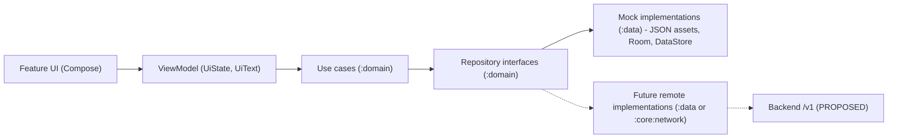

# Backend integration plan

Purpose: define the repository boundaries that let deterministic mock data be replaced by a real backend without rewriting screens.
Status: Draft for owner review — P1, 29 Oct 2026
Sources: master orchestrator brief §9.3–9.5, §10, §11; P0 assessment §6 (proposed module structure); workbook ADR-002, ADR-004, ADR-007, ADR-014, tickets LS-036, LS-037, LS-038, LS-140.

> The MVP stays local and deterministic. Nothing here authorises network code; a backend milestone needs your explicit approval (brief §11).

## 1. Where the seam is



Features depend only on `:domain` interfaces. Swapping `MockStoryCatalogRepository` for a remote one is a Hilt binding change in `:data`, not a feature change.

## 2. Repository boundaries

| Repository (`:domain`) | MVP implementation (`:data`) | Future implementation | Language-aware? |
| --- | --- | --- | --- |
| `StoryCatalogRepository` | `assets/mock/stories_{tag}.json` loader with English fallback | `GET /v1/stories` | Yes |
| `StoryDetailsRepository` (may merge with catalog) | same JSON | `GET /v1/stories/{id}` | Yes |
| `StoryGenerationRepository` | deterministic simulator driven by `AppConfig` timings (LS-082) | `POST`/`GET`/`DELETE /v1/story-generations` | Yes (target language) |
| `SavedStoriesRepository` | Room | `/v1/me/saved-stories` + local cache | IDs only |
| `ReadingProgressRepository` | Room | `/v1/me/reading-progress` | IDs only |
| `ProfileRepository` | Room / DataStore | account + child-profile API (TBD) | No |
| `PreferencesRepository` | DataStore | local only | No |
| `LanguageRepository` | `AppCompatDelegate.setApplicationLocales()` wrapper | local only | Is the language source |

Only add an abstraction when a screen uses it (brief §11: "smallest architecture that preserves the replacement points").

## 3. Language-aware signatures (proposed)

```kotlin
interface StoryCatalogRepository {
    fun observeStories(query: CatalogQuery, language: AppLanguage): Flow<List<StorySummary>>
    suspend fun getStory(id: StoryId, language: AppLanguage): StoryResult
}

interface StoryGenerationRepository {
    suspend fun submit(request: StoryCreationRequest): GenerationJobId   // request.language = target story language
    fun observe(jobId: GenerationJobId): Flow<StoryGenerationState>
    suspend fun cancel(jobId: GenerationJobId)
}
```

Rules:

- `AppLanguage` comes from the `SupportedLanguage` registry in `:core:common`; repositories never read `Locale.getDefault()` directly.
- Results carry `language` and `isFallback` so the UI can show (or test) fallback behaviour.
- Errors are typed (`DomainError.NotFound`, `.Network`, `.RateLimited`, `.ContentRejected`), mapped to `UiText` in the ViewModel — never English strings.
- IDs are value classes (`StoryId`) and identical across languages.

## 4. Swap plan

| Step | Change | Owner approval |
| --- | --- | --- |
| 1 | Introduce `:core:network` (HTTP client, auth interceptor, `Accept-Language` interceptor, error mapping) | Backend milestone approval |
| 2 | Add remote data sources + DTOs in `:data`; keep DTO ≠ entity ≠ domain model | Per ticket |
| 3 | Make Room the cache/source of truth for saved stories and progress; remote syncs into it | ADR needed |
| 4 | Switch Hilt bindings per build type/flavor (`mock` vs `remote`) so tests keep using mocks | Per ticket |
| 5 | Contract tests against the agreed API schema; MockWebServer only once a network layer exists (brief §17.3) | Per ticket |

## 5. What must not happen

- No API keys or AI-provider secrets in the app or repository (brief §11.2, R-24 public repo).
- No networking library, WorkManager job or Paging added before it is needed.
- No feature-module change needed to swap mock → remote; if one is, treat it as an architecture defect.
