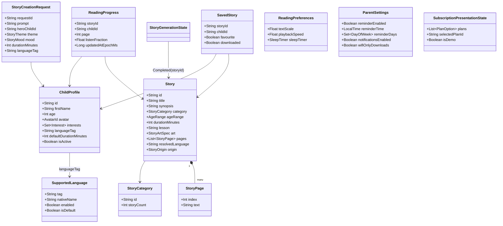

# Data models

Purpose: define the MVP domain models, their fields, identity, persistence and which fields depend on language.

Status: Draft for owner review — P1, 29 Oct 2026 (ADR-004 persistence, ADR-007 localized mock content — Proposed)

Sources: brief §10 · design doc §3 (fields visible on each screen) · workbook risk R-11 (personal data) · P0 decision D14 (minimal child data, Proposed).

## 1. Principles

- Domain models live in `:domain` (pure Kotlin). DTOs (`*Dto`, JSON) and Room entities (`*Entity`) live in `:data` with mappers; the three are never the same class (brief §9.5).
- IDs are stable strings from mock JSON (`story_little_elephant`), identical in every language. No random IDs or timestamps in screenshot tests.
- Language-dependent fields are resolved in `:data` for the requested `languageTag`; a missing Kannada field falls back to English **per field**, and the model records `resolvedLanguage` so the UI can show the actual language (design meta shows "EN").
- Child data is minimal: first name, age, avatar, interests, preferred language, default duration (D14). The parent email shown in the prototype is not stored.

## 2. Class diagram



`StoryGenerationState` is a sealed type: `Idle`, `InProgress(stage: GenerationStage, percent: Int)`, `Paused(requestId)`, `Completed(storyId)`, `Failed(error: GenerationError)`. `GenerationStage` = `Imagining`, `Writing`, `PreparingNarration` (design SCR-08 thresholds from `AppConfig`).

## 3. Model catalogue

| Model | Kind | Identity | Persistence | Language-dependent fields | Lifecycle / notes |
| --- | --- | --- | --- | --- | --- |
| `SupportedLanguage` | config (in `:core:common`) | `tag` (BCP-47) | code registry | `nativeName` is fixed per language, never translated | adding a language = one entry (ADR-006) |
| `ChildProfile` | domain + `ChildProfileEntity` | UUID created on save | Room `child_profile` | none (names are user input) | 1…N per device (FR-03); delete removes progress and saved rows |
| `Story` | domain + `StoryDto` | stable mock ID | bundled JSON (catalog); generated stories in Room `generated_story` | `title`, `synopsis`, `lesson`, `pages[].text`, category label | catalog is read-only; `origin` = `Catalog` or `Generated` |
| `StoryPage` | value | (`storyId`, `index`) | with story | `text` | reader shows one page per paragraph (5 in the design) |
| `StoryCategory` | domain | stable ID (`bedtime`, `animals`, `adventure`, `friendship`, `indian_tales`, …) | JSON | label via string resource `category_*`, hero copy per language in JSON | `storyCount` computed, not hardcoded ("18 STORIES") |
| `StoryCreationRequest` | domain | `requestId` (UUID) | in memory + `SavedStateHandle` | `languageTag` chooses output language | validation: prompt 1…`AppConfig.Create.promptMaxChars` |
| `StoryGenerationState` | domain (sealed) | `requestId` | in memory | – | simulated; deterministic output per request in MVP |
| `SavedStory` | domain + entity | (`childId`, `storyId`) | Room `saved_story` | none | favourite and downloaded flags per child |
| `ReadingProgress` | domain + entity | (`childId`, `storyId`) | Room `reading_progress` | none — page index survives a language change because IDs and page counts match | page counts per language must match; checked by the mock-content test (LS-041/LS-036) |
| `ReadingPreferences` | domain | singleton | DataStore | none | text scale 0.9–1.3, speed options from `AppConfig` |
| `ParentSettings` | domain | singleton | DataStore | none | reminder is UI-only in MVP (D13, ADR-015) |
| `SubscriptionPresentationState` | presentation only | – | none | plan names and notes via strings; prices formatted with locale-aware currency | demo only, behind `FeatureFlags.demoSubscription` (R-15) |
| `NotificationItem` | domain | stable mock ID | JSON `notifications_{tag}.json` + read flags in DataStore | title, body | mock inbox (FR-18) |

## 4. Mock JSON shape (proposed)

```json
{
  "schemaVersion": 1,
  "language": "kn",
  "stories": [
    {
      "id": "story_little_elephant",
      "categoryId": "friendship",
      "ageMin": 4, "ageMax": 7,
      "durationMinutes": 6,
      "art": { "palette": "friendship", "motif": "elephant" },
      "title": "…",
      "synopsis": "…",
      "lesson": "…",
      "pages": ["…", "…"]
    }
  ]
}
```

Non-text fields (`categoryId`, ages, duration, art) are authoritative in `stories_en.json`; other language files may carry only the text fields. A test asserts every ID in a language file exists in the English file and that page counts match (brief §17.8). The seed set must include a long Kannada title, a story with no Kannada translation (to exercise fallback), a missing-art placeholder and an empty-library case (brief §10).
