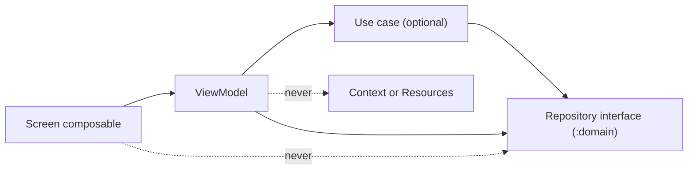

# Dependency rules

Purpose: define which module and layer dependencies are allowed, which are forbidden, and how each rule is enforced automatically.

Status: Draft for owner review — P1, 29 Oct 2026

Sources: brief §9.5, §15.3 · [module-structure.md](module-structure.md) · ADR-002 (module structure, Proposed).

## 1. Allowed edges

| From | May depend on |
| --- | --- |
| `:app` | every module |
| `:feature:*` | `:core:designsystem`, `:core:ui`, `:core:common`, `:domain` |
| `:core:ui` | `:core:designsystem`, `:domain`, `:core:common` |
| `:core:designsystem` | Compose + Material 3 only |
| `:data` | `:domain`, `:core:common` |
| `:prototype:*` | `:domain`, `:core:common`; added to `:app` with `debugImplementation` only, so release builds never contain it |
| `:domain` | `:core:common`, Kotlin stdlib, kotlinx-coroutines-core |
| `:core:common` | Kotlin stdlib, kotlinx-coroutines-core |

## 2. Forbidden edges and why

| Rule | Reason | Enforced by |
| --- | --- | --- |
| R1 `:feature:A` → `:feature:B` | features stay independently buildable and parallelizable (§15.3) | `littlestory.android.feature` plugin fails the build if a `project(":feature:…")` dependency is added; CI `dependencyGuard` style check (LS-031) |
| R2 `:feature:*` → `:data` | UI must not see implementations; only `:app` wires them via Hilt | convention plugin check |
| R3 `:domain` → Android, Compose, Room, Retrofit | domain stays pure Kotlin and unit-testable on the JVM | `:domain` is a JVM module: Android classes cannot compile |
| R4 `:domain` → string resources or translated text | no language inside business logic (brief §4.4 rule 3) | JVM module has no `R`; Detekt rule forbids string literals in `:domain` except identifiers (if D15 approved) |
| R5 `:core:designsystem` → `:domain` or any feature | design system is product-agnostic | convention plugin check |
| R6 `:core:common` → Android | registry and config must be usable from domain tests | JVM module |
| R7 circular dependencies | Gradle refuses them; kept explicit for review | Gradle |
| R8 DTOs, entities and domain models mixed | each layer keeps its own type; mappers in `:data` | code review, `:domain` cannot import `:data` |
| R9 raw colours, dp, text styles in `:feature:*` | design values have one home (brief §4.5) | Detekt custom rule / Lint check (LS-034), review |
| R10 hardcoded user-facing text | strings live in resources | Lint `HardcodedText` = error, Compose literal check (LS-034) |

## 3. Layer rules inside a feature module

| Rule | Detail |
| --- | --- |
| Composables receive state + lambdas | a `Route` composable collects the ViewModel; the stateless `Screen` composable is previewable and screenshot-tested |
| ViewModels hold no `Context` | text goes out as `UiText`; formatting is done in the UI |
| Use cases only when they add logic | e.g. `SearchStoriesUseCase`, `ValidateStoryPromptUseCase`; a pass-through repository call needs no use case |
| No mock data in composables or ViewModels | everything comes through repositories (brief §10) |

## 4. High-conflict files (single owner)

| Files | Owner |
| --- | --- |
| root `build.gradle.kts`, `settings.gradle.kts`, `gradle/libs.versions.toml`, `build-logic/` | Build engineer |
| `AndroidManifest.xml` (app), `locales_config.xml`, `SupportedLanguage`, `:core:ui` strings | Localization engineer |
| `:core:designsystem` theme and tokens | Design-system engineer |
| `:domain` models and repository interfaces | Domain/data engineer |
| root `NavHost`, route registry, Hilt modules in `:app` | Orchestrator |

Changes to these files from another ticket need the owner's review in the PR.
