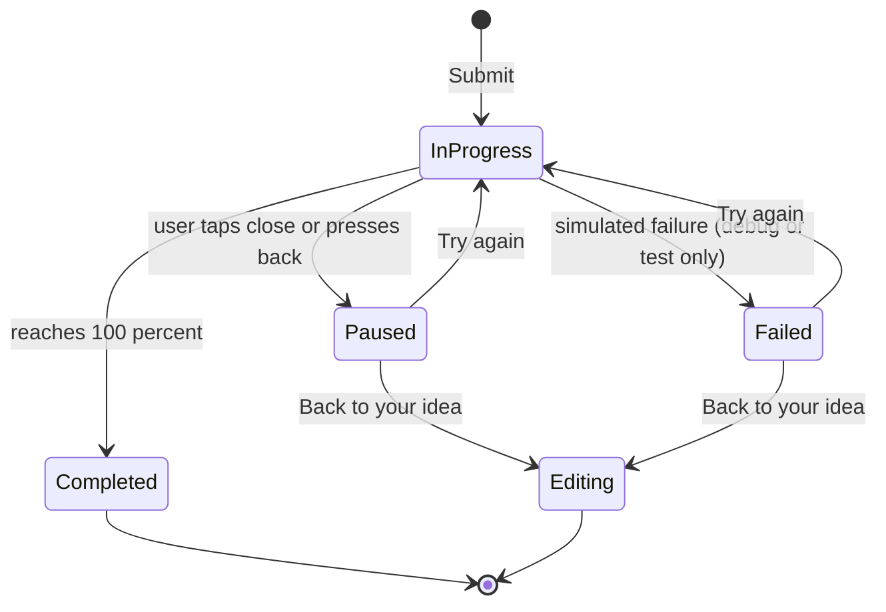

# Error handling

Purpose: define error types per layer, how they map to localized messages, and how retry works.

Status: Draft for owner review — P1, 29 Oct 2026

Sources: brief §9.3 ("explicit error models"), §4.4 rule 3, §6.2 · design doc §3.4, §3.7, §3.8, §3.12, §3.17 (empty and error states).

## 1. Principles

- `:domain` returns typed results, never messages: `sealed interface AppError` subtypes in `:core:common`/`:domain`.
- ViewModels map an error to a `UiText` string resource; English never appears in a ViewModel (brief §4.4).
- Empty is not an error: "no results", "no downloads" and "no stories here yet" are normal states with their own UI.
- Simulated features never fake success after a failure and never claim a real service ran (NFR-12).
- No child content or personal data in logs (NFR-07). Logging uses error codes only.

## 2. Error catalogue

| Domain error | Raised by | Screen(s) | UI treatment | String key (proposed) | Retry |
| --- | --- | --- | --- | --- | --- |
| `ValidationError.PromptEmpty` | `ValidateStoryPromptUseCase` | SCR-07 | red banner, cleared on typing | `create_error_prompt_empty` | user edits |
| `ValidationError.PromptTooLong(max)` | same | SCR-07 | counter turns error colour; input capped at max | `create_error_prompt_too_long` (`%1$d`) | user edits |
| `ValidationError.ChildNameRequired` | `SaveChildProfileUseCase` | SCR-02 | field error | `setup_error_child_name_required` | user edits |
| `ValidationError.AgeOutOfRange(min,max)` | same | SCR-02 | field error (select prevents it; defensive) | `setup_error_age_range` | – |
| `GenerationError.Cancelled` | user ✕ | SCR-08 | paused state "Story creation paused" | `generating_paused_title`, `generating_paused_body` | "Try again" restarts at the configured restart percent |
| `GenerationError.Failed` | simulated repo (only in tests / debug toggle) | SCR-08 | paused state + error line | `error_generation_failed` | "Try again" |
| `ContentError.StoryNotFound(id)` | `StoryRepository` | SCR-06, SCR-09, SCR-10, SCR-11a | full-screen error with back | `error_story_not_found` | back |
| `ContentError.LoadFailed` | JSON loader (corrupt asset) | lists | error state + retry button | `error_content_load` | `Retry` action re-reads |
| `StorageError.WriteFailed` | Room / DataStore | favourite, save, settings | snackbar, state not changed | `error_save_failed` | user repeats |
| `DownloadError.SpaceExceeded` | simulated downloads | SCR-17, SCR-06 | snackbar | `downloads_error_space` | – |

Generic fallback for any unmapped error: `error_generic` ("Something went wrong. Please try again."), with the code logged.

## 3. Mapping pattern

```kotlin
// :feature:create — illustrative
private fun AppError.toUiText(): UiText = when (this) {
    ValidationError.PromptEmpty -> UiText.Res(R.string.create_error_prompt_empty)
    is ValidationError.PromptTooLong -> UiText.Res(R.string.create_error_prompt_too_long, listOf(max))
    else -> UiText.Res(CoreUiR.string.error_generic)
}
```

The limit in the message comes from the same `AppConfig` value the validator uses (brief §4.5 "validation limits").

## 4. Retry and recovery flow



## 5. Tests

- Unit: each validator and repository error path returns the right `AppError`; each ViewModel maps it to the expected resource ID (assert IDs, not English text).
- UI: error banners and paused states render in EN and KN; screenshot tests cover SCR-07 error and SCR-08 paused (LS-122).
