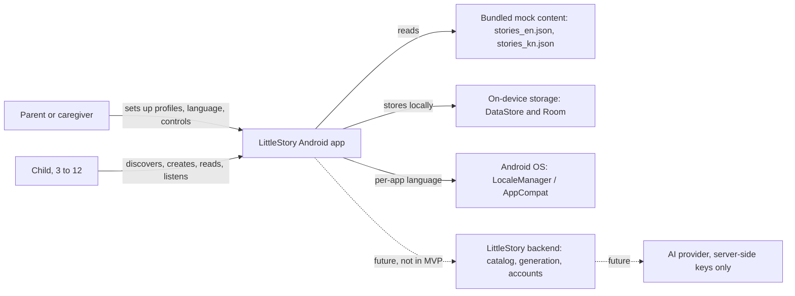
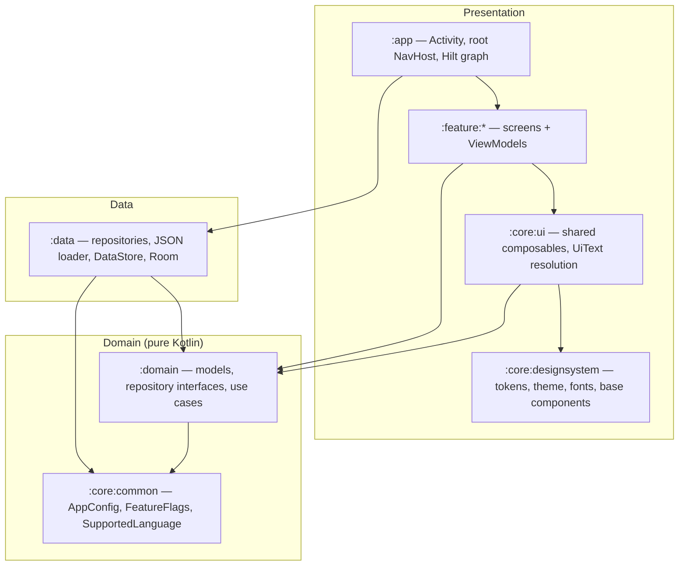
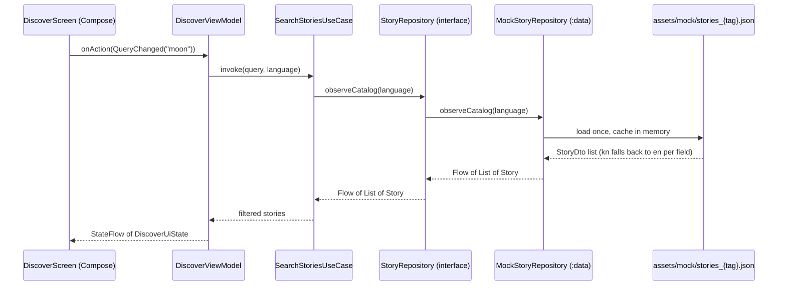
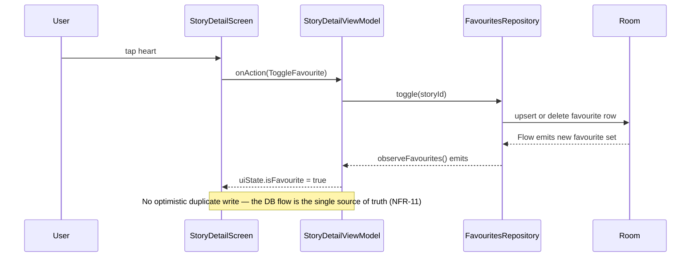

# High-level design

Purpose: describe how the LittleStory Android MVP is structured, how requests and state flow, and where future backend work plugs in.

Status: Draft for owner review — P1, 29 Oct 2026

Sources: master orchestrator brief §4, §9, §11 · `docs/design/LittleStory_Figma_Design_Details.md` · backlog workbook (Requirements, ADRs) · P0 discovery assessment (decisions D1–D15, all Proposed).

## 1. Scope of the MVP

| In the MVP | Not in the MVP (Won't, per brief §4.3) |
| --- | --- |
| Native Android app, Kotlin + Jetpack Compose + Material 3 themed to LittleStory tokens | Real AI provider, backend, authentication, cloud sync |
| 18 designed screens (SCR-01…SCR-18) plus SCR-19…SCR-23 once designs or patterns are approved (LS-004) | Real payments, production TTS or streaming, remote notifications |
| Deterministic local mock data in English and Kannada (`assets/mock/*_{tag}.json`) | Analytics SDKs, runtime machine translation |
| Simulated generation, narration, downloads and demo subscription, clearly labelled (NFR-12) | Languages other than EN and KN in the shipped UI |
| Local persistence: DataStore (preferences) + Room (profiles, favourites, progress, downloads) — ADR-004 | Any transmission of child data |

## 2. System context

The dotted edges are replacement points only. The app holds no API keys and makes no network calls in the MVP (NFR-07, brief §11.2).

## 3. Containers and layers

Module detail and edge rules: [module-structure.md](module-structure.md), [dependency-rules.md](dependency-rules.md).

## 4. Request flow (read path)

`UI → ViewModel → use case (when useful) → repository interface → repository implementation → mock data source`.

## 5. State flow (write path)

Pattern details (UiState, actions, one-off effects, UiText): [state-management.md](state-management.md).

## 6. Cross-cutting concerns

| Concern | Approach | Detail |
| --- | --- | --- |
| Localization | Per-app language via AppCompat, `SupportedLanguage` registry, `UiText`, per-language mock JSON with EN fallback | [../localization/localization-strategy.md](../localization/localization-strategy.md), ADR-005, ADR-006, ADR-007, ADR-009 |
| Configuration | `AppConfig`, `FeatureFlags`, `BuildConfig`; tokens only in `:core:designsystem` | [configuration-and-constants.md](configuration-and-constants.md), ADR-012 |
| Navigation | Navigation Compose with type-safe serializable routes (Nav3 evaluated in LS-030) | [navigation-design.md](navigation-design.md), ADR-001 |
| DI | Hilt | ADR-003 |
| Persistence | DataStore + Room | ADR-004, [data-models.md](data-models.md) |
| Errors | Typed domain errors mapped to `UiText` in the UI layer | [error-handling.md](error-handling.md) |
| Simulations | Behind interfaces, labelled in UI, toggled by `FeatureFlags` | ADR-014 |
| Theme | One light theme with "night" surface tokens; no dark mode in MVP | ADR-013 |
| Story artwork | Compose Canvas driven by story palette + motif (no raster images) | ADR-010 |

## 7. Future backend replacement points

Each repository interface in `:domain` takes or observes the requested `languageTag`, so a backend can serve localized catalogs without UI changes (brief §11).

| Interface (`:domain`) | MVP implementation (`:data`) | Future implementation |
| --- | --- | --- |
| `StoryRepository` | `MockStoryRepository` (bundled JSON) | REST catalog, `GET /v1/stories` |
| `StoryGenerationRepository` | `SimulatedGenerationRepository` (timed progress from `AppConfig`) | job-based generation API |
| `FavouritesRepository`, `ProgressRepository`, `DownloadsRepository` | Room | Room as offline cache + sync |
| `ProfileRepository` | Room | account service (consent, deletion) |
| `PreferencesRepository` | DataStore | unchanged |
| `LanguageRepository` | AppCompat per-app locales | unchanged |

Proposed contracts are documented (not implemented) in `docs/api/`.

## 8. Toolchain note

No library or plugin versions are chosen in P1. They are verified against official compatibility tables and pinned in `gradle/libs.versions.toml` in LS-030. Builds cannot run in the current cloud workspace until `dl.google.com` is reachable (R-21, decision D3).
