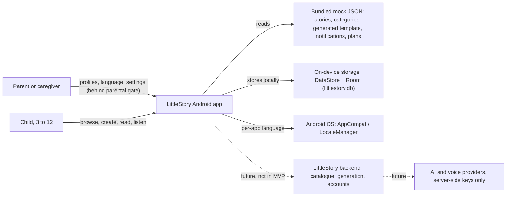
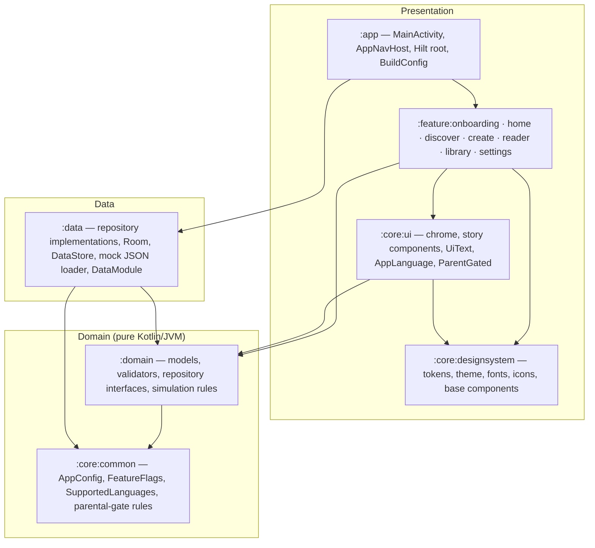
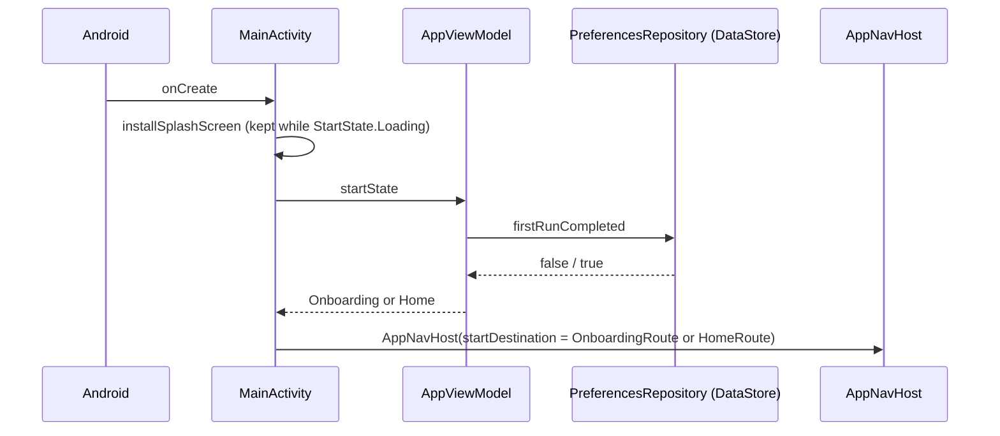
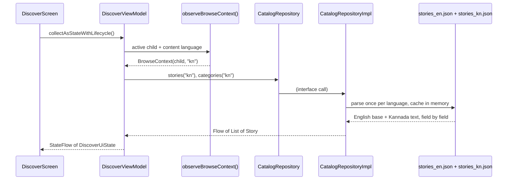
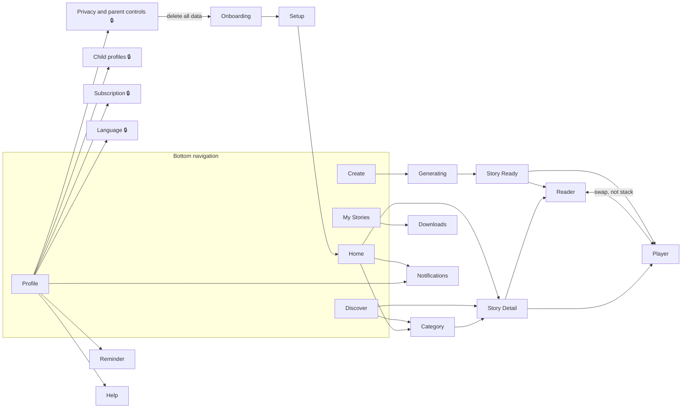
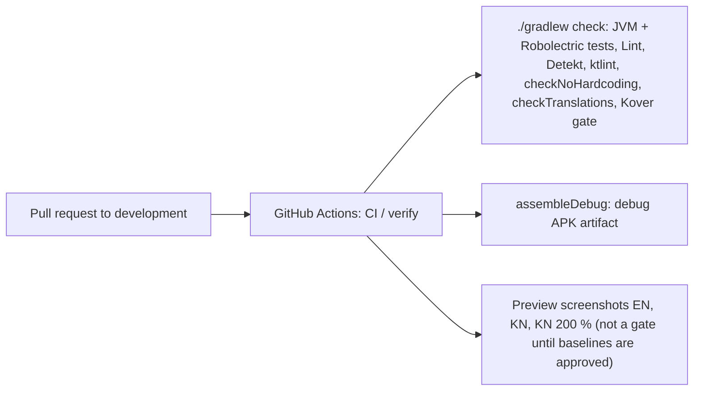

# High-level design (Android)

Purpose: describe how the LittleStory Android app is built today — its scope, modules, layers, data flow, navigation and cross-cutting concerns — and where future backend work plugs in. Class-level detail is in the [low-level design](low-level-design.md).

Status: Draft for owner review — v2, 31 Oct 2026. Rewritten from the P1 plan (29 Oct 2026) to match the code on `development` after P1–P8 and PRs #16–#18. Where the build differs from the P1 plan, §10 says so.

Sources: the code on `development` (commit `f5d1056`) · master orchestrator brief §4, §9, §11 · ADR-001…ADR-018 · [module-structure.md](module-structure.md), [navigation-design.md](navigation-design.md), [state-management.md](state-management.md).

## 1. What the app is

LittleStory is a native Android storytelling app for children aged 3–12 and their parents. A family can browse a bundled catalogue of stories, create a personalised story from a few words about the child's day, read it page by page or listen to it in a narration player, and manage child profiles, language and parent settings. The MVP ships in English and Kannada.

| In the MVP (built) | Not in the MVP (brief §4.3, ADR-014) |
| --- | --- |
| Kotlin + Jetpack Compose + Material 3, themed to the LittleStory tokens | Real AI provider, backend, authentication, cloud sync |
| 21 screens registered in the navigation graph (§5) | Real payments, production TTS or audio streaming, remote notifications |
| Deterministic mock content in English and Kannada (`data/src/main/assets/mock/*_{tag}.json`) | Analytics or advertising SDKs, runtime machine translation |
| Simulated generation, narration, downloads and demo subscription, labelled in the UI | Any transmission of child data; the app manifest declares no network permission |
| Local persistence: DataStore (preferences) and Room (profiles, favourites, progress, downloads, created stories) | Accounts, login/logout, parent profile (proposed in PR #19, not yet merged) |
| Parental gate before parent-only screens (Google Play Families policy) | |

Toolchain (pinned in `gradle/libs.versions.toml`): AGP 9.5, Gradle 9.8.2, Kotlin 2.4.21, Compose BOM 2026.09.00, Hilt 2.60.1, Room 2.8.5, DataStore 1.3, Navigation Compose 2.10 (typed routes), kotlinx.serialization, JDK 21 toolchain. `minSdk 26` (ADR-016), `targetSdk 36`, `compileSdk 37.2`.

## 2. System context

The dotted edges are replacement points only. The app holds no API keys and makes no network calls (NFR-07, brief §11.2).

## 3. Modules and layers

The project has 13 Gradle modules plus the `build-logic` included build (ADR-002). Every module applies one convention plugin from `build-logic`, which also enforces the allowed project dependencies at configuration time (`DependencyRules.kt`); an illegal edge fails the build.

| Module | Plugin | Owns |
| --- | --- | --- |
| `:app` | `littlestory.android.application` | `LittleStoryApplication` (`@HiltAndroidApp`), `MainActivity`, `AppViewModel` (start destination), `AppNavHost` (the only place features meet), `AppModule` (`FeatureFlags`, `AppInfo` from `BuildConfig`), `SafetyModule`, `locales_config.xml`, preview screenshot tests and journey tests |
| `:core:common` | `littlestory.jvm.library` | `AppConfig`, `FeatureFlags`, `AppInfo`, `SupportedLanguages`, `ParentalGateChallenge(s)` |
| `:core:designsystem` | `littlestory.android.library` + compose | Colour, type, shape, dimension, elevation and motion tokens; `LittleStoryTheme`; Kannada-capable fonts (ADR-008); icons; buttons, chips, fields, banners, toasts |
| `:core:ui` | `littlestory.android.library` + compose | `TopBar`, `BottomNav`, `LoadingIndicator`, story cards and Canvas artwork (ADR-010), illustrations, `UiText`, `AppLanguage`, `ParentalGateDialog` / `ParentGated`, system-bar helpers |
| `:domain` | `littlestory.jvm.library` | Models (`Story`, `ChildProfile`, `GenerationState`…), validators, repository interfaces, `BrowseContext` helpers, `simulatedGenerationProgress`, `SimulatedPlayback` |
| `:data` | `littlestory.android.library` + hilt + room | Repository implementations, `LittleStoryDatabase` (schema v2), DataStore preferences, `MockContentSource`, `DataModule` |
| `:feature:*` | `littlestory.android.feature` | Screens, ViewModels, typed routes and `NavGraphBuilder` extensions for their area, plus their own `strings.xml` in `values` and `values-kn` |

Rules: [dependency-rules.md](dependency-rules.md). Features never depend on each other or on `:data`; `:domain` has no Android, Compose or string-resource dependencies.

## 4. Runtime architecture

### 4.1 Startup

`MainActivity` extends `AppCompatActivity` so per-app language changes recreate it on API < 33. It provides the parental-gate question source through a `CompositionLocal`, wraps everything in `LittleStoryTheme`, and draws edge to edge.

### 4.2 Layered request flow

`Compose screen → ViewModel → repository interface (:domain) → implementation (:data) → mock JSON / Room / DataStore`. Small pure helpers in `:domain` (for example `observeBrowseContext`, `catalogue()`, `observeStory`) take the place of separate use-case classes; there is no use case that only forwards a call.

### 4.3 Write path and single source of truth

User actions call a ViewModel function; the ViewModel writes through a repository; Room or DataStore emits the new value; every screen observing that flow updates. ViewModels never keep a second copy of persisted state (NFR-11). Example: the heart on Story Detail calls `FavouritesRepository.toggle`, which is serialised by a `Mutex` so rapid taps from any screen settle on one value (LS-075).

### 4.4 State management

Each screen has one immutable `UiState` exposed as `StateFlow` and collected with `collectAsStateWithLifecycle()`. Non-replayable events (start generation, story ready, data deleted) go through a `Channel` exposed as `effects: Flow`. Navigation callbacks are passed into each screen's `XxxRoute` composable, so screens never see the `NavController`. Text that is UI copy is a string resource or `UiText`; text that is content (story title, child name) is a plain string already resolved for the language. Full pattern: [state-management.md](state-management.md); class detail: [LLD §3](low-level-design.md#3-presentation-pattern).

## 5. Navigation

One `NavHost` in `:app` built from typed `@Serializable` routes (ADR-001). Each feature exports `NavGraphBuilder.xxxScreen(...)` builders and its route types; `AppNavHost` wires their callbacks. Five tab roots (Home, Discover, Create, My Stories, Profile) show the bottom navigation; anything pushed on top covers it.

🔒 = wrapped in `ParentGated`, so the parental gate is asked whichever screen links there. Tap navigation is ignored unless the current entry is `RESUMED` (no double opens); navigation driven by events (generation finished, Setup done, data deleted) is direct. Back rules, including "Story Ready back goes Home", are in [navigation-design.md](navigation-design.md) §4.

## 6. Data and persistence

| Store | Technology | Contents | Child data? |
| --- | --- | --- | --- |
| Mock content | JSON in `data/src/main/assets/mock/`, parsed with kotlinx.serialization | `stories_{en,kn}`, `categories_{en,kn}`, `generated_{en,kn}` (story template), `notifications_{en,kn}`, `plans` | No |
| `littlestory.db` | Room, schema v2, exported schemas, auto-migration 1→2 | `child_profile`, `saved_story`, `reading_progress`, `download`, `generated_story`, `notification_read` | First name, age, avatar, interests (decision D14: nothing more) |
| `littlestory_prefs` | Preferences DataStore | first-run flag, content language, active profile id, reader text scale, playback speed, reminder, notification and download settings | No |
| Per-app locale | AppCompat (platform storage on API 33+) | UI language | No |

English is the base for all content: it defines the ids and structural fields, and a translation file only overrides text field by field, so a missing or malformed Kannada entry falls back to English instead of failing (ADR-007). Privacy & parent controls can wipe everything (`LocalDataRepository.deleteAll`), after which the app returns to onboarding with the system language. Entity and DAO detail: [LLD §5](low-level-design.md#5-data-layer); models: [data-models.md](data-models.md).

## 7. Simulated features

All simulations sit behind repository interfaces or pure domain rules, are deterministic (virtual-time testable), and are labelled in the UI (ADR-014, NFR-12).

| Feature | How it is simulated | Replacement point |
| --- | --- | --- |
| Story generation | `simulatedGenerationProgress`: +4 % every 120 ms through three stages, then a localized template filled with the hero's first name and saved to the library | `GenerationRepository` → job-based generation API |
| Narration | `SimulatedPlayback`: a position fraction advanced on a 500 ms ticker; chapters = pages; speed, skip, sleep timer | a player service over real TTS audio |
| Downloads | a Room row with a fixed size; nothing is fetched | `DownloadsRepository` → real file download |
| Subscription | illustrative plans from `plans.json` behind `FeatureFlags.demoSubscription` | billing + entitlements service |
| Notifications | mock inbox per language; read state in Room; nothing is scheduled (ADR-015) | push / WorkManager reminder |

## 8. Cross-cutting concerns

| Concern | Approach | Detail |
| --- | --- | --- |
| Localization | `SupportedLanguages` registry; UI language via `AppCompatDelegate.setApplicationLocales` (`AppLanguage`); story language stored separately in DataStore; strings in each module's `values` + `values-kn`; `UiText`; per-language mock JSON with English fallback; `checkTranslations` gate | [localization-strategy.md](../localization/localization-strategy.md), ADR-005/006/007/009, [adding-a-new-language.md](../localization/adding-a-new-language.md) |
| Configuration | `AppConfig` (limits, options, timings), `FeatureFlags` (provided by Hilt so tests override), `BuildConfig`; visual values only as design-system tokens; `checkNoHardcoding` scanner | [configuration-and-constants.md](configuration-and-constants.md), ADR-012, [hardcoding-audit.md](hardcoding-audit.md) |
| Design system | Semantic tokens and components in `:core:designsystem`; one light theme with night surfaces (ADR-013); Canvas story art (ADR-010) | [design-system.md](../design/design-system.md), [fidelity-review.md](../design/fidelity-review.md) |
| Accessibility | 48 dp targets, content descriptions and state descriptions from resources, live regions for progress, font scaling to 200 %, Kannada line height; automated checks in Robolectric tests | [accessibility-spec.md](../design/accessibility-spec.md) |
| Dependency injection | Hilt; singletons for repositories, database and DataStore; `@HiltViewModel` per screen; test modules replace `SafetyModule` | ADR-003, [LLD §6](low-level-design.md#6-dependency-injection) |
| Errors | No exceptions reach the UI: missing content becomes `NotFound` states, malformed JSON falls back to English, an unknown generation request becomes a paused state with "Back to your idea" | [error-handling.md](error-handling.md), [LLD §8](low-level-design.md#8-error-handling) |
| Child safety and privacy | Minimal child data, all on device; no network, ads or analytics; `AD_ID` permission removed; parental gate (multiplication on an in-dialog keypad) before child profiles, subscription, language and privacy; draft privacy policy behind `FeatureFlags.draftLegalText` | [child-safety-requirements.md](../security/child-safety-requirements.md), [play-families-compliance.md](../security/play-families-compliance.md), [security-review.md](../security/security-review.md) |
| Quality gates | Detekt, ktlint, Android Lint, `checkNoHardcoding`, `checkTranslations`, dependency rules, Kover ≥ 80 % line coverage on ViewModels and domain logic | ADR-018, [test-strategy.md](../testing/test-strategy.md) |

## 9. Testing and CI

| Level | Where | Examples |
| --- | --- | --- |
| Pure unit | `:domain`, `:core:common`, `build-logic` | validators, simulation rules, parental gate, config, quality scanners |
| Repository | `:data` (Robolectric + in-memory Room) | `CatalogRepositoryTest`, `PersistenceTest`, `GenerationAndInboxTest` |
| ViewModel | each feature, fakes + `kotlinx-coroutines-test` + Turbine | `CreateFlowViewModelTest`, `ReaderAndPlayerViewModelTest` |
| Compose UI | each feature, Robolectric, nodes selected by test tag | `CreateScreensTest`, `SettingsScreensTest` |
| Screenshot | Roborazzi per feature; Compose Preview Screenshot Testing in `:app` | EN, KN, KN at 200 % font scale (ADR-011) |
| Journey | `:app`, Hilt test graph | `EnglishJourneysTest`, `KannadaJourneysTest`, `FirstRunFlowTest` |

CI runs on every pull request and on pushes to `development`, `staging` and `main` with a read-only token and no secrets. Plans: [test-strategy.md](../testing/test-strategy.md), [test-plan.md](../testing/test-plan.md); build instructions: [build-and-run.md](../release/build-and-run.md).

## 10. Differences from the P1 plan

| P1 plan (29 Oct) | As built |
| --- | --- |
| `StoryRepository`, `StoryGenerationRepository`, `LanguageRepository`, use cases such as `SearchStoriesUseCase` | `CatalogRepository`, `GenerationRepository`, `LibraryRepository` (created stories), `NotificationsRepository`, `SubscriptionRepository`, `LocalDataRepository`; filtering and sorting live in ViewModels; shared logic is a handful of `:domain` functions instead of use-case classes; UI language is handled by `AppLanguage` in `:core:ui`, not a repository |
| `MockStoryRepository`, `SimulatedGenerationRepository` | `CatalogRepositoryImpl`, `GenerationRepositoryImpl` |
| ViewModels take an `onAction(Action)` sealed interface | ViewModels expose one public function per user action (`onCreate()`, `onNext()`); the screen bundles them into a `Callbacks` data class |
| Navigation library to be chosen in LS-030 | Navigation Compose with typed routes (ADR-001) |
| SCR-19…SCR-23 pending | Splash (system splash API), Language, Privacy, Help built; Account and Audio preferences have route types but no screen (not designed) |
| No parental gate | `ParentGated` on parent-only screens (PR #18) |

## 11. Future backend replacement points

Every catalogue-facing repository takes the requested `languageTag`, so a backend can serve localized content without UI changes (brief §11).

| Interface (`:domain`) | MVP implementation (`:data`) | Future implementation |
| --- | --- | --- |
| `CatalogRepository` | `CatalogRepositoryImpl` (bundled JSON) | REST catalogue with Room cache |
| `GenerationRepository` | `GenerationRepositoryImpl` (simulated, in-memory requests) | job-based generation API ([ai-generation-flow.md](../api/ai-generation-flow.md)) |
| `LibraryRepository`, `FavouritesRepository`, `ProgressRepository`, `DownloadsRepository` | Room | Room as offline cache + sync per account |
| `ProfilesRepository` | Room + DataStore active id | account service with parent profile, consent and deletion |
| `SubscriptionRepository` | `plans.json` | billing and entitlements |
| `NotificationsRepository` | mock JSON + Room read state | push and scheduled reminders |
| `PreferencesRepository`, `LocalDataRepository` | DataStore / Room | unchanged; delete also revokes the account session |

Accounts, login/logout and parent profiles are not in the app yet; the proposal is in PR #19 (`docs/api/backend-ai-accounts-design.md`, decisions D16–D20). Contracts: [backend-integration-plan.md](../api/backend-integration-plan.md), [future-api-contracts.md](../api/future-api-contracts.md).
