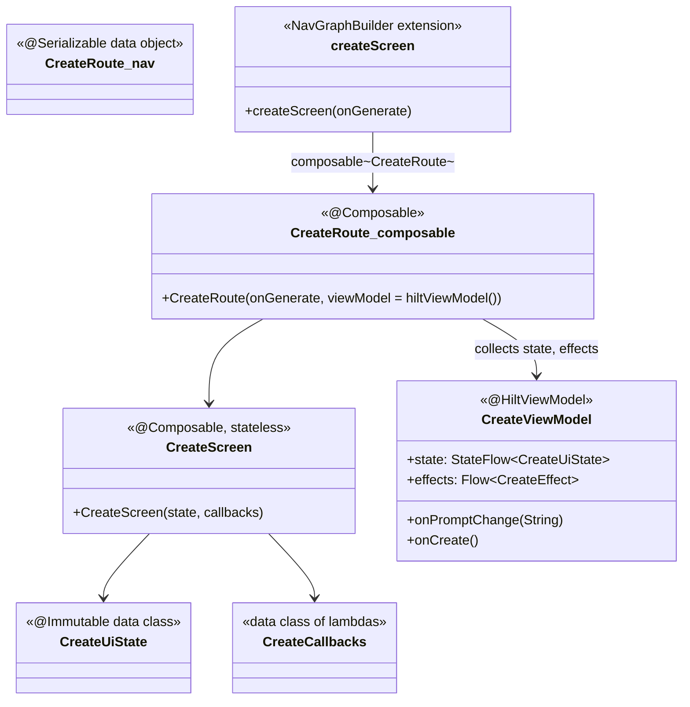
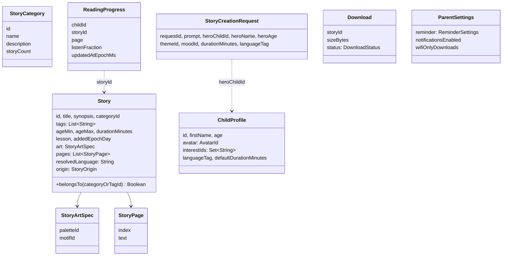
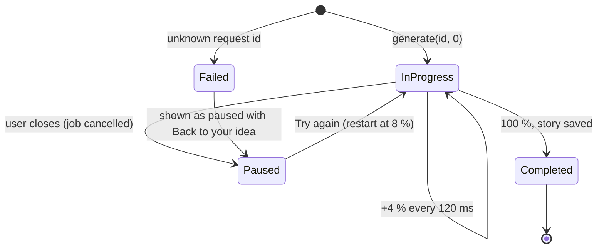
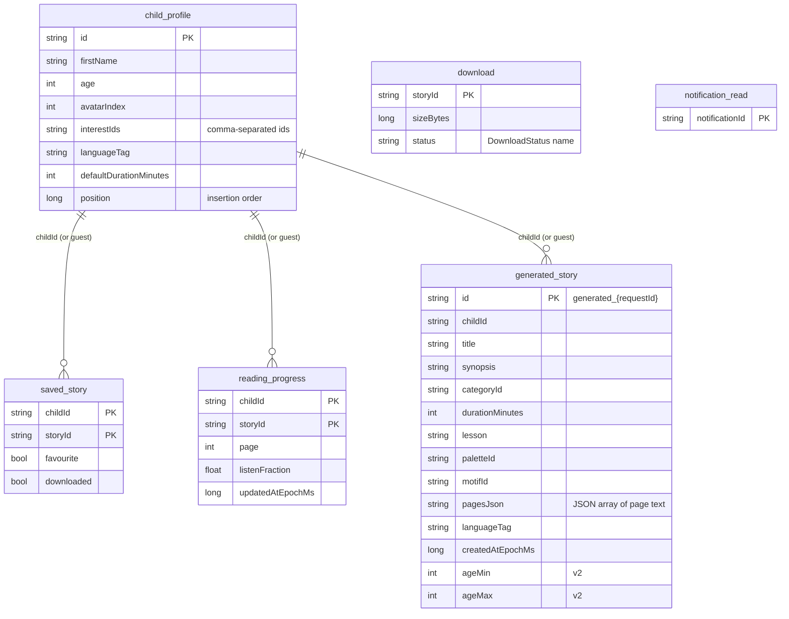
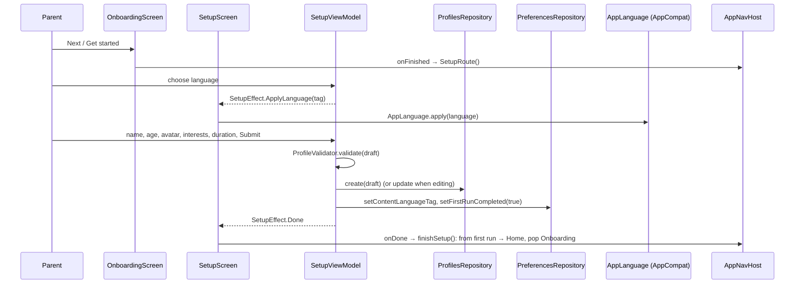
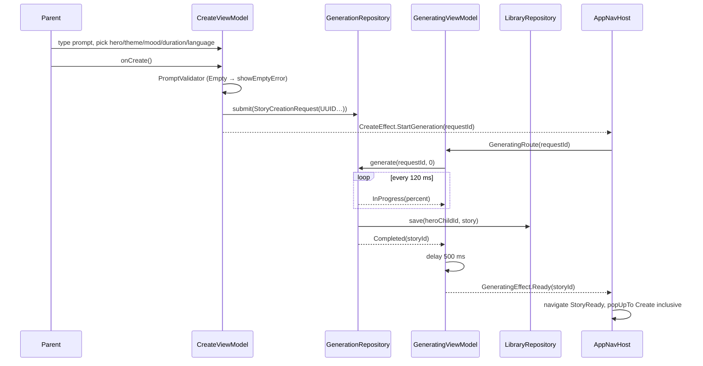
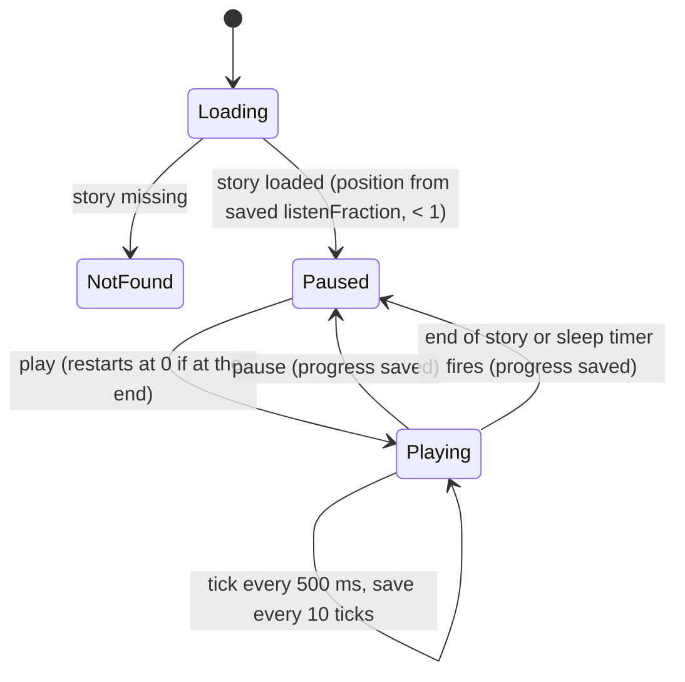
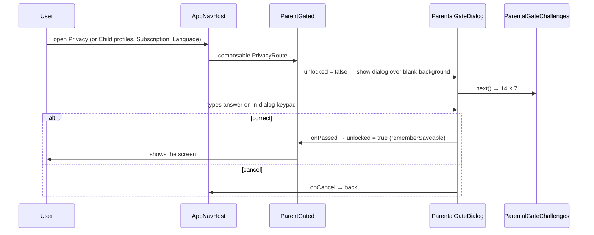

# Low-level design (Android)

Purpose: describe the classes, contracts, state machines and key flows inside each module of the LittleStory Android app, so a developer can change one part without reading all of it. The system view is in the [high-level design](high-level-design.md).

Status: Draft for owner review — v1, 31 Oct 2026. Written from the code on `development` (commit `f5d1056`). When code and this document disagree, the code wins and this document is fixed in the same PR.

Package root: `com.littlestory`. Paths below are relative to each module's `src/main/kotlin/com/littlestory/`.

## 1. Build logic

`build-logic/convention` is an included build; every module applies exactly one of its plugins.

| Plugin id | Class | Applies |
| --- | --- | --- |
| `littlestory.android.application` | `AndroidApplicationConventionPlugin` | AGP application, SDK levels from the version catalog, JDK 21 toolchain |
| `littlestory.android.library` | `AndroidLibraryConventionPlugin` | AGP library with the same settings |
| `littlestory.android.compose` | `AndroidComposeConventionPlugin` | Compose compiler plugin, Compose BOM |
| `littlestory.android.feature` | `AndroidFeatureConventionPlugin` | library + compose + hilt + serialization, and the four core modules |
| `littlestory.android.hilt` | `AndroidHiltConventionPlugin` | Hilt + KSP |
| `littlestory.android.room` | `AndroidRoomConventionPlugin` | Room + KSP, schemas exported to the module's `schemas/` directory and committed |
| `littlestory.jvm.library` | `JvmLibraryConventionPlugin` | plain Kotlin/JVM (`:domain`, `:core:common`) |
| `littlestory.quality` | `QualityConventionPlugin` | Detekt, ktlint, `checkNoHardcoding` (`HardcodingScanner`) |
| root | `RootConventionPlugin` | `checkTranslations` (`TranslationChecker`), Kover aggregate with an 80 % line gate on ViewModels and domain logic |

`DependencyRules.enforceDependencyRules()` inspects every `ProjectDependency` at configuration time and throws if it is not in `allowedProjectDependencies(path)`:

| Module | May depend on |
| --- | --- |
| `:core:common`, `:core:designsystem` | nothing |
| `:domain` | `:core:common` |
| `:core:ui` | `:core:designsystem`, `:domain`, `:core:common` |
| `:data` | `:domain`, `:core:common` |
| `:feature:*` | `:core:designsystem`, `:core:ui`, `:domain`, `:core:common` |
| `:app` | everything (composition root) |

A new module without a rule fails the build until it is added. `TestConfig.kt` adds Robolectric, Compose UI test and Roborazzi to Android modules.

## 2. `:core:common`

| Type | File | Role |
| --- | --- | --- |
| `AppConfig` | `core/common/config/AppConfig.kt` | Nested objects (`Profiles`, `Home`, `Create`, `Setup`, `Generation`, `Player`, `Reader`, `Downloads`, `Reminder`, `Discover`, `Subscription`, `ParentalGate`, `Ui`) holding every limit, option list and timing. Feature code reads these, never literals. |
| `FeatureFlags` | `config/FeatureFlags.kt` | Data class of switches: `demoSubscription`, `simulatedNarration`, `simulatedDownloads`, `bedtimeReminder`, `notificationsInbox`, `draftLegalText`, `pseudoLocales`. Provided by Hilt from `AppModule` (`pseudoLocales = BuildConfig.DEBUG`). |
| `AppInfo` | `config/AppInfo.kt` | Version name and code for Help & about, filled from `:app` `BuildConfig`. |
| `SupportedLanguage`, `SupportedLanguages` | `language/SupportedLanguage.kt` | The only language registry: `English` (`en`), `Kannada` (`kn`, native name ಕನ್ನಡ). `default` = English. `fromTag("kn-IN")` normalises to a supported language or the default. |
| `ParentalGateChallenge` | `safety/ParentalGate.kt` | `first × second` with factors from `AppConfig.ParentalGate`; `isAnsweredBy(input)` accepts any Unicode decimal digits (so Kannada digits work), ignores spaces, caps at 6 digits. |
| `ParentalGateChallenges`, `RandomParentalGateChallenges` | same | `fun interface` source of questions; random in the app, fixed in tests. |

## 3. Presentation pattern

Every screen follows the same shape. Example from `:feature:create`:



| Part | Rule |
| --- | --- |
| Route type | `@Serializable` object or data class in `feature/x/navigation/XRoutes.kt`; arguments are primitives, enums or nullable ids. Read in the ViewModel with `savedState.toRoute<XRoute>()`. |
| Graph builder | `fun NavGraphBuilder.xScreen(callbacks…)` in `XNavigation.kt`. Parent-only screens wrap their content in `ParentGated(onBack)`. |
| `XRoute` composable | The only stateful composable: gets the ViewModel with `hiltViewModel()`, collects `state` with `collectAsStateWithLifecycle()`, collects `effects` in `LaunchedEffect(viewModel)`, maps them to navigation callbacks. |
| `XScreen` composable | Stateless; takes `state` and a `XCallbacks` / `XActions` data class. Used directly by previews, screenshot tests and UI tests. |
| `XUiState` | `@Immutable`. A data class with defaults, or a sealed interface `Loading / NotFound / Loaded(content)` when the screen depends on one item. Derived values are getters, not stored fields. |
| `XEffect` | Sealed interface sent through `Channel(Channel.BUFFERED).receiveAsFlow()` — consumed once, never replayed after rotation. |
| State production | Read-only screens: `combine(...)…stateIn(viewModelScope, WhileSubscribed(5_000), initial)`. Screens with local edits (forms, player): `MutableStateFlow` updated with `update {}` plus `init` collectors. |
| Test tags | Each screen file declares an `XTags` object (`CreateTags.PROMPT`, `CreateTags.suggestion(i)`…). Tests select by tag, never by English text. |
| Text | UI copy from `stringResource` / `pluralStringResource` in the screen, or `UiText` when the ViewModel chooses the message (`UiText.Res`, `UiText.Plural`, `UiText.Dynamic` for content only). |

### 3.1 Browsing context

Most ViewModels need "who is browsing and in which story language". `:domain` provides it once:

```kotlin
data class BrowseContext(val child: ChildProfile?, val languageTag: String) {
    val childId: String get() = child?.id ?: AppConfig.Profiles.GUEST_ID
}
fun observeBrowseContext(profiles, preferences): Flow<BrowseContext>   // combine + distinctUntilChanged
fun <T> Flow<BrowseContext>.flatMapContext(block): Flow<T>              // flatMapLatest
fun CatalogRepository.catalogue(languageTag): Flow<Catalogue>          // stories + categories
fun observeStory(catalog, library, storyId, languageTag): Flow<Story?> // bundled, else created
```

The guest id keeps favourites and progress working when Setup was skipped. Switching the active child or the story language re-runs every downstream flow through `flatMapLatest`.

## 4. Domain layer (`:domain`)

### 4.1 Models



Other models: `SavedStory`, `PlaybackState`, `SleepTimer` (`Off`, `Minutes(n)`, `EndOfStory`), `ReadingPreferences(textScale, playbackSpeed)`, `ReminderSettings(enabled, time, days)`, `NotificationItem` (+ `NotificationSection`, `NotificationKind`), `Plan` (price in minor units + ISO currency). Field-level notes and language dependence: [data-models.md](data-models.md).

### 4.2 Validation

| Validator | Input | Errors |
| --- | --- | --- |
| `PromptValidator.validate(prompt)` | Create prompt | `PromptError.Empty` (blank), `TooLong` (> `AppConfig.Create.PROMPT_MAX_CHARS` = 500). The form also truncates input at the limit. |
| `ProfileValidator.validate(draft)` | `ChildProfileDraft` | set of `ProfileError`: `NameEmpty`, `NameTooLong` (> 30), `AgeOutOfRange` (outside 3..12), `DurationNotAllowed` (not in Setup's options). Interests may be empty. |

### 4.3 Repository contracts

All in `domain/repository/Repositories.kt`. Reads are cold `Flow`s that re-emit on change; writes are `suspend`.

| Interface | Reads | Writes | Notes |
| --- | --- | --- | --- |
| `CatalogRepository` | `categories(tag)`, `stories(tag)`, `story(id, tag)` | — | Resolved for the language with English fallback. |
| `ProfilesRepository` | `profiles`, `activeProfile` | `create(draft)`, `update`, `delete(id)`, `setActive(id)` | `activeProfile` is null before Setup. |
| `FavouritesRepository` | `favouriteIds(childId)` | `setFavourite`, `toggle` → new value | Implementations serialise toggles. |
| `LibraryRepository` | `created(childId)`, `story(id)` | `save(childId, story)` | Generated stories, newest first. |
| `GenerationRepository` | `request(id)`, `generate(id, startPercent)` | `submit(request)` | `generate` emits `InProgress…` then `Completed`, or `Failed` for an unknown id. |
| `ProgressRepository` | `progress(childId)` | `update(progress)` | Newest first; used for Home "Resume". |
| `DownloadsRepository` | `downloads` | `start(id)`, `remove(id)` | Simulated. |
| `PreferencesRepository` | `firstRunCompleted`, `contentLanguageTag`, `reading`, `parentSettings` | setters for each | UI language is not here (AppCompat owns it). |
| `NotificationsRepository` | `notifications(tag)` | `markRead(id)`, `markAllRead()` | |
| `SubscriptionRepository` | `plans` | — | Illustrative only. |
| `LocalDataRepository` | — | `deleteAll()` | Wipes Room and DataStore. |

`StoryStores` bundles `catalog`, `library`, `favourites`, `downloads`, `progress` so Reader, Player and My Stories take one dependency.

### 4.4 Simulation rules

**Generation** (`domain/generation/SimulatedGeneration.kt`, `model/Creation.kt`):

- `simulatedGenerationProgress(requestId, startPercent)` emits `InProgress(percent)` immediately, then adds `STEP_PERCENT` (4) every `STEP_INTERVAL_MS` (120 ms) until 100. It uses `delay`, so tests drive it with virtual time; cancelling the collector pauses it.
- `generationStageFor(percent)`: `Imagining` below 38 %, `Writing` below 76 %, then `PreparingNarration` (`AppConfig.Generation.stageThresholdsPercent`).



**Playback** (`domain/player/SimulatedPlayback.kt`), all pure functions on a position fraction 0..1:

| Function | Rule |
| --- | --- |
| `totalSeconds(minutes)` | `max(minutes, 1) × 60` |
| `tick(position, speed)` | `+ TICK_PERCENT (0.25 %) × speed`, clamped |
| `skip(position, minutes, ±1)` | `± SKIP_SECONDS (15) / totalSeconds` |
| `chapterOf`, `chapterStart` | chapters are the story's pages, spread evenly |
| `nextSpeed(current)` | cycles `0.75 → 1.0 → 1.25 → 1.5` |
| `sleepAfterSeconds(timer)` | `Minutes(n)` → `n × 60`; `Off` / `EndOfStory` → null |
| `secondsPerTick(minutes, speed)` | simulated seconds consumed per tick, for the sleep countdown |

## 5. Data layer (`:data`)

### 5.1 Room

`data/db/LittleStoryDatabase.kt` — `littlestory.db`, `version = 2`, `exportSchema = true`, `AutoMigration(1 → 2)` (added `ageMin`/`ageMax` on `generated_story` with default 0, read back as the full age range).



There are no foreign keys: `childId` can be the guest id, which has no profile row. `ProfilesRepositoryImpl.delete` removes a child's saved, progress and generated rows explicitly. DAOs (`data/db/Daos.kt`) use `@Upsert` for writes and `Flow` for reads.

### 5.2 DataStore

`PreferencesRepositoryImpl` and `ActiveProfileStore` share one Preferences DataStore (`files/datastore/littlestory_prefs.preferences_pb`).

| Key | Type | Default | Owner |
| --- | --- | --- | --- |
| `first_run_completed` | Boolean | false | `PreferencesRepositoryImpl` |
| `content_language_tag` | String | `en` | ″ |
| `reader_text_scale` | Float | 1.0 | ″ |
| `playback_speed` | Float | 1.0 | ″ |
| `reminder_enabled`, `reminder_hour`, `reminder_minute`, `reminder_days` | Boolean, Int, Int, Set&lt;String&gt; | false, 20, 30, all days | ″ |
| `notifications_enabled`, `wifi_only_downloads` | Boolean | true, true | ″ |
| `active_profile_id` | String? | none | `ActiveProfileStore` |

The active id lives in DataStore, not on the profile row, so deleting a child clears it cleanly. `ProfilesRepositoryImpl.activeProfile` falls back to the first profile when the stored id is missing.

### 5.3 Repository implementations

| Implementation | Backing | Key behaviour |
| --- | --- | --- |
| `CatalogRepositoryImpl(source, io)` | `MockContentSource` | Parses `stories_en.json` and `categories_en.json` as the base, overlays `*_{lang}.json` field by field (`title`, `synopsis`, `lesson`, `pages`, category `name`/`description`). Blank or missing fields keep English; `resolvedLanguage` is the target language only when the title was translated. Cached per language in a `ConcurrentHashMap` via `computeIfAbsent`, so concurrent cold-start collectors parse once. `storyCount` is computed from `belongsTo`. |
| `GenerationRepositoryImpl(source, library)` | in-memory `ConcurrentHashMap` of pending requests + `generated_{lang}.json` | `generate` runs the simulated progress, builds a `Story` from the localized template replacing `{child}` with the hero's first name (or the template's `defaultHero`), maps the theme to a category (`themeCategoryIds`), sets ages around the hero's age, saves it with `LibraryRepository.save`, emits `Completed`. Story id is `generated_{requestId}`, so a retry never duplicates. The prompt is never stored. |
| `LibraryRepositoryImpl(dao, clock)` | `generated_story` | `Story ↔ GeneratedStoryEntity` mappers; pages encoded as a JSON string array; unreadable JSON yields no pages (Reader then shows Not found). |
| `ProfilesRepositoryImpl(...)` | `child_profile` + `ActiveProfileStore` | `create` trims the name, appends at `maxPosition + 1`, and makes the first profile active. `newId` is injected (`UUID`) for tests. |
| `FavouritesRepositoryImpl(dao)` | `saved_story` | A `Mutex` orders `setFavourite` and `toggle`; preserves the `downloaded` flag on write. |
| `ProgressRepositoryImpl(dao)` | `reading_progress` | Upsert per child and story. |
| `DownloadsRepositoryImpl(dao, size)` | `download` | `start` writes a `Completed` row with `AppConfig.Downloads.SIMULATED_STORY_BYTES`. |
| `NotificationsRepositoryImpl(source, dao, io)` | `notifications_{lang}.json` + `notification_read` | Merges read ids into items. |
| `SubscriptionRepositoryImpl(source, io)` | `plans.json` | Plans in minor units. |
| `PreferencesRepositoryImpl(store)` | DataStore | §5.2. |
| `LocalDataRepositoryImpl(db, store, io)` | both | `clearAllTables()` on IO, then `store.edit { clear() }`. |

`MockContentSource` is a `fun interface read(fileName): String?`; the app reads `assets/mock/`, tests read files from disk. Mock JSON shapes are `StoriesFile`, `CategoriesFile`, `GeneratedTemplate` (all `ignoreUnknownKeys`). Seed data: [test-data.md](../testing/test-data.md).

## 6. Dependency injection

Hilt, all bindings in `SingletonComponent`.

| Module | Location | Provides |
| --- | --- | --- |
| `DataModule` | `:data` `data/di/DataModule.kt` | `DataStore<Preferences>`, `LittleStoryDatabase`, `MockContentSource`, every repository interface (singletons), `StoryStores` (unscoped wrapper of singletons) |
| `AppModule` | `:app` `app/di/AppModule.kt` | `FeatureFlags`, `AppInfo` from `BuildConfig` |
| `SafetyModule` | `:app` `app/di/SafetyModule.kt` | `ParentalGateChallenges` (random); replaced by `FixedParentalGateModule` in app tests |

ViewModels are `@HiltViewModel` with `@Inject constructor`, obtained with `hiltViewModel()` in the `XRoute` composable, scoped to the navigation back-stack entry; route arguments arrive through `SavedStateHandle`. Feature modules see only `:domain` interfaces; only `:app` sees `DataModule`. The parental-gate question source reaches composables through `LocalParentalGateChallenges`, provided in `MainActivity`.

## 7. Key flows

### 7.1 First run: Onboarding → Setup → Home



Skip writes only `firstRunCompleted = true`; the app then browses as the guest. `SetupRoute(childId)` reuses the same screen to edit a child; `finishSetup()` then just pops back.

### 7.2 Create a story



- `CreateViewModel` loads the story language from preferences, then follows `profiles` + `activeProfile`: it keeps the chosen hero if still present, else the active child, else the first; the active child's default duration is applied once if it is one of Create's options.
- Closing Generating calls `onClose()`: the job is cancelled and `paused = true`. **Try again** restarts at `RESTART_PERCENT` (8 %). Back from the paused state returns to the form with the prompt intact.
- If the process died, the in-memory request is gone: `generate` emits `Failed`, shown as paused with "Back to your idea".
- Story Ready reads the saved story through `LibraryRepository.story(id)`; back goes Home because Create and Generating were popped (navigation-design §4).

### 7.3 Reader

`ReaderViewModel` (`ReaderRoute(storyId, page = 0)`):

- `state = browse.flatMapContext { combine(observeStory(...), page, preferences.reading, favouriteIds) }` → `Loading | NotFound | Loaded(ReaderContent)`. `NotFound` covers a missing story or one with no pages.
- `onNext` / `onPrevious` clamp to the page range, update the local `page` flow, then upsert `ReadingProgress` keeping the existing `listenFraction`.
- `onTextSmaller` / `onTextLarger` step `textScale` by 0.1 within 0.9..1.3, rounded in tenths to avoid float drift, and persist it in DataStore, so every story opens at the chosen size.
- Play opens the Player with `popUpTo<ReaderRoute> { inclusive = true }`: Reader and Player swap rather than stack.

### 7.4 Player



`PlayerViewModel` (`PlayerRoute(storyId)`):

- `init` reads the browse context once, restores position from progress and speed from `ReadingPreferences`, then observes story + favourites + downloads.
- The ticker is a `viewModelScope` job: `delay(SIMULATED_TICK_MS)`, `tick()`, save every `PROGRESS_SAVE_EVERY_TICKS`. `tick()` also counts down `sleepRemaining` with `secondsPerTick`; when it reaches 0, or the story ends with `EndOfStory`, playback stops and the timer resets to `Off`.
- Previous chapter restarts the current chapter first, then goes back one (slack 1 %). Speed changes persist to DataStore. Volume is UI state only.
- Progress saves keep the existing `page`, so Reader and Player share one `reading_progress` row per child and story; Home's Resume reads it.

### 7.5 Favourites and downloads (any screen)

`favourites.toggle(browse.first().childId, storyId)` → `Mutex`-guarded read-modify-write of `saved_story` → `favouriteIds` re-emits → every visible screen updates. Downloads: `start` / `remove` on `DownloadsRepository`; the Downloads screen sums `sizeBytes` against `AppConfig.Downloads.SIMULATED_QUOTA_BYTES`.

### 7.6 Language switch

| What | Where stored | Who changes it | Effect |
| --- | --- | --- | --- |
| UI language | AppCompat per-app locale | `AppLanguage.apply(language)` from Language screen and Setup | Activity recreated; all `stringResource` and `UiText` re-resolve |
| Story language | DataStore `content_language_tag` | `LanguageViewModel.onStoryLanguageSelected`, Setup submit, Create (per request) | `BrowseContext.languageTag` changes; catalogue flows re-run for the new language |

Both pickers list `SupportedLanguages.enabled` with native names, so a new registry entry appears without feature changes ([adding-a-new-language.md](../localization/adding-a-new-language.md)).

### 7.7 Parental gate



The unlock is kept while the destination stays on the back stack, so returning from a sub-screen does not ask again. The keypad replaces a text field because a `TextField` inside a dialog hung Robolectric tests with qualifiers.

### 7.8 Delete all local data

Privacy → confirm → `PrivacyViewModel.onConfirmDelete()` → `LocalDataRepository.deleteAll()` → `PrivacyEffect.Deleted` → `PrivacyScreen` calls `AppLanguage.reset()` → `onDeleted` navigates to `OnboardingRoute` with `popUpTo(graph) { inclusive = true }`.

## 8. Error handling

| Failure | Where handled | What the user sees |
| --- | --- | --- |
| Mock JSON file missing or malformed | `CatalogRepositoryImpl.parse`, `GenerationRepositoryImpl.template` (`runCatching` → null) | English content; an empty list only if the English file itself is broken (caught by `CatalogRepositoryTest`) |
| Translation missing for a field | catalogue resolver | that field in English |
| Unknown story id (deep link, deleted creation) | `observeStory` returns null | `NotFound` state with a back action |
| Generated story pages unreadable | `GeneratedStoryEntity.toDomain` | no pages → Reader `NotFound` |
| Unknown generation request (process death) | `GenerationRepositoryImpl.generate` emits `Failed(Unknown)` | Generating paused, "Back to your idea" |
| Empty prompt | `PromptValidator` | inline error under the prompt (live region) |
| Invalid profile | `ProfileValidator` | inline field errors |
| Wrong parental-gate answer | `ParentalGateChallenge.isAnsweredBy` | error message and a new question |
| Double tap during navigation | `NavHostController.go/back` check `RESUMED` | second tap ignored |

No repository throws into the UI in the MVP, because every source is local. The typed-error model for a future network layer is in [error-handling.md](error-handling.md).

## 9. Screen catalogue

| Screen (SCR) | Module · route | ViewModel inputs | State · effects |
| --- | --- | --- | --- |
| Onboarding (01) | onboarding · `OnboardingRoute` | `SavedStateHandle` (page) | `OnboardingUiState` · `OnboardingEffect` |
| Setup (02) | onboarding · `SetupRoute(childId?)` | Profiles, Preferences | `SetupUiState` · `SetupEffect.Done`, `ApplyLanguage` |
| Home (03) | home · `HomeRoute` | Catalog, Favourites, Profiles, Preferences, Progress | `HomeUiState` |
| Discover (04) | discover · `DiscoverRoute` | Catalog, Favourites, Profiles, Preferences, `SavedStateHandle` (query, filter) | `DiscoverUiState`; locale-aware search over title, synopsis and category name |
| Category (05) | discover · `CategoryRoute(categoryId)` | Catalog, Favourites, Downloads, Profiles, Preferences | `CategoryUiState`; sort recommended / shortest / newest |
| Story Detail (06) | discover · `StoryDetailRoute(storyId)` | Catalog, Favourites, Downloads, Profiles, Preferences | `StoryDetailUiState` |
| Create (07) | create · `CreateRoute` | Profiles, Preferences, Generation | `CreateUiState` · `StartGeneration` |
| Generating (08) | create · `GeneratingRoute(requestId)` | Generation | `GeneratingUiState` · `Ready` |
| Story Ready (09) | create · `StoryReadyRoute(storyId)` | Library, Favourites, Downloads, Profiles, Preferences | `StoryReadyUiState` |
| Reader (10) | reader · `ReaderRoute(storyId, page)` | `StoryStores`, Profiles, Preferences | `ReaderUiState` |
| Player (11) | reader · `PlayerRoute(storyId)` | `StoryStores`, Profiles, Preferences | `PlayerUiState` |
| My Stories (12) | library · `MyStoriesRoute(tab)` | `StoryStores`, Profiles, Preferences | `MyStoriesUiState`; tabs All / Created by me / Downloaded / Favourites |
| Downloads (13) | library · `DownloadsRoute` | Catalog, Library, Downloads, Profiles, Preferences | `DownloadsUiState` |
| Profile (14) | settings · `ProfileRoute` | Profiles, Preferences, `FeatureFlags` | `ProfileUiState` |
| Subscription (15) 🔒 | settings · `SubscriptionRoute` | Subscription | `SubscriptionUiState` |
| Child profiles (16) 🔒 | settings · `ChildProfilesRoute` | Profiles | `ChildProfilesUiState` |
| Reminder (17) | settings · `ReminderRoute` | Preferences | `ReminderUiState` (UI only, nothing scheduled) |
| Notifications (18) | settings · `NotificationsRoute` | Notifications, Preferences | `NotificationsUiState` |
| Language (20) 🔒 | settings · `LanguageRoute` | Preferences (+ `AppLanguage` in the screen) | `LanguageUiState` |
| Privacy (21) 🔒 | settings · `PrivacyRoute` | LocalData, `FeatureFlags` | `PrivacyUiState` · `Deleted` |
| Help (22) | settings · `HelpRoute` | `AppInfo` | — |

SCR-19 (splash) is the system splash in `MainActivity`. `AccountRoute` and `AudioPreferencesRoute` (SCR-23) exist as types only. Per-screen states and acceptance criteria: [screen-inventory.md](../design/screen-inventory.md), [screen-state-matrix.md](../design/screen-state-matrix.md).

## 10. Shared UI components (`:core:designsystem`, `:core:ui`)

| Component | Module · file | Used for |
| --- | --- | --- |
| `LittleStoryTheme` + `LittleStoryTheme.colors/typography/dimens/shapes/elevation/motion` | designsystem · `theme/` | Every colour, size and duration; no literals in features |
| `LittleStoryButton`, `LittleStoryChip`, `LittleStorySelect`, text fields, `LittleStoryNotesBanner`, toasts | designsystem · `component/` | Base controls with 48 dp targets and pressed states (`Press.kt`) |
| `LittleStoryIcons`, `BrandMark` | designsystem · `icon/`, `brand/` | Vector icons and logo |
| `TopBar`, `BottomNav` / `NavTab` | ui · `chrome/NavigationChrome.kt` | Screen chrome |
| `LoadingIndicator`, `LoadingScreen` | ui · `chrome/Loading.kt` | Shown only after `AppConfig.Ui.LOADING_INDICATOR_DELAY_MS` (300 ms) |
| `StoryArt`, story cards, `Avatar` | ui · `story/` | Canvas cover art from `StoryArtSpec` (ADR-010) |
| `NightScene`, `Sparkles`, home illustrations | ui · `illustration/` | Decorative art, hidden from accessibility |
| `UiText`, `asString()` | ui · `text/UiText.kt` | Resolving ViewModel text |
| `AppLanguage` | ui · `language/AppLanguage.kt` | Per-app locale |
| `ParentalGateDialog`, `ParentGated` | ui · `safety/ParentalGate.kt` | Parental gate |
| `SystemBarIcons` | ui · `system/SystemBars.kt` | Light or dark status-bar icons per screen (night screens) |

Token values and component specs: [design-system.md](../design/design-system.md).

## 11. Testing hooks

| Seam | How tests use it |
| --- | --- |
| Repository interfaces | Each feature's `Fakes.kt` implements them in memory |
| `MockContentSource` | `:data` tests read the real JSON from disk |
| `newId`, `clock`, size lambdas in constructors | deterministic ids and times |
| `delay`-based simulations | `runTest` + virtual time advance generation and playback |
| `XScreen(state, callbacks)` stateless composables | UI and screenshot tests render any state without a ViewModel |
| `XTags` objects | node selection independent of language |
| `FixedParentalGateModule` | app journeys answer the gate deterministically |
| `FeatureFlags` data class | tests flip flags without build variants |

Strategy and plans: [test-strategy.md](../testing/test-strategy.md), [ui-test-plan.md](../testing/ui-test-plan.md), [integration-test-plan.md](../testing/integration-test-plan.md).

## 12. Extension recipes

Common changes and the single place each one touches are in [how-to-change.md](how-to-change.md). For a new screen: add a route type and `xScreen` builder in the owning feature, a `@HiltViewModel` with an `@Immutable` state, strings in `values` and `values-kn`, a `XTags` object, tests and screenshots, then wire callbacks in `AppNavHost`. For a new data source: add or extend an interface in `:domain`, implement it in `:data`, bind it in `DataModule`; screens do not change.
