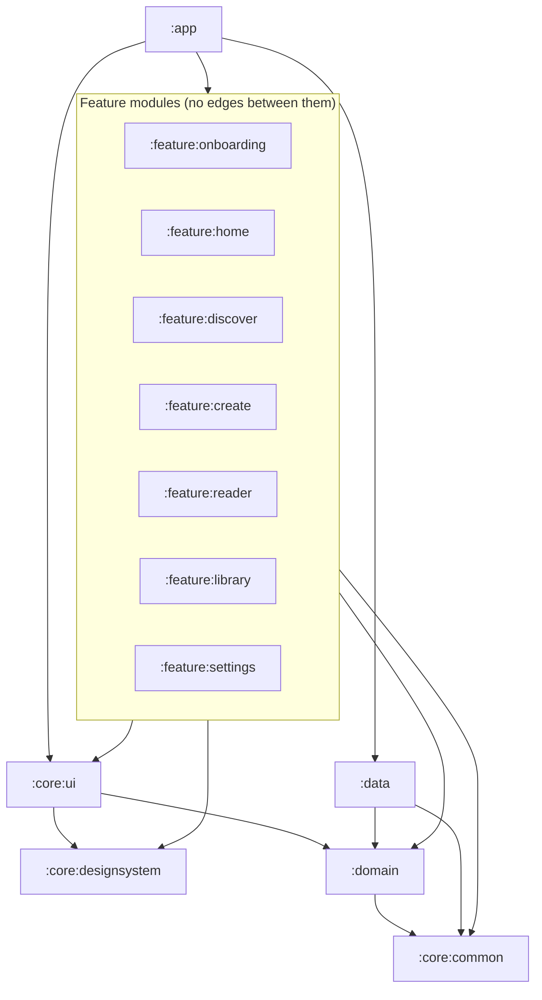

# Module structure

Purpose: list every Gradle module proposed for the MVP, what it owns, what it may depend on, and which strings it owns.

Status: Draft for owner review — P1, 29 Oct 2026 (replaces the 12-feature layout in workbook ADR-002; decision D4, Proposed)

Sources: brief §9.4–9.5 · P0 assessment §6 · workbook Backlog (Component/Module column) and Translations sheet.

## 1. Why 7 feature modules, not 12

The brief asks for "fewer modules" when an MVP is small (§9.4). Grouping screens that share a journey and a ViewModel scope keeps each feature module cohesive and cuts Gradle configuration and cross-module navigation glue.

| Workbook ADR-002 module | Proposed module |
| --- | --- |
| `feature:onboarding` | `:feature:onboarding` |
| `feature:home` | `:feature:home` |
| `feature:discover`, `feature:storydetails` | `:feature:discover` |
| `feature:create` | `:feature:create` |
| `feature:reader`, `feature:player` | `:feature:reader` |
| `feature:library` | `:feature:library` |
| `feature:settings`, `feature:profiles`, `feature:notifications`, `feature:subscription` | `:feature:settings` |

Splitting a module later is cheap because features never depend on each other.

## 2. Module table

| Module | Type | Owns | Screens | May depend on |
| --- | --- | --- | --- | --- |
| `build-logic` | included build | convention plugins: `littlestory.android.application`, `.android.library`, `.android.compose`, `.android.feature`, `.jvm.library`, `.android.hilt`, `.android.room` | – | – |
| `:app` | Android application | `Application`, `MainActivity`, root `NavHost`, route registry, Hilt components, manifest, `res/xml/locales_config.xml`, `app_name`, splash (SCR-19) | SCR-19 | all modules |
| `:core:designsystem` | Android library + Compose | colour, type, shape, spacing, elevation, motion tokens; fonts (DM Sans, Manrope, Kannada fallback); 21 icons; Button, IconButton, fields, chips, segmented control, toggle, sheet, dialog, toast, progress bars | – | Compose, Material 3 only |
| `:core:ui` | Android library + Compose | StoryArt, StoryCard, ListStoryRow, ContinueCard, SectionHeader, Avatar, TopBar, BottomNav, EmptyState, NoteBanner; `UiText` resolver; shared strings | – | `:core:designsystem`, `:domain`, `:core:common` |
| `:core:common` | JVM library (pure Kotlin) | `AppConfig`, `FeatureFlags`, `SupportedLanguage` registry, `DispatcherProvider`, `Result`/`AppError` base types | – | Kotlin stdlib, coroutines |
| `:domain` | JVM library (pure Kotlin) | domain models, repository interfaces, use cases | – | `:core:common` |
| `:data` | Android library | repository implementations, `MockContentLoader` (kotlinx.serialization), DataStore, Room database + DAOs, `assets/mock/*.json` | – | `:domain`, `:core:common` |
| `:feature:onboarding` | feature | Onboarding, Setup | SCR-01, SCR-02 | core + `:domain` |
| `:feature:home` | feature | Home | SCR-03 | core + `:domain` |
| `:feature:discover` | feature | Discover, no-results, Category, Story detail | SCR-04a, SCR-04b, SCR-05, SCR-06 | core + `:domain` |
| `:feature:create` | feature | Create a story, Generating + paused, Story ready | SCR-07, SCR-08, SCR-09 | core + `:domain` |
| `:feature:reader` | feature | Reader, Player, Sleep-timer sheet | SCR-10, SCR-11a, SCR-11b | core + `:domain` |
| `:feature:library` | feature | My Stories, Offline downloads | SCR-12, SCR-17 | core + `:domain` |
| `:feature:settings` | feature | Profile hub, Child profiles, Subscription, Bedtime reminder, Notifications, Language, Privacy, Help, Account/Audio prefs | SCR-13–16, SCR-18, SCR-20–23 | core + `:domain` |

"core" = `:core:designsystem`, `:core:ui`, `:core:common`. `:core:database` and `:core:network` are not created in the MVP (brief §9.4): Room lives inside `:data` until a second consumer exists, and there is no network layer.

## 3. Dependency graph

## 4. String ownership

Android string resources can only live in Android modules, so `:core:common` and `:domain` hold none. Each feature owns its own `values/strings.xml` and `values-kn/strings.xml` (brief §9.4).

| Module | String scope | Prefix | Owner |
| --- | --- | --- | --- |
| `:app` | `app_name`, splash, launcher label | `app_`, `splash_` | Localization engineer |
| `:core:ui` | shared actions, navigation labels, content descriptions, metadata formats, generic errors, enum labels (interests, categories, moods, themes) | `action_`, `nav_`, `cd_`, `meta_`, `error_`, `state_`, `label_`, `interest_`, `category_`, `mood_`, `theme_` | Localization engineer (single owner, high conflict) |
| `:feature:onboarding` | onboarding + setup | `onboarding_`, `setup_` | feature engineer |
| `:feature:home` | home | `home_` | feature engineer |
| `:feature:discover` | discover, category, detail | `discover_`, `category_screen_`, `detail_` | feature engineer |
| `:feature:create` | create, generating, ready | `create_`, `generating_`, `ready_` | feature engineer |
| `:feature:reader` | reader, player, sleep timer | `reader_`, `player_`, `sleep_` | feature engineer |
| `:feature:library` | my stories, downloads | `library_`, `downloads_` | feature engineer |
| `:feature:settings` | profile hub, profiles, subscription, reminder, notifications, language, privacy, help | `settings_`, `profiles_`, `subscription_`, `reminder_`, `notifications_`, `language_`, `privacy_`, `help_` | feature engineer |
| `:data` | none — mock content is JSON in `assets/mock/`, not strings | – | Domain/data engineer |

Note: the workbook Translations sheet still uses the old 12-module names and places some shared keys in `core:common`; those rows move to `:core:ui` (or `:app` for `app_name`) when the sheet is regenerated from real `strings.xml` files in P2 (LS-040, LS-043).

## 5. Convention plugins

| Plugin | Applies | Used by |
| --- | --- | --- |
| `littlestory.android.application` | AGP app, Kotlin, JDK toolchain, minSdk 26 (D5), lint config | `:app` |
| `littlestory.android.library` | AGP library, Kotlin, toolchain, lint config | `:core:designsystem`, `:core:ui`, `:data` |
| `littlestory.android.compose` | Compose compiler, BOM, tooling | designsystem, ui, features, app |
| `littlestory.android.feature` | library + compose + hilt + standard feature deps (`:core:*`, `:domain`) | all `:feature:*` |
| `littlestory.jvm.library` | Kotlin JVM, toolchain | `:core:common`, `:domain` |
| `littlestory.android.hilt` / `.room` | Hilt + KSP / Room + KSP + schema export | app, data, features |

All versions live in `gradle/libs.versions.toml` and are pinned in LS-030.
