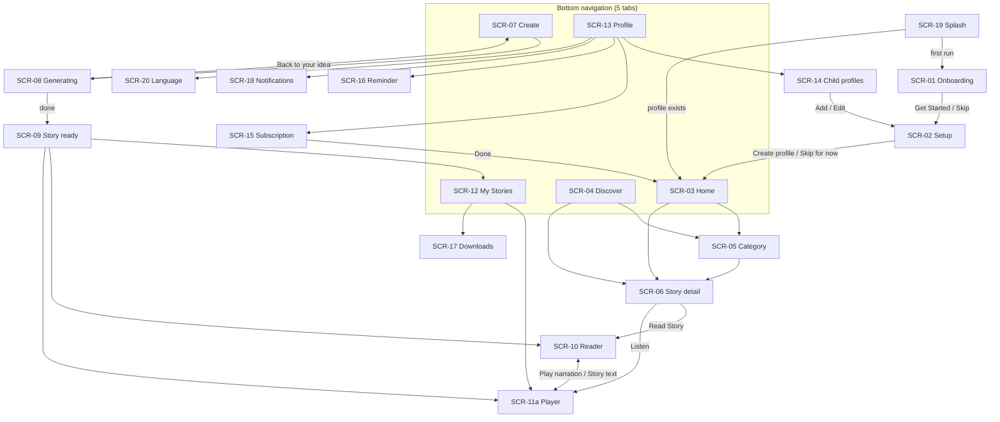

# Navigation design

Purpose: define every route, its arguments, the navigation graph and back behaviour for the MVP.

Status: Draft for owner review — P1, 29 Oct 2026 (ADR-001: Navigation Compose with type-safe serializable routes, Proposed; Navigation 3 evaluated in LS-030)

Sources: `docs/design/LittleStory_Figma_Design_Details.md` §3 (interactions per screen) · workbook Screens sheet · brief §6.1, §9.1 · LS-050.

## 1. Principles

- Routes are typed `@Serializable` objects or data classes, declared once in each feature's `navigation` package and registered in `:app` (no route strings in feature code, brief §4.5).
- Arguments are stable IDs only (`storyId`, `childId`, `categoryId`) — never full objects or display text, so a language change does not invalidate the back stack.
- Features expose `NavGraphBuilder.xxxScreen(onNavigate…)` extensions and receive navigation callbacks as lambdas; they never reference another feature's route type. `:app` connects them.
- No deep links in the MVP. The notifications inbox (SCR-18) navigates in-app only.

## 2. Route list

| Route (proposed type) | Screen | Args | Entry points (from design) | Module |
| --- | --- | --- | --- | --- |
| `SplashRoute` | SCR-19 Splash | – | app launch | `:app` |
| `OnboardingRoute` | SCR-01 Onboarding (3 slides) | – | first run | onboarding |
| `SetupRoute` | SCR-02 Setup | `childId: String?` (null = new child) | Onboarding Get Started/Skip; Child profiles Add/Edit; Profile "Account settings" (placeholder, see §5) | onboarding |
| `HomeRoute` | SCR-03 Home | – | Setup CTA / Skip for now; bottom nav; subscription Done | home |
| `DiscoverRoute` | SCR-04a/04b Discover | – | bottom nav; Home "See all"; notification "Fresh tales" | discover |
| `CategoryRoute` | SCR-05 Category | `categoryId` | Home tiles, culture banner, Discover "View all" | discover |
| `StoryDetailRoute` | SCR-06 Story detail | `storyId` | story cards everywhere | discover |
| `CreateRoute` | SCR-07 Create | – | bottom nav Create; Home hero CTA; Paused "Back to your idea" | create |
| `GeneratingRoute` | SCR-08 Generating / paused | `requestId` | Create CTA | create |
| `StoryReadyRoute` | SCR-09 Story ready | `storyId` | auto-advance from Generating; notification "Your new story is ready" | create |
| `ReaderRoute` | SCR-10 Reader | `storyId`, `page: Int = 0` | Detail/Ready "Read Story"; Player "Story text" | reader |
| `PlayerRoute` | SCR-11a Player (+ SCR-11b sheet as in-screen state) | `storyId` | Detail/Ready "Listen"; Reader play; Home "Resume story"; My Stories play | reader |
| `MyStoriesRoute` | SCR-12 My Stories | `tab: LibraryTab = All` | bottom nav; Ready "Saved to My Stories" (tab = CreatedByMe) | library |
| `DownloadsRoute` | SCR-17 Offline downloads | – | My Stories download icon; Profile "Download settings" | library |
| `ProfileRoute` | SCR-13 Profile hub | – | bottom nav; Home avatar (design: → Child profiles, see §5) | settings |
| `ChildProfilesRoute` | SCR-14 Child profiles | – | Profile "Manage children"; Home avatar | settings |
| `SubscriptionRoute` | SCR-15 Subscription (flag `demoSubscription`) | – | Profile "Subscription" | settings |
| `ReminderRoute` | SCR-16 Bedtime reminder | – | Profile row; notification "Storytime" | settings |
| `NotificationsRoute` | SCR-18 Notifications | – | Home bell, Discover bell, Profile row | settings |
| `LanguageRoute` | SCR-20 Language preferences (design missing, LS-004) | – | Profile "Language preferences" | settings |
| `PrivacyRoute` | SCR-21 Privacy & parent controls (blocked, LS-114) | – | Profile row | settings |
| `HelpRoute` | SCR-22 Help & about (blocked, LS-115) | – | Profile row | settings |
| `AccountRoute`, `AudioPreferencesRoute` | SCR-23 (design missing) | – | Profile rows | settings |

## 3. Graph

## 4. Back behaviour

| Situation | Behaviour |
| --- | --- |
| Bottom-nav tab switch | single top, save and restore each tab's state (`saveState`/`restoreState`); back from a non-Home tab returns to Home, back from Home exits |
| Onboarding → Setup → Home | onboarding and setup are popped inclusive when Home is reached, so back from Home exits the app |
| Generating | system back = same as ✕: show the paused state (design), not leave the screen; second back returns to Create with the prompt kept |
| Story ready | proposed: back returns to Home, not Create, because the story is already saved and re-showing the filled form invites duplicates (decision N4, LS-004) |
| Reader ↔ Player | they replace each other (`popUpTo` the other) so back from either returns to the screen that opened the pair |
| Sleep-timer sheet (SCR-11b), dialogs | back closes the sheet or dialog first |
| Setup opened from Child profiles | back returns to Child profiles without saving; unsaved-changes prompt not designed (open question) |
| Language change on any screen | Activity recreation keeps the back stack; ViewModels survive (see [state-management.md](state-management.md)) |

## 5. Open navigation questions (for LS-004)

| # | Question | Proposal |
| --- | --- | --- |
| N1 | Home avatar goes to Child profiles in the prototype, while the Profile tab is the hub | keep the design: avatar → Child profiles |
| N2 | Profile "Account settings" and "Language preferences" route back to Setup in the prototype (placeholder routes, R-19) | Language → new `LanguageRoute`; Account → `AccountRoute` once designed |
| N3 | Profile "Audio preferences" opens the Player in the prototype | `AudioPreferencesRoute` once designed; hide row until then |
| N4 | Story ready back target | Home (above) |
| N5 | Screen transitions are not designed (R-09) | platform default fade until a motion spec exists; durations from motion tokens |

## Implementation notes (P3)

- Routes are `@Serializable` objects/classes in each feature's `navigation` package; `:app` `AppNavHost` is the only place that connects them. Only Onboarding, Setup and Home are registered so far; the other routes exist for later tickets.
- SCR-19 (splash) is the system SplashScreen API, held until the first-run flag is read (`AppViewModel.startState`), so there is no in-app splash route. Its background is the night colour, defined once in `:app` `colors.xml` because the splash theme cannot read Compose tokens.
- First run: Onboarding → Setup → Home with Onboarding popped inclusive. Setup opened later returns with `popBackStack()`.
- Setup omits the parent name field (decision D14) and the avatar add tile; both are noted in `docs/project-management/implementation-status.md`.

## Implementation notes (P4)

- Registered now: Home, Discover, Category (`categoryId`, or `all` for the whole catalogue) and Story Detail (`storyId`). Screens read their route arguments from `SavedStateHandle` by name.
- Bottom navigation is drawn by `AppNavHost` only while Home or Discover is on top; Category and Story Detail cover it. Tab switches use `popUpTo<HomeRoute>` with `saveState`/`restoreState` and `launchSingleTop`.
- Create, My Stories and Profile tabs are visible but do nothing until their milestones register those routes. Home's bell, avatar, Create and Resume actions, and Story Detail's Listen and Read, are likewise unconnected for now.
- Search text, the active chip and the sort order live in `SavedStateHandle`, so they survive rotation and process death.
