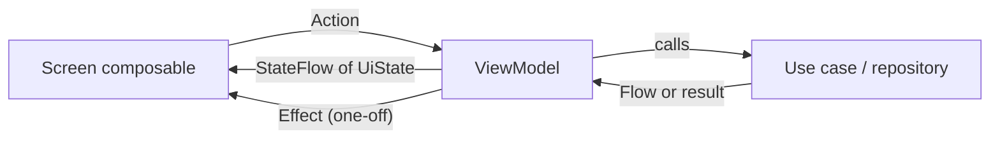
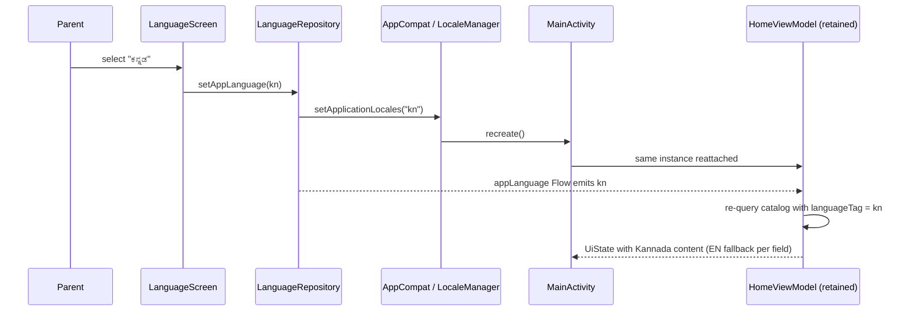

# State management

Purpose: define one pattern for screen state, user actions, one-off effects, text and lifecycle so every feature behaves the same way.

Status: Draft for owner review — P1, 29 Oct 2026 (ADR-009 UiText, Proposed)

Sources: brief §9.3, §6.2 · [high-level-design.md](high-level-design.md) · design doc §3 (screen states).

## 1. Pattern

Unidirectional flow, no MVI framework (brief §9.3):



| Element | Rule |
| --- | --- |
| `UiState` | one immutable `data class` per screen, `@Immutable`/stable collections (`ImmutableList`) to limit recomposition; default value renders a meaningful initial state |
| `Action` | `sealed interface` of user intents (`QueryChanged`, `ToggleFavourite`, `Retry`) handled by one `onAction` function |
| `Effect` | only for things that must not replay after rotation or language change: navigate, show toast/snackbar; delivered via `Channel` + `receiveAsFlow()` and collected in a `LaunchedEffect` |
| Collection | `collectAsStateWithLifecycle()` in the `Route` composable only |
| Loading states | modelled only when meaningful (brief §6.2): JSON load and generation have them; synchronous toggles do not |

```kotlin
// Illustrative — :feature:create
@Immutable
data class CreateUiState(
    val prompt: String = "",
    val promptLimit: Int,                       // from AppConfig.Create.promptMaxChars
    val selectedTheme: StoryTheme = StoryTheme.Adventure,
    val mood: StoryMood = StoryMood.Magical,
    val durationMinutes: Int,                   // from AppConfig.Create.defaultDurationMinutes
    val storyLanguage: SupportedLanguage,
    val error: UiText? = null,
)

sealed interface CreateAction {
    data class PromptChanged(val text: String) : CreateAction
    data class SuggestionPicked(val suggestion: StorySuggestion) : CreateAction
    data object Submit : CreateAction
}

sealed interface CreateEffect {
    data class OpenGenerating(val requestId: String) : CreateEffect
}
```

## 2. UiText

ViewModels never hold translated strings (brief §4.4 rule 3). They emit `UiText`, resolved in Compose with the current locale.

```kotlin
// :core:ui
sealed interface UiText {
    data class Res(@StringRes val id: Int, val args: List<Any> = emptyList()) : UiText
    data class Plural(@PluralsRes val id: Int, val count: Int, val args: List<Any> = emptyList()) : UiText
    data class Dynamic(val value: String) : UiText   // user-entered or content text only, never UI copy
}

@Composable
fun UiText.asString(): String = when (this) {
    is UiText.Res -> stringResource(id, *args.toTypedArray())
    is UiText.Plural -> pluralStringResource(id, count, *args.toTypedArray())
    is UiText.Dynamic -> value
}
```

`UiText` lives in `:core:ui` because it references Android resource IDs. Pure-Kotlin layers (`:domain`) express messages as typed errors or enums, which the ViewModel maps to `UiText` (see [error-handling.md](error-handling.md)). `Dynamic` is reserved for content (child names, story titles from localized JSON).

## 3. Lifecycle, configuration change and process death

| Event | What survives | How |
| --- | --- | --- |
| Rotation / font scale change | all UI state | ViewModel |
| **App language change** | ViewModel, back stack, user input | `setApplicationLocales` recreates the Activity; ViewModels are retained. State holds IDs and enums, never resolved text, so the UI re-renders in the new language. Content flows re-query with the new `languageTag` (see below) |
| Process death | form input that matters (Create prompt, Setup fields, reader page) | `SavedStateHandle` for small inputs; durable data (profiles, favourites, progress) is in Room/DataStore |
| Background generation (simulated) | progress | generation runs in the ViewModel scope; after process death the paused state is shown with "Try again" (no WorkManager in MVP, brief §11.3) |

Content language: ViewModels observe `PreferencesRepository.storyLanguage` (and `LanguageRepository.appLanguage`) as `Flow`s and `flatMapLatest` into repository calls, so mock content switches language without recreating state by hand.



## 4. Testing the pattern

- ViewModel unit tests drive `onAction` and assert `UiState` sequences with Turbine; time-based simulations use `StandardTestDispatcher` and `advanceTimeBy` with values from `AppConfig`.
- Effects are asserted from the effect flow, not from UI.
- A language-change test re-emits the language flow and asserts state keeps IDs and input (brief §6.2 "language change while the screen is open").
