# LittleStory — Figma Design Details

> **Rename note:** the product is now called **LittleStory** (formerly LittleKatha). This document uses the new name throughout. The screenshots in `screens/` were captured before the rename and still show the old name in the logo and the Premium banner.

**Source:** Figma Make file "Mobile App UI Prototype" (`2DYtUW39GtnsDpUd5jSu6x`), version 1
**Frame:** 430 px wide phone shell, 18 screens, 22 captured states (screenshots in `screens/`)
**How extracted:** Figma Make files are code-based, so values below come from the prototype's source code and compiled stylesheet, and screenshots from the running build, not from Figma layers. Tokens are also in `design-tokens.json`.
**Companion documents:** `docs/product/` (product, flows, requirements) and `docs/design/screen-inventory.md`; the earlier `LittleStory_App_Overview.md` is not in the repository

---

## 1. Design system

Machine-readable tokens are in `design-tokens.json` (same folder). The values below were read directly from the prototype's compiled stylesheet.

### 1.1 Colour

**Brand and surfaces**

| Token | Hex | Used for |
|-------|-----|----------|
| `--indigo` | `#35256F` | Primary buttons, hero card, active nav label, links |
| `--indigo-2` | `#4B388B` | Eyebrow labels |
| `--lavender` | `#A995F5` | Focus ring, selected outline, progress fill, active Create tab on dark |
| `--soft-lavender` | `#EAE3FF` | Secondary button, selected chip, active nav pill, icon tiles |
| `--night` | `#17152F` | Dark canvas (onboarding, player, generating, premium hero) |
| `--night-surface` | `#242044` | Dark raised surface |
| `--cream` | `#FFF9F0` | App background (warm, not white) |
| `--white` | `#FFFFFF` | Cards, inputs |
| `--surface` | `#F8F5FB` | Segmented-control track |
| `--line` | `#E9E4EC` | Borders, dividers |
| backdrop | `#E8E5ED` | Page colour outside the phone shell |

**Accents**

| Token | Hex | Used for |
|-------|-----|----------|
| `--yellow` | `#FFD977` | Stars, hero moon, kickers on dark, progress gradient end |
| `--peach` | `#FFC9AD` | Lesson icon tile, hero book edge |
| moon | `#FFF1BD` | Crescent moon |

**Text**

| Token | Hex | Used for |
|-------|-----|----------|
| `--text` | `#25213A` | Primary text |
| `--muted` | `#716B80` | Secondary text |
| reader body | `#393348` | Story paragraphs |
| nav inactive | `#817B8D` | Inactive tab labels |

**Semantic**

| Token | Hex | Used for |
|-------|-----|----------|
| `--success` | `#287A54` | Success text, toggle "on", completed step |
| success bg | `#EAF5EE` | Trust badge, privacy notes |
| `--error` | `#B42318` | Form error |
| favourite | `#9D3158` on `#FFEDF2` | Active heart |

**Story artwork gradients** (`linear-gradient(145deg, A, B)`)

| Story | Category | A → B |
|-------|----------|-------|
| The Little Elephant Who Shared | Friendship | `#F6B995` → `#694B91` |
| Aarav and the Magical Cricket Bat | Adventure | `#6252A6` → `#F2A978` |
| Mira and the Moonlit Garden | Bedtime | `#32306D` → `#9F91E9` |
| The Banyan Tree's Secret | Indian Tales | `#47796B` → `#EFBB69` |
| Ananya's Journey to the Stars | Space | `#25285D` → `#DB82A6` |
| The Lanterns of Jaipur | Festivals | `#B15B54` → `#F5C568` |

**Light/dark usage:** there is no theme switch. The app is a cream light UI with four deliberately dark "night" screens: Onboarding, Generating, Player (and the Premium hero banner). Dark is used to signal bedtime/story-in-progress.

### 1.2 Typography

| Role | Family | Notes |
|------|--------|-------|
| Body, buttons, labels | **DM Sans** 400/500/600/700 | Default `body` font |
| Headings, brand, top-bar titles, story paragraphs | **Manrope** 500/600/700/800 | `h1`, `h2`, `.brand-name`, `.topbar-title`, `.reader-content p` |

Loaded from Google Fonts (`DM Sans` + `Manrope`, `display=swap`).

| Style | Spec |
|-------|------|
| Onboarding title | 29 px / 1.12, −0.8 px tracking |
| Setup title | 29 px / 1.18, −0.8 px |
| Hero title | 25 px / 1.12, −0.7 px (22 px on ≤360 px screens) |
| Home greeting title | 21 px, −0.5 px |
| Top-bar title | 17 px, weight 800 |
| Brand wordmark | 18 px, weight 800, −0.5 px |
| Body (onboarding) | 15 px / 1.55 |
| Reader paragraph | 16 px / 1.95, Manrope, user-scalable 0.9–1.3 em |
| Chip | 12 px, weight 600 |
| Eyebrow | 10 px, weight 800, +1.6 px, uppercase |
| Hero kicker | 9 px, weight 800, +1.4 px |
| Bottom-nav label | 10 px, weight 600 |

Sentence case throughout; eyebrows and kickers are the only all-caps.

### 1.3 Shape, elevation, spacing

| Token | Value |
|-------|-------|
| Radius large / medium / small | 24 / 18 / 13 px |
| Button radius | 16 px (min-height 52 px, full width) |
| Hero card radius | 26 px |
| Onboarding bottom sheet | 32 px top corners |
| Chip radius | 20 px (pill) |
| Avatar | 15 px (large: 19 px) rounded square |
| Icon button | 42 px circle, white at ~76 % opacity |
| Shadow | `0 12px 30px #2318461C` · soft `0 5px 18px #23184614` |
| Primary button shadow | `0 8px 18px #35256F33` |
| Page content padding | 6 px 20 px 28 px (16 px sides on ≤360 px) |
| Shell | `min(100%, 430px)`, centred, `box-shadow 0 0 50px #17152F24` |
| Top bar | 68 px high, 3-column grid (`1fr auto 1fr`) |
| Bottom nav | 76 px + safe-area inset, blurred white `#FFFFFFF5`, top hairline |
| Breakpoints | ≤360 px (compact), min-height ≥900 px (tall: larger player cover, taller onboarding art) |

Safe areas: `env(safe-area-inset-top/bottom)` is respected in top bars, bottom nav, sticky action bars and onboarding.

### 1.4 Iconography

21 hand-drawn line icons in a single `Icon` component: `home, compass, plus, book, user, bell, search, heart, download, play, pause, back, chevron, clock, check, close, edit, moon, settings, volume`. 24×24 viewBox, 1.8 px stroke, round caps and joins, `currentColor`. Active heart and active download fill with `currentColor`. Decorative stars are text glyphs (`✦ ✧ ·`) in yellow or white.

### 1.5 Brand mark

"LittleStory" wordmark in Manrope 800 with a CSS-drawn symbol: a skewed (−4°) open book/box outline (32×29, 2 px stroke, asymmetric radii `5 12 4 7`), an inner "L" curve, a crescent moon at the top-right corner, and a yellow ✦ star. A `light` variant is white for dark backgrounds. No raster logo asset exists in the file.

### 1.6 Illustration style

All art is built from CSS shapes (no images in the project):

- **Story cover (`StoryArt`)**: diagonal gradient from the table above, a crescent moon (cream disc with a cut-out in the cover's first colour), a white ✦ and a dot, a dark translucent hill (`#18243047`, 140 % wide ellipse rotated −5°), and a single character figure (skin `#D58C68`, hair band `#342526`, shirt in a theme colour).
- **Motifs:** `elephant` (grey-violet body `#8C82A8`, trunk, two legs), `cricket` (figure plus a tan bat), `moon`, `forest` (green shirt), `space` (pink shirt), `festival` (gold shirt).
- **Avatar:** three nested CSS shapes — skin-tone rounded square, dark hair cap, face with two dot eyes.
- **Home hero scene:** crescent moon, two stars, a reading child with a cream book.
- **Onboarding scene:** large glowing crescent (138 px, `box-shadow 0 0 55px #FFD97747`), two translucent clouds, three twinkling stars, a child in a purple top reading an open book.
- **Culture banner:** terracotta arch/gateway shape on peach.
- **Category hero (Indian Tales):** mustard arch with a dark doorway on indigo.

### 1.7 Motion

| Animation | Where | Spec |
|-----------|-------|------|
| `twinkle` | Onboarding stars | `2.4s infinite alternate`; to `opacity .3; scale(.8) rotate(12deg)` |
| `twinkle` | Generating stars | `1.7s infinite alternate`, delays 0 / .4 s / .7 s |
| `twinkle` | Magic-book spark | `1.1s infinite alternate` |
| Button press | All buttons | `transform .18s, background .18s`; `:active` → `scale(.98)` |
| Icon button state | Heart/download | `all .2s` |
| Toggle | Switches | `all .2s` (knob slides, track turns `#287A54`) |
| Chevron | "More options" | rotates 180° in `.2s` |
| Generation bar | Generating | width `.2s`; gradient `lavender → yellow` |
| Reading progress | Reader | width `.3s` |
| Reader text size | Reader | `font-size .2s` |
| Onboarding pager | Dots | active dot widens from 7 px to 24 px |

Programmatic motion (not CSS): generation progress +4 % every 120 ms (≈3 s, plus 0.5 s before auto-advance); player progress +0.25 % every 500 ms while "playing"; rewind/forward 15 s = 3.1 % of an 8-minute track.

There are **no screen-transition animations** (screens swap instantly), no sheet slide-in animation and no toast auto-dismiss. Treat these as open design decisions.

---

## 2. Components

| Component | Description |
|-----------|-------------|
| **Button** | `primary` (indigo, white text, soft shadow), `secondary` (soft-lavender, indigo text), `ghost` (text only). 52 px high, 16 px radius, optional leading icon. Disabled: 45 % opacity. |
| **IconButton** | 42 px circular, translucent white; `active` = rose heart on pink. |
| **TopBar** | Back button **or** brand mark on the left, optional centred title, optional right action. |
| **BottomNav** | 5 tabs; active tab gets a soft-lavender pill behind the icon; Create is a raised 48×40 indigo tile with a 5 px white ring (lavender when active). |
| **SectionHeader** | Manrope title + optional "See all ›" link. |
| **StoryCard** | Cover art + floating heart toggle + title + "Category · N min". Used in a 2-column grid (Discover) and horizontal scroll rows (Home, Discover). |
| **List story row** | 156-px-wide art tile, category eyebrow, title, meta, trailing heart/play. Used in Category, My Stories, Downloads. |
| **Continue card** | Art + "8 MIN · 42 % COMPLETE" + title + progress bar + "Resume story". |
| **Chips** | Pill buttons; selected = soft-lavender fill, lavender border, check icon (Setup). |
| **Segmented control** | 3 equal segments on `--surface`; active segment is white with soft shadow. |
| **Form card** | White 24 px-radius card; labels 12 px muted bold; 48 px inputs; focus = lavender border + 3 px soft-lavender ring. |
| **Toggle** | 43×25 switch, `role="switch"`, green when on. |
| **Search field** | Magnifier, placeholder, clear (✕) when non-empty. |
| **Tabs** | Horizontal pill tabs (My Stories). |
| **Avatar** | CSS-drawn child face; `selected` adds a 3 px lavender outline. |
| **Bottom sheet** | White, 32 px top radius, drag-handle bar, option rows with hairlines, Cancel ghost button, dimmed overlay (tap to dismiss). |
| **Dialog** | Centred card with green check disc, title, text, "Done". |
| **Toast** | Pill with check: "Reminder saved for {time}". |
| **Empty state** | Circular icon, title, one sentence, secondary action. |
| **Notes / trust banners** | Green-tint rounded panels with check or moon icon (privacy messaging). |
| **Progress bars** | Reading (3 px, lavender), generation (gradient, rounded), playback (range input), storage (indigo bar, yellow fill). |

---

## 3. Screen specifications

Screenshots are in `screens/` and were captured from the running prototype at 430 px width, 2× scale. Tall captures include empty space below the content because each screen is at least one viewport high.

### 3.1 Onboarding — 3 slides

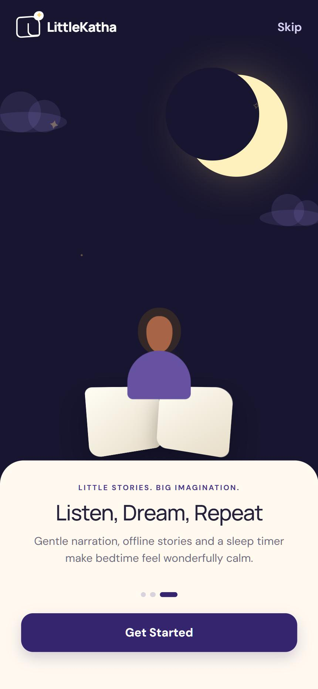

- **Purpose:** introduce the promise and move the parent into setup.
- **Layout:** full-bleed night-blue scene (top), cream bottom sheet with 32 px top corners (bottom). Top row: white brand mark left, "Skip" (`#D8D0F5`) right.
- **Scene:** large glowing crescent top-right, two translucent clouds, three twinkling ✦ stars, a child reading an open book, bottom-centre.
- **Sheet content (per slide):** eyebrow "LITTLE STORIES. BIG IMAGINATION." → title → body → pager dots → primary button.

| Slide | Title | Body | Button |
|-------|-------|------|--------|
| 1 | Every Day Has a Story | Turn school days, family moments and tiny acts of kindness into magical adventures. | Continue |
| 2 | Your Child, the Hero | Stories shaped around their name, age and favourite things—with parents always in control. | Continue |
| 3 | Listen, Dream, Repeat | Gentle narration, offline stories and a sleep timer make bedtime feel wonderfully calm. | Get Started |

- **Interactions:** Continue advances; Get Started and Skip go to Setup. No swipe gesture and no back-to-previous-slide control.
- **Animation:** star twinkle only; the scene is identical on all three slides.

### 3.2 Setup — child profile
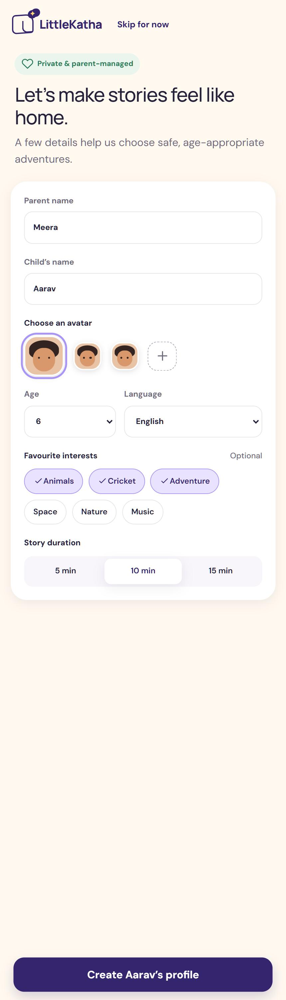

- **Purpose:** collect the minimum to personalise stories.
- **Header:** brand mark + "Skip for now" text action → Home.
- **Intro:** green badge "Private & parent-managed" (heart icon); title "Let's make stories feel like home."; sub "A few details help us choose safe, age-appropriate adventures."
- **Form card:** Parent name (default *Meera*) · Child's name (default *Aarav*, shared app state) · Choose an avatar (3 faces, first selected, dashed "+" tile) · Age select 3–12 (default 6) · Language select (English, Hindi, Kannada, Tamil, Telugu, Marathi, Malayalam; default English) · Favourite interests chips (Animals, Cricket, Adventure, Space, Nature, Music; multi-select; defaults Animals, Cricket, Adventure; labelled "Optional") · Story duration segmented 5 / 10 / 15 min (10 highlighted).
- **CTA:** sticky bottom bar, "Create {child}'s profile" → Home.

### 3.3 Home
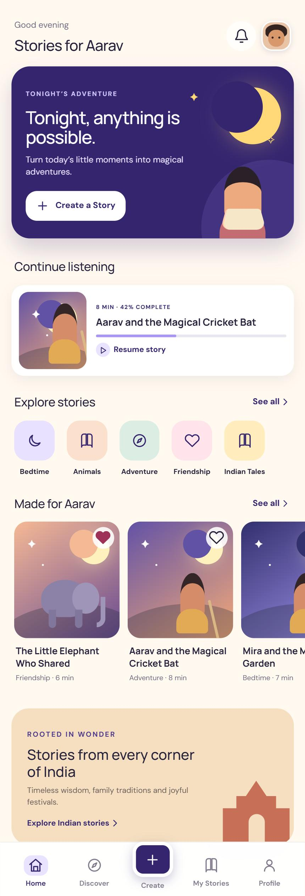

- **Header:** "Good evening" (muted, 12 px) over "Stories for {child}"; bell → Notifications; avatar → Child Profiles.
- **Hero card (indigo, 26 px radius):** kicker "TONIGHT'S ADVENTURE", "Tonight, anything is possible.", "Turn today's little moments into magical adventures.", white button "+ Create a Story" → Create. Right 40 %: crescent moon, stars, reading child.
- **Continue listening:** one card for *Aarav and the Magical Cricket Bat*, "8 MIN · 42% COMPLETE", progress bar, "Resume story" → Player.
- **Explore stories:** "See all ›" → Discover; horizontal tile row Bedtime, Animals, Adventure, Friendship, Indian Tales (pastel tinted icon tiles) → Category.
- **Made for {child}:** "See all ›"; horizontal row of four story cards with heart toggles → Detail.
- **Culture banner:** peach card, "ROOTED IN WONDER", "Stories from every corner of India", "Timeless wisdom, family traditions and joyful festivals.", link "Explore Indian stories ›" → Category; terracotta gateway art.

### 3.4 Discover
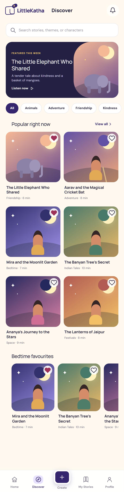

- **Top bar:** brand mark, title "Discover", bell.
- **Search:** "Search stories, themes, or characters"; filters live as you type; ✕ clears. While searching, the featured card is hidden and the section title becomes `Results for "{query}"`.
- **Featured card (dark):** "FEATURED THIS WEEK", *The Little Elephant Who Shared*, "A tender tale about kindness and a basket of mangoes.", "Listen now ▷", cover art on the right.
- **Filter chips (scroll):** All, Animals, Adventure, Friendship, Kindness, Nature, Space, Science, Panchatantra, Indian Folk Tales, Festivals, Learning.
- **Popular right now:** 2-column grid + "View all ›" → Category. **Bedtime favourites:** horizontal row.
- **Empty state:** search icon, "No stories found", "Try a different title or explore one of our story collections.", "Clear search".

### 3.5 Category — Indian Tales
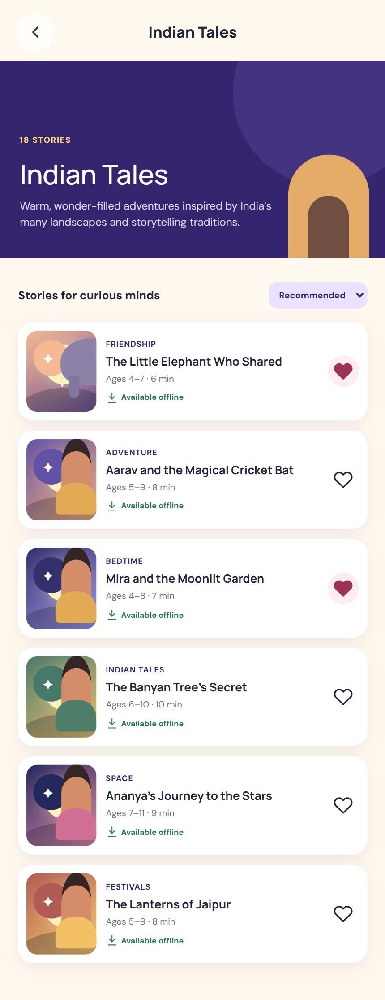

- Back → Discover. Hero band (indigo): "18 STORIES", "Indian Tales", "Warm, wonder-filled adventures inspired by India's many landscapes and storytelling traditions." with an arch illustration.
- "Stories for curious minds" + sort select (Recommended / Shortest first / Newest).
- Rows: art, category eyebrow, title, "Ages 4–7 · 6 min", green "Available offline", heart toggle.

### 3.6 Story detail
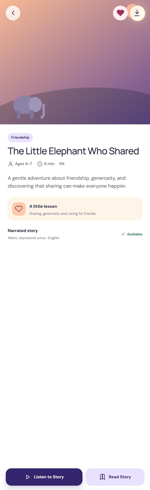

- Full-width cover (large art) with floating back / favourite / download buttons.
- White body sheet: category pill, title, metadata (Ages 4–7 · 6 min · EN), synopsis "A gentle adventure about friendship, generosity, and discovering that sharing can make everyone happier.", **A little lesson** panel (peach heart tile: "Sharing, generosity and caring for friends."), **Narrated story** row ("Warm, expressive voice · English", green "✓ Available").
- Sticky dual action bar: **Listen to Story** (primary) → Player; **Read Story** (secondary) → Reader.

### 3.7 Create a Story
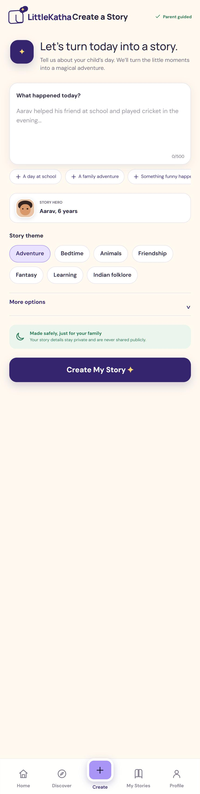
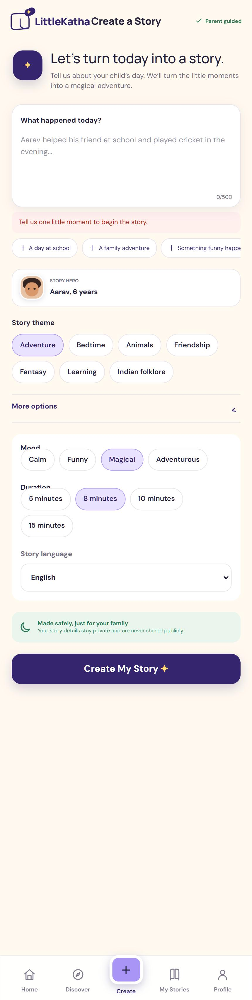

- **Top bar:** title "Create a Story", right label "✓ Parent guided".
- **Intro:** indigo ✦ orb, "Let's turn today into a story.", "Tell us about your child's day. We'll turn the little moments into a magical adventure."
- **Textarea:** label "What happened today?", placeholder `{child} helped his friend at school and played cricket in the evening…`, counter `n/500`.
- **Suggestion chips (scroll):** A day at school, A family adventure, Something funny happened, I learned something new, An act of kindness. "A day at school" fills the sample sentence; others fill `{child} had {suggestion in lowercase}.`
- **Story hero selector:** avatar + "STORY HERO / {child}, 6 years" + select (Aarav, Ananya).
- **Story theme (single-select chips):** Adventure (default), Bedtime, Animals, Friendship, Fantasy, Learning, Indian folklore.
- **More options (collapsible, chevron rotates):** Mood (Calm, Funny, Magical*, Adventurous) · Duration (5, 8*, 10, 15 minutes) · Story language select.
- **Safety note (green):** moon icon, "Made safely, just for your family — Your story details stay private and are never shared publicly."
- **CTA:** "Create My Story ✦".
- **Validation:** empty text → red banner "Tell us one little moment to begin the story." (cleared when the user types).

### 3.8 Generating
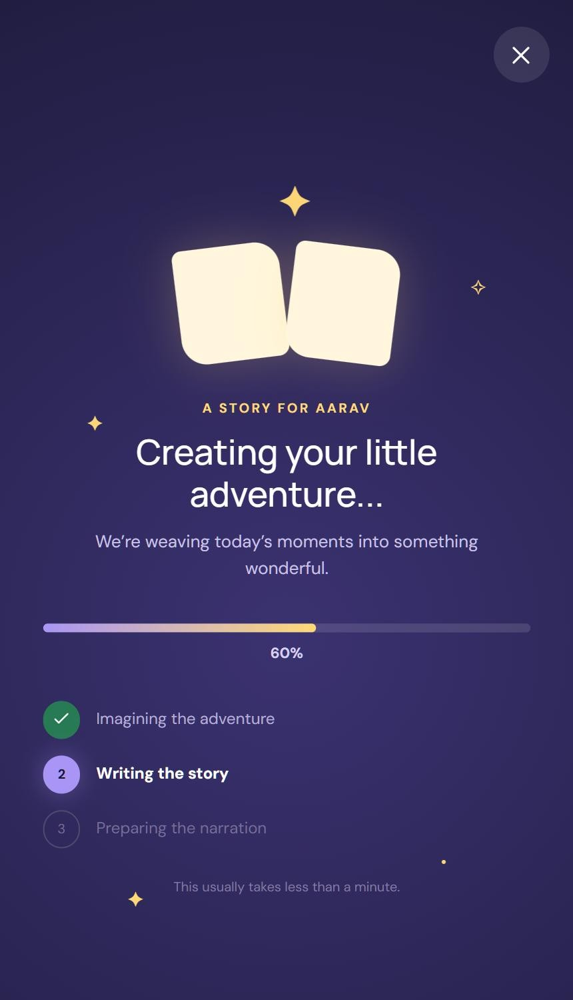

- Full-bleed night gradient. ✕ top-right. Four twinkling stars; a glowing two-page "magic book" with a pulsing ✦.
- Eyebrow "A STORY FOR {CHILD}", title "Creating your little adventure…", "We're weaving today's moments into something wonderful."
- Gradient progress bar (lavender → yellow) with `%` below. Three stages: **Imagining the adventure** (<38 %), **Writing the story** (<76 %), **Preparing the narration** (≥76 %); done = green check, active = lavender numbered disc and bold text, pending = muted.
- Footnote "This usually takes less than a minute."
- **Cancel state ("Story creation paused"):** book icon, "Your idea is still here. Continue whenever you're ready." Buttons: **Try again** (restarts at 8 %) and **Back to your idea** → Create.
- Auto-advances to Story ready.

### 3.9 Story ready
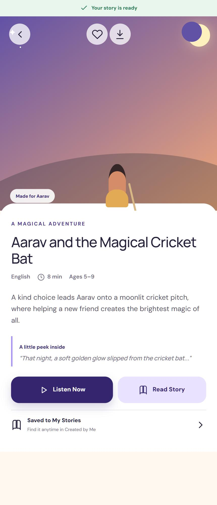

- Green ribbon "✓ Your story is ready". Large cover with back / favourite / download and a "Made for Aarav" chip.
- Eyebrow "A MAGICAL ADVENTURE", title *Aarav and the Magical Cricket Bat*, metadata (English · 8 min · Ages 5–9), synopsis "A kind choice leads Aarav onto a moonlit cricket pitch, where helping a new friend creates the brightest magic of all."
- "A little peek inside" pull-quote with a lavender left rule: "That night, a soft golden glow slipped from the cricket bat…"
- **Listen Now** → Player; **Read Story** → Reader. Row "Saved to My Stories — Find it anytime in Created by Me" → My Stories.

### 3.10 Reader
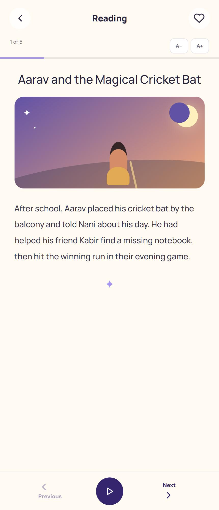

- Top bar "Reading" with back and favourite. Sub-row: "1 of 5" and **A−** / **A+** (0.9–1.3 em in 0.1 steps). 3 px lavender reading-progress bar.
- Centred title, cover art (page 1 only), a paragraph in Manrope 16 px / 1.95 (left-aligned), ✦ flourish.
- Bottom bar: **Previous** (disabled on page 1) · round indigo ▷ **Play narration** → Player · **Next** (disabled on last page).
- The story is **5 pages** (one paragraph each); the five paragraphs are the `storyParagraphs` array in the prototype's `App.tsx`.

### 3.11 Player
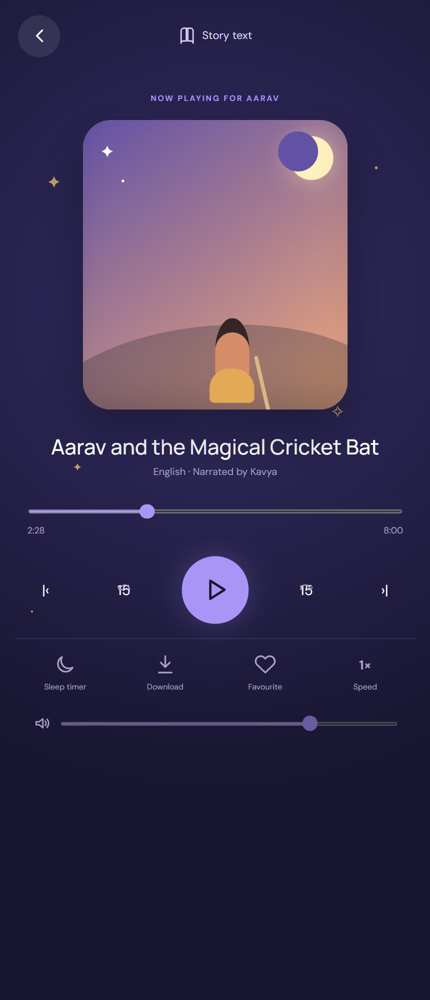
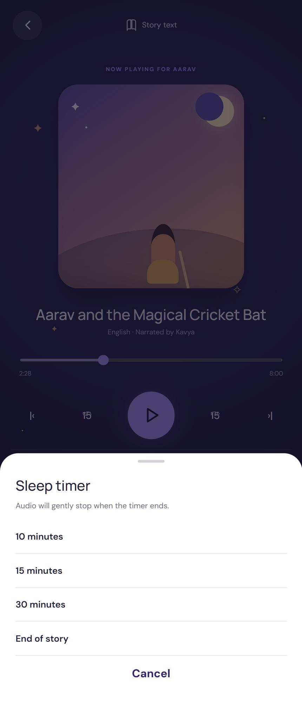

- Night gradient with five twinkling stars. Top: back, "Story text" link → Reader.
- "NOW PLAYING FOR AARAV"; rounded cover (265×290 on tall phones, 220×235 on ≤360 px) with a soft glow; title; "English · Narrated by Kavya".
- Seek slider (starts at 31 %, shows `2:28 / 8:00`); controls: previous chapter, rewind 15, large lavender play/pause, forward 15, next chapter.
- Secondary row: **Sleep timer**, **Download** (→ "Downloaded" with check), **Favourite** (→ "Loved"), **Speed** (cycles 0.75× → 1× → 1.25× → 1.5×).
- Volume slider (default 75).
- **Sleep timer sheet:** handle, "Sleep timer", "Audio will gently stop when the timer ends.", options 10 minutes / 15 minutes / 30 minutes / End of story (selected shows a check; the chosen label replaces "Sleep timer" on the button), Cancel.

### 3.12 My Stories
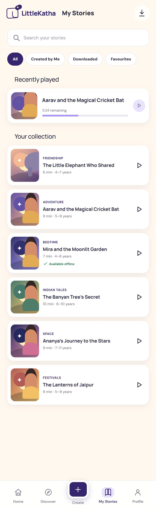

- Top bar: brand + "My Stories" + download icon → Offline Downloads.
- Search "Search your stories". Tabs: **All**, **Created by Me**, **Downloaded**, **Favourites**.
- All tab: "Recently played" card (*Aarav and the Magical Cricket Bat*, "3:24 remaining", progress bar, round play) → Player; "Your collection" list.
- Rows: art, category eyebrow, title, "N min · age years", green "Available offline" when downloaded, ▷ play.
- **Empty states:** Downloaded → "Ready for offline adventures?" / "Download a story and bedtime can travel anywhere."; others → "No stories here yet" / "Tap the heart on a story you love to keep it close." Both offer "Discover stories".

### 3.13 Profile (settings hub)
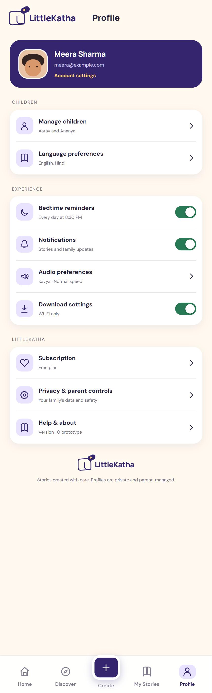

- Indigo parent card: avatar, **Meera Sharma**, meera@example.com, "Account settings" (yellow) → Setup.
- **CHILDREN:** Manage children ("Aarav and Ananya") → Child Profiles; Language preferences ("English, Hindi") → Setup.
- **EXPERIENCE:** Bedtime reminders ("Every day at 8:30 PM", toggle on) → Reminders; Notifications ("Stories and family updates", toggle on) → Notifications; Audio preferences ("Kavya · Normal speed") → Player; Download settings ("Wi-Fi only", toggle on) → Downloads.
- **LITTLESTORY:** Subscription ("Free plan") → Subscription; Privacy & parent controls ("Your family's data and safety"); Help & about ("Version 1.0 prototype").
- Footer: brand mark + "Stories created with care. Profiles are private and parent-managed."
- Icon tiles are 19-px line icons on soft-lavender squares; toggles are the green switch.

### 3.14 Child Profiles
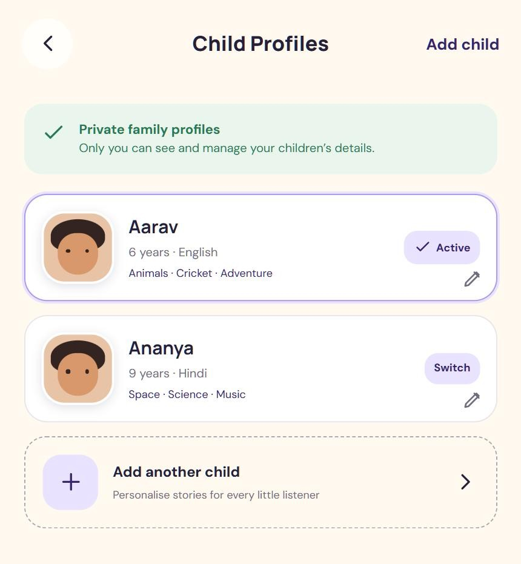

- "Add child" text action → Setup. Green banner "Private family profiles — Only you can see and manage your children's details."
- Two profile cards: **Aarav** (6 years · English · Animals · Cricket · Adventure) and **Ananya** (9 years · Hindi · Space · Science · Music). The active card has a lavender border and an "✓ Active" pill; the other shows "Switch". Pencil → Setup.
- Dashed "Add another child — Personalise stories for every little listener" row.

### 3.15 Subscription
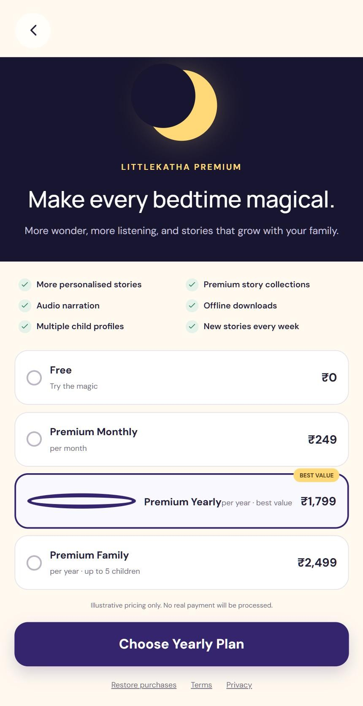

- Night hero: large moon, "LITTLESTORY PREMIUM", "Make every bedtime magical.", "More wonder, more listening, and stories that grow with your family."
- Benefits (2-column checklist): More personalised stories · Premium story collections · Audio narration · Offline downloads · Multiple child profiles · New stories every week.
- Plans (single select; **Yearly** preselected, carries a yellow "BEST VALUE" tag):

| Plan | Price | Note |
|------|-------|------|
| Free | ₹0 | Try the magic |
| Premium Monthly | ₹249 | per month |
| Premium Yearly | ₹1,799 | per year · best value |
| Premium Family | ₹2,499 | per year · up to 5 children |

- "Illustrative pricing only. No real payment will be processed." CTA "Choose {plan} Plan". Links: Restore purchases · Terms · Privacy.
- **Confirmation dialog:** green check, "Plan selected", "This is a prototype, so no payment was made. You selected the {plan} plan.", Done → Home.

### 3.16 Bedtime Reminder
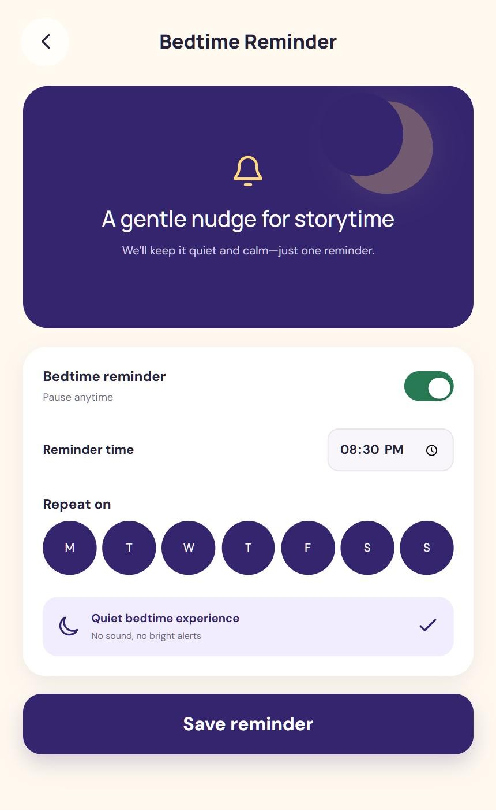

- Indigo panel: moon, bell, "A gentle nudge for storytime", "We'll keep it quiet and calm—just one reminder."
- Card: **Bedtime reminder** toggle ("Pause anytime") · **Reminder time** (time input, default 20:30) · **Repeat on** seven round day buttons M T W T F S S (all on by default) · "Quiet bedtime experience — No sound, no bright alerts" (always on).
- Disabling the toggle disables time and days. CTA "Save reminder" → toast "✓ Reminder saved for {time}".

### 3.17 Offline Downloads
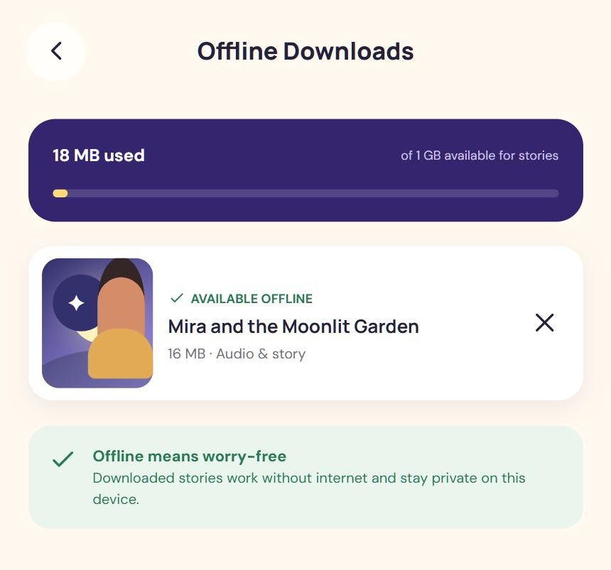

- Indigo storage card: "{n} MB used" of "1 GB available for stories" with a yellow-fill bar (minimum 3 % width).
- Downloaded stories list with "✓ AVAILABLE OFFLINE", title, "{size} MB · Audio & story" and ✕ to remove.
- Empty state: "No downloads yet" — "Save a few favourites for journeys, power cuts, and cosy nights away." → "Find a story".
- Green tip: "Offline means worry-free — Downloaded stories work without internet and stay private on this device."

### 3.18 Notifications
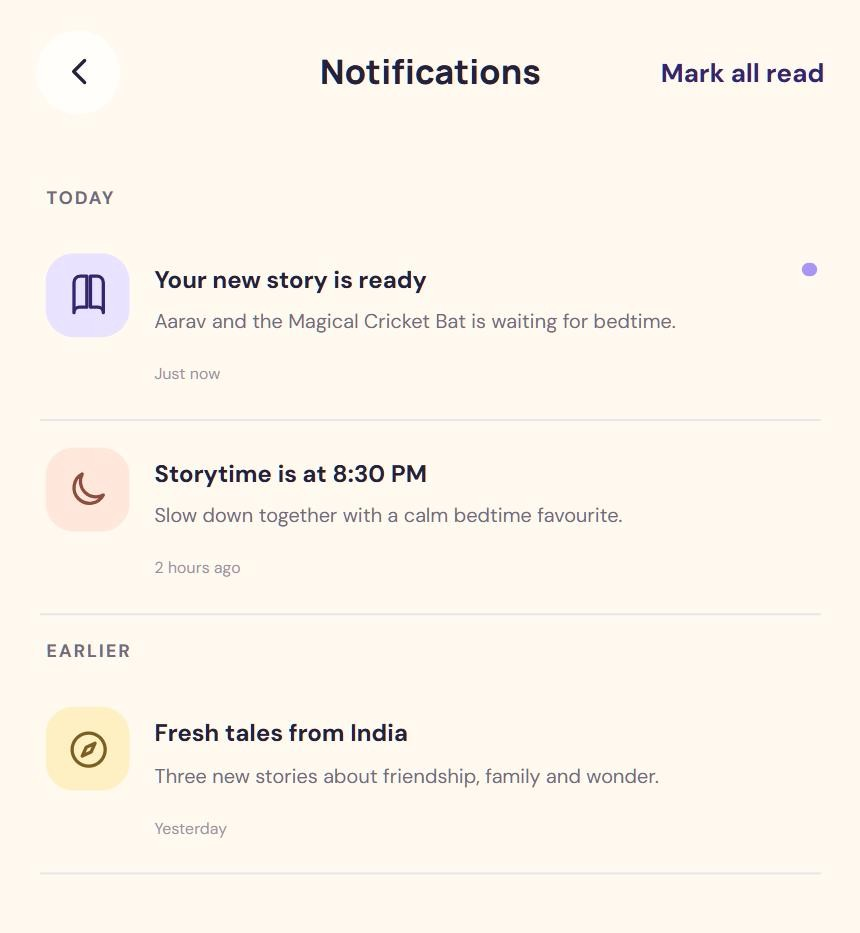

- "Mark all read" action. **TODAY:** *Your new story is ready* (unread lavender dot, → Story ready), *Storytime is at 8:30 PM* (→ Reminders). **EARLIER:** *Fresh tales from India — Three new stories about friendship, family and wonder.* (→ Discover).
- Icon tiles: lavender (book), peach (moon), yellow (compass).

---

## 4. Accessibility (as designed)

Good: icon buttons carry `aria-label`/`title`; toggles use `role="switch"` with `aria-checked`; nav has `aria-label="Main navigation"`; decorative SVGs are `aria-hidden`; inputs have labels; focus ring on form fields; disabled states are real `disabled` buttons; a screen-reader-only "Go to previous screen" button exists; safe-area insets respected; reader text is user-scalable.

Gaps to fix in the build: nested interactive elements (toggle `<button>` inside a row `<button>`); no visible focus style on most buttons; several secondary text colours (`#716B80` on cream at 10–12 px, `#817B8D` nav labels) are likely below 4.5:1 and should be measured; chips/day pickers lack `aria-pressed`; the 15 s rewind/forward glyphs overlap (see App Overview, section 7); tap targets under 44 px for chips and 42 px icon buttons; no reduced-motion handling for the infinite twinkle animations.