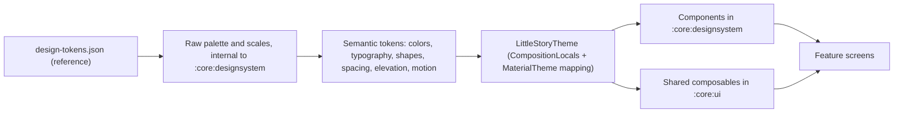

# LittleStory — Design System

Purpose: define how the extracted design tokens and components become the Compose design system in `:core:designsystem` and `:core:ui`, so feature screens use semantic tokens and shared components only.

Status: Draft for owner review — P1, 29 Oct 2026

Sources: `design-tokens.json`; `LittleStory_Figma_Design_Details.md` §1–2; master orchestrator brief §4.5, §5, §9.4; workbook Design System and Backlog sheets (LS-010…LS-020); ADR-008, ADR-010, ADR-013 (Proposed). All values are *Needs Figma verification* (see [figma-audit.md](figma-audit.md)).

## 1. Rules

1. Raw values (hex colours, dp, sp, durations, font files) exist **only** in `:core:designsystem`. Feature modules reference semantic tokens such as `LittleStoryTheme.colors.primary` or `LittleStoryTheme.spacing.screenHorizontal`.
2. A pull request that adds a hex literal, a raw `dp`/`sp` value or an inline `TextStyle` in feature code is changed before review (brief §5.1; enforced by LS-034).
3. Each token is defined exactly once (LS-010 acceptance criterion). Two tokens with the same value but different meaning stay separate.
4. Unit mapping (Proposed): the prototype is a 430 CSS-px phone shell rendered at 1×, so **1 CSS px = 1 dp** and font px = sp. Visual comparison uses a 430 dp-wide device profile.
5. Single light theme with "night" surfaces for Onboarding, Generating, Player and the Premium hero (ADR-013, Proposed). No dark mode in the MVP.

## 2. Token architecture

Raw palette entries are `internal`; only semantic roles are public. Material 3 `ColorScheme` and `Typography` are filled from the semantic tokens so stock Material components inherit the brand.

## 3. Colour roles (Proposed mapping)

| Semantic role | Raw token | Value | Used for |
| --- | --- | --- | --- |
| `primary` | indigo | #35256F | Primary buttons, hero card, active nav label, links |
| `onPrimary` | white | #FFFFFF | Text and icons on primary |
| `primaryVariantLabel` | indigo-2 | #4B388B | Eyebrow labels |
| `accent` | lavender | #A995F5 | Focus ring, selected outline, progress fill |
| `secondaryContainer` | soft-lavender | #EAE3FF | Secondary button, selected chip, nav pill, icon tiles |
| `onSecondaryContainer` | indigo | #35256F | Text on soft-lavender |
| `background` | cream | #FFF9F0 | App background |
| `surface` | white | #FFFFFF | Cards, inputs, sheets |
| `surfaceMuted` | surface | #F8F5FB | Segmented-control track |
| `outline` | line | #E9E4EC | Borders, dividers (decorative only; see accessibility) |
| `night` | night | #17152F | Night canvases |
| `nightSurface` | night-surface | #242044 | Raised surface on night, featured card |
| `highlight` | yellow | #FFD977 | Stars, moon, kickers on dark, progress gradient end |
| `warmAccent` | peach | #FFC9AD | Lesson tile, hero book edge |
| `moon` | moon | #FFF1BD | Crescent moon fill |
| `textPrimary` | text | #25213A | Primary text |
| `textSecondary` | muted | #716B80 | Secondary text |
| `textReader` | reader-body | #393348 | Story paragraphs |
| `navInactive` | nav-inactive | #817B8D → **adjust** | Inactive nav labels (fails contrast, see accessibility-spec) |
| `success` / `successContainer` | success / success-bg | #287A54 / #EAF5EE | Success text, toggle on, trust notes |
| `error` | error | #B42318 | Form error |
| `favourite` / `favouriteContainer` | favourite / favourite-bg | #9D3158 / #FFEDF2 | Active heart |
| `storyArt[category]` | storyArt.* | 6 gradient pairs | Story covers (data-driven by category) |
| `illustration.*` | illustration.* | 9 colours | Drawn characters and props (ADR-010) |

Untokenised colours seen in specs that need a token or verification: culture banner background, lesson panel `#FFF4E8`, reader background `#FFFAF2`, success ribbon `#E9F6EE` (figma-audit A6). Add them as named tokens in LS-010 after checking the screenshots.

## 4. Typography

| Family | Weights | Roles | Kannada |
| --- | --- | --- | --- |
| DM Sans | 400, 500, 600, 700 | Body, buttons, labels | No glyphs — fallback required |
| Manrope | 500, 600, 700, 800 | Headings, brand, top-bar titles, reader paragraphs | No glyphs — fallback required |
| Noto Sans Kannada (Proposed, ADR-008, OFL) | matching weights where available | Kannada fallback in both families | Yes |

Fonts are bundled in `res/font` (no downloadable-fonts dependency at runtime). Licence texts listed in Help & about (LS-115) and docs.

| Style token | Size / line height | Tracking | Weight / family |
| --- | --- | --- | --- |
| `displayOnboarding` | 29 / 1.12 | −0.8 | Manrope 800 |
| `displaySetup` | 29 / 1.18 | −0.8 | Manrope 800 |
| `heroTitle` | 25 / 1.12 (22 on compact) | −0.7 | Manrope 800 |
| `homeTitle` | 21 | −0.5 | Manrope 800 |
| `topBarTitle` | 17 | – | Manrope 800 |
| `brandName` | 18 | −0.5 | Manrope 800 |
| `bodyLarge` | 15 / 1.55 | – | DM Sans 400 |
| `readerBody` | 16 / 1.95, user scale 0.9–1.3 | – | Manrope 500 |
| `button` | per component | – | DM Sans 700 |
| `chip` | 12 | – | DM Sans 600 |
| `eyebrow` | 10, uppercase (Latin only) | +1.6 | DM Sans 800 |
| `heroKicker` | 9 | +1.4 | DM Sans 800 |
| `navLabel` | 10 | – | DM Sans 600 |

Kannada needs larger line heights and must never be clipped; per-script line-height adjustments, minimum sizes for 9–10 sp styles and the fallback chain are specified in `docs/localization/kannada-typography.md` (written by the localization stream). Sizes are in sp so system font scale applies.

## 5. Shape, spacing, elevation, layout

| Token group | Values |
| --- | --- |
| Radius | `lg` 24, `md` 18, `sm` 13, `button` 16, `hero` 26, `sheetTop` 32, `chip` 20 (pill), `avatar` 15 (large 19), icon button = circle |
| Spacing | screen padding top 6 / sides 20 / bottom 28; compact sides 16; derive an 4-dp-based scale for gaps from screenshots in LS-012 |
| Component sizes | button min height 52, icon button 42 visual / **48 touch**, top bar 68, bottom nav 76 + inset, input 48, toggle 43×25 visual / 48 touch, Create tab tile 48×40 with 5 dp ring |
| Elevation / shadow | `card` 0 12 30 #2318461C; `soft` 0 5 18 #23184614; `primaryButton` 0 8 18 #35256F33; `hero` 0 16 30 #35256F33; `createNav` 0 5 15 #35256F40 — Compose shadows approximate CSS blur; verify visually |
| Breakpoints | compact width ≤ 360 dp; tall height ≥ 900 dp — use window size info, not hardcoded checks (LS-012) |

## 6. Motion

| Token | Value | Reduced motion |
| --- | --- | --- |
| `twinkleOnboarding` | 2400 ms, infinite, alternate, to opacity 0.3, scale 0.8, rotate 12° | Off |
| `twinkleGenerating` | 1700 ms, delays 0 / 400 / 700 ms | Off |
| `twinkleSpark` | 1100 ms | Off |
| `press` | 180 ms, scale 0.98 | Instant |
| `toggle`, `iconState`, `chevron` | 200 ms | Instant |
| `readingProgress` | 300 ms | Instant |
| `readerFontSize` | 200 ms | Instant |
| Screen transitions, sheet slide | Not designed (R-09) | – |

Programmatic timings (generation step, player tick, skip seconds) are behaviour, not design: they live in `AppConfig` (`:core:common`), not here.

## 7. Iconography and illustration

- 21 line icons per the design pack; the details doc names 20 (home, compass, plus, book, user, bell, search, heart, download, play, pause, back, chevron, clock, check, close, edit, moon, settings, volume) and the 21st must be identified from the prototype source in LS-013. Implemented as vector drawables `ic_*`, 24×24, 1.8 stroke, round caps (LS-013). Directional icons (back, chevron) set `autoMirrored` for RTL.
- Decorative stars (✦ ✧ ·) are drawn, not text, so they are never translated or read by TalkBack.
- Illustrations (StoryArt motifs, avatar, hero and onboarding scenes, culture and category arches) are Compose Canvas drawings driven by tokens and story data (ADR-010, Proposed). No text inside illustrations.
- Brand mark: drawn composable, default and light variants (LS-014).

## 8. Component catalogue

| Component | Variants / states | Module | Ticket | Accessibility notes |
| --- | --- | --- | --- | --- |
| `LsButton` | primary, secondary, ghost, white-on-indigo; leading icon; disabled (45 % alpha); pressed | designsystem | LS-015 | ≥48 dp; text wraps for Kannada |
| `LsIconButton` | translucent default, active heart, active download | designsystem | LS-015 | `contentDescription` required parameter; 48 dp touch |
| `LsTextField`, `LsTextArea` | default, focused (lavender border + ring), error, counter | designsystem | LS-016 | Label bound; error announced |
| `LsSelect` | closed, open | designsystem | LS-016 | TalkBack operable |
| `LsChip` | default, selected (check), single and multi select | designsystem | LS-016 | Selected state semantics |
| `LsSegmentedControl` | 3 segments | designsystem | LS-016 | Selected announced |
| `LsToggle` | on, off, disabled | designsystem | LS-016 | `Role.Switch`; separate from row |
| `LsSearchField` | empty, with clear | designsystem | LS-016 | Clear button labelled |
| `LsTabs` | pill tabs | designsystem | LS-016 | Selected announced; scrollable |
| `LsBottomSheet` | handle, options, cancel | designsystem | LS-017 | Focus trapped; dismiss on back |
| `LsDialog` | success | designsystem | LS-017 | Focus moves to dialog |
| `LsToast` | check pill; duration from config | designsystem | LS-017 | Polite live region |
| `EmptyState` | icon, title, body, action | designsystem | LS-017 | Title is a heading |
| `NoteBanner` | success tint with check or moon | designsystem | LS-017 | – |
| Progress bars | reading, generation (gradient), playback, storage | designsystem | LS-017 | Progress semantics |
| `TopBar` | back or brand; title; action | core:ui | LS-019 | Back labelled |
| `BottomNav` | 5 tabs, raised Create | core:ui | LS-019 | Selected tab announced; Kannada fit |
| Sticky action bars | single, dual | core:ui | LS-019 | Insets |
| `StoryArt` | 6 motifs × palettes | core:ui | LS-018 | Decorative |
| `StoryCard`, `ListStoryRow`, `ContinueCard` | favourite, downloaded, progress | core:ui | LS-018 | One merged description |
| `SectionHeader` | with or without "See all" | core:ui | LS-018 | Heading |
| `Avatar` | default, selected, large | core:ui | LS-018 | Decorative unless selectable |
| `BrandMark` | default, light | designsystem | LS-014 | Content description "LittleStory" |

A catalogue screen (debug only) previews every token and component in English, Kannada and `en-XA` (LS-020).

## 9. Related

[accessibility-spec.md](accessibility-spec.md) · [screen-state-matrix.md](screen-state-matrix.md) · [visual-regression-strategy.md](visual-regression-strategy.md) · `docs/localization/kannada-typography.md` · `docs/architecture/configuration-and-constants.md`
