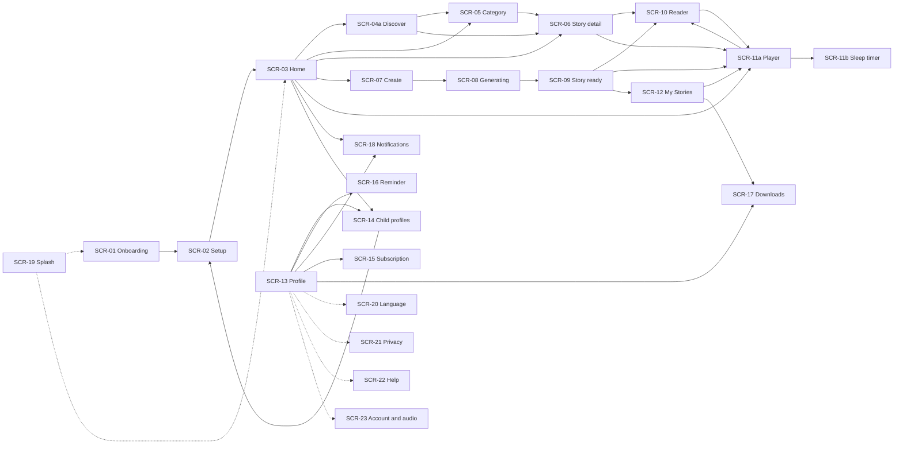

# LittleStory — Screen Inventory

Purpose: one entry per screen (SCR-01…SCR-23) with design reference, navigation, components, inputs, states, data, accessibility, localization notes, screenshot-test needs, acceptance criteria and related tickets.

Status: Draft for owner review — P1, 29 Oct 2026

Sources: workbook Screens and Backlog sheets; `LittleStory_Figma_Design_Details.md` §3; `screens/` (22 JPEGs, 430 px wide, 2× scale, captured before the LittleKatha → LittleStory rename); master orchestrator brief §6. The live Figma Make file could not be read during P0, so every designed screen is *Needs Figma verification* (see [figma-audit.md](figma-audit.md)).

## Overview

| ID | Screen | Design | Module (proposed) | Screenshot |
| --- | --- | --- | --- | --- |
| SCR-01 | Onboarding (3 slides) | Ready | :feature:onboarding | 01–03 |
| SCR-02 | Setup – child profile | Ready | :feature:onboarding | 04 |
| SCR-03 | Home | Ready | :feature:home | 05 |
| SCR-04a | Discover | Ready | :feature:discover | 06 |
| SCR-04b | Discover – no results | Spec only, not captured | :feature:discover | – |
| SCR-05 | Category (Indian Tales) | Ready | :feature:discover | 21 |
| SCR-06 | Story detail | Ready | :feature:discover | 22 |
| SCR-07 | Create a Story | Ready | :feature:create | 07, 08 |
| SCR-08 | Generating + Paused | Ready (paused not captured) | :feature:create | 09 |
| SCR-09 | Story ready | Ready | :feature:create | 10 |
| SCR-10 | Reader | Ready | :feature:reader | 11 |
| SCR-11a | Player | Ready | :feature:reader | 12 |
| SCR-11b | Player – sleep timer sheet | Ready | :feature:reader | 13 |
| SCR-12 | My Stories | Ready | :feature:library | 14 |
| SCR-13 | Profile (settings hub) | Ready | :feature:settings | 15 |
| SCR-14 | Child profiles | Ready | :feature:settings | 20 |
| SCR-15 | Subscription (demo) + dialog | Ready | :feature:settings | 16 |
| SCR-16 | Bedtime reminder | Ready | :feature:settings | 17 |
| SCR-17 | Offline downloads | Ready | :feature:library | 18 |
| SCR-18 | Notifications | Ready | :feature:settings | 19 |
| SCR-19 | Splash / launch | **Missing** | :app | – |
| SCR-20 | Language preferences | **Missing** | :feature:settings | – |
| SCR-21 | Privacy & parent controls | **Missing** | :feature:settings | – |
| SCR-22 | Help & about | **Missing** | :feature:settings | – |
| SCR-23 | Account settings / Audio preferences | **Missing** | :feature:settings | – |

## Navigation map

Bottom navigation has five tabs: Home, Discover, Create (raised centre tile), My Stories, Profile.

Dotted arrows lead to screens with no design (decision D10).

## Kannada layout decisions (English frame is the reference)

No Kannada frames exist. These rules apply to every screen unless an entry below says otherwise; each deviation is recorded here, not invented per ticket.

| Element | Rule (Proposed) |
| --- | --- |
| Titles and body | Wrap to more lines; line height from the Kannada type scale (see `docs/localization/kannada-typography.md`) |
| Buttons | Height grows with text (min 52 dp); label may wrap to two lines; never ellipsize |
| Chips, tabs, filter rows | Horizontal scroll; chip width grows with label |
| Bottom-nav labels (10 sp) | Single line; if a Kannada label does not fit, use the approved shorter label from the glossary rather than shrinking text |
| Eyebrows and kickers | Uppercase transform applies to Latin only; Kannada shown as written |
| Numbers, dates, prices | Locale-formatted (NFR-13) |

## Screens

## SCR-01 — Onboarding (3 slides)

Screenshots: [`01-onboarding-1-every-day-has-a-story.jpg`](screens/01-onboarding-1-every-day-has-a-story.jpg), [`02-onboarding-2-your-child-the-hero.jpg`](screens/02-onboarding-2-your-child-the-hero.jpg), [`03-onboarding-3-listen-dream-repeat.jpg`](screens/03-onboarding-3-listen-dream-repeat.jpg)

| Field | Value |
| --- | --- |
| Design reference | Figma Make · Mobile App UI Prototype · screen 'onboarding' — Needs Figma verification |
| Design status | Design Ready |
| Proposed module | :feature:onboarding |
| Entry points | First launch |
| Exit paths | Setup (Continue on slide 3 / Get Started / Skip) |
| Components | Brand mark (light), Skip text button, night scene illustration (moon, clouds, twinkling stars, child reading), cream bottom sheet 32dp top radius, eyebrow, title, body, pager dots, primary button |
| Input fields | None |
| Validation rules | – |
| States | Slide 1, Slide 2, Slide 3 |
| Data dependencies | Static copy only |
| Accessibility | Pager must announce 'slide n of 3'; twinkle animation must respect reduced motion; Skip ≥48dp |
| Localization notes | 3 titles/bodies; body min-height 70px may grow in Kannada |
| Screenshot tests | EN + KN |
| Related tickets | LS-014, LS-060 |
| Implementation / review | Not started / Not reviewed |
| Open questions | Should slides support swipe and back? (not in prototype) |

Design notes: Night canvas #17152F. Sheet: eyebrow 'LITTLE STORIES. BIG IMAGINATION.' → title 29/1.12 Manrope → body 15/1.55 muted → pager (active dot 24px, others 7px) → button. Slide 1 'Every Day Has a Story'; 2 'Your Child, the Hero'; 3 'Listen, Dream, Repeat' (button 'Get Started'). Scene identical on all slides. No swipe and no back control in prototype.

Acceptance criteria:

- Copy matches design in EN; KN present (LS-060)
- Continue advances; slide 3 shows Get Started → Setup (LS-060)
- Skip → Setup (LS-060)
- Pager announced (LS-060)

## SCR-02 — Setup – Child profile

Screenshots: [`04-setup-profile.jpg`](screens/04-setup-profile.jpg)

| Field | Value |
| --- | --- |
| Design reference | Figma Make · Mobile App UI Prototype · screen 'setup' — Needs Figma verification |
| Design status | Design Ready |
| Proposed module | :feature:onboarding |
| Entry points | Onboarding; Child Profiles (Add/Edit); Profile → Account settings |
| Exit paths | Home (CTA or 'Skip for now') |
| Components | TopBar with brand + 'Skip for now', trust badge, form card (text fields, avatar picker, age select, language select, interest chips multi-select, segmented duration), sticky CTA |
| Input fields | Parent name, child name (text); avatar (single select); age 3–12 (select); language (select, registry); interests (multi-select chips); duration (segmented) |
| Validation rules | Child name required (rule pending, TC-005); name max length from `AppConfig`; age range from `AppConfig`; language must be an enabled registry entry |
| States | Default, editing, validation (name required – decision), saving |
| Data dependencies | ChildProfile (parent name, child name, avatar, age 3–12, language, interests, default duration) |
| Accessibility | Labels bound to fields; chips expose selected state; select fields operable by TalkBack |
| Localization notes | Language list must come from SupportedLanguage registry (EN, ಕನ್ನಡ) – design shows 7 languages |
| Screenshot tests | EN + KN |
| Related tickets | LS-016, LS-045, LS-061, LS-062 |
| Implementation / review | Not started / Not reviewed |
| Open questions | Is parent name needed (data minimisation)? Required-field rules? Avatar '+' behaviour? |

Design notes: Badge 'Private & parent-managed' (green). Title 'Let’s make stories feel like home.' Fields: Parent name (Meera), Child’s name (Aarav), avatar row (3 faces + dashed +), Age 3–12 (6), Language (English), interests Animals/Cricket/Adventure/Space/Nature/Music (3 preselected, 'Optional'), duration 5/10/15 min (10). CTA 'Create {child}’s profile'.

Acceptance criteria:

- Only EN/KN shown (LS-045)
- Choosing ಕನ್ನಡ switches UI immediately (LS-045)
- Selection persists (LS-045)
- Defaults as designed for demo data only (empty for real first run – decision) (LS-061)
- CTA text includes child name via format arg (LS-061)
- Profile saved and Home shows name (LS-061)
- Active child persists (LS-062)
- Switching child updates all screens (LS-062)

## SCR-03 — Home

Screenshots: [`05-home.jpg`](screens/05-home.jpg)

| Field | Value |
| --- | --- |
| Design reference | Figma Make · Mobile App UI Prototype · screen 'home' — Needs Figma verification |
| Design status | Design Ready |
| Proposed module | :feature:home |
| Entry points | Setup; bottom nav |
| Exit paths | Notifications, Child Profiles, Create, Player, Discover, Category, Story Detail |
| Components | Greeting header + bell + avatar, indigo hero card with illustration and white button, SectionHeader, ContinueCard, category tiles row, StoryCard row with heart toggle, culture banner, BottomNav |
| Input fields | None |
| Validation rules | – |
| States | Populated; no continue-listening item (decision); empty 'Made for' (decision) |
| Data dependencies | Active child, recently played + progress, categories, recommended stories, favourites |
| Accessibility | Hero image decorative; story cards announce title, category, duration, favourite state |
| Localization notes | 'Stories for {child}', 'Made for {child}' – name inside string must use format args |
| Screenshot tests | EN + KN |
| Related tickets | LS-014, LS-018, LS-070, LS-091 |
| Implementation / review | Not started / Not reviewed |
| Open questions | Greeting only shows 'Good evening' – time-of-day logic? Empty states for new user not designed |

Design notes: Header 'Good evening' 12sp muted / 'Stories for Aarav' 21sp. Hero #35256F radius 26: kicker 'TONIGHT’S ADVENTURE', 'Tonight, anything is possible.', body, '+ Create a Story'. Continue card: '8 MIN · 42% COMPLETE', progress lavender, 'Resume story'. Categories: Bedtime, Animals, Adventure, Friendship, Indian Tales (pastel tiles). Culture banner #F5DFC0 'ROOTED IN WONDER / Stories from every corner of India'.

Acceptance criteria:

- Matches screenshot EN (LS-070)
- KN layout without clipping (LS-070)
- All tap targets navigate per spec (LS-070)
- Empty continue state handled (LS-070)
- Resume opens last page/position (LS-091)
- Progress % shown correctly (LS-091)

## SCR-04a — Discover

Screenshots: [`06-discover.jpg`](screens/06-discover.jpg)

| Field | Value |
| --- | --- |
| Design reference | Figma Make · Mobile App UI Prototype · screen 'discover' — Needs Figma verification |
| Design status | Design Ready |
| Proposed module | :feature:discover |
| Entry points | Bottom nav; Home 'See all' |
| Exit paths | Story Detail, Category, Notifications |
| Components | TopBar brand+title+bell, search field with clear, dark featured card, horizontal filter chips, 2-column grid, horizontal row |
| Input fields | Search text; category chip (single select) |
| Validation rules | None (free search); trimmed, case-insensitive, locale-aware |
| States | Default, searching (featured hidden, title 'Results for …'), filtered by chip |
| Data dependencies | Catalog, categories, favourites |
| Accessibility | Search field labelled; chip selection announced |
| Localization notes | Search must work for Kannada titles (locale-aware lowercase/contains) |
| Screenshot tests | EN + KN |
| Related tickets | LS-014, LS-016, LS-018, LS-071 |
| Implementation / review | Not started / Not reviewed |
| Open questions | Featured card 'Listen now' goes to Detail in prototype – should it open Player? |

Design notes: Search placeholder 'Search stories, themes, or characters'. Featured #242044: 'FEATURED THIS WEEK', 'The Little Elephant Who Shared', 'Listen now ▷'. Chips: All, Animals, Adventure, Friendship, Kindness, Nature, Space, Science, Panchatantra, Indian Folk Tales, Festivals, Learning. Sections 'Popular right now' (+View all) and 'Bedtime favourites'.

Acceptance criteria:

- Search filters by title in EN and KN (LS-071)
- Chip filters by category (LS-071)
- 'Results for …' title while searching (LS-071)

## SCR-04b — Discover – No results (empty state)

Screenshots: [`06-discover.jpg`](screens/06-discover.jpg)

| Field | Value |
| --- | --- |
| Design reference | Figma Make · Mobile App UI Prototype · screen 'discover (empty)' — Needs Figma verification |
| Design status | Design Ready (spec only) |
| Proposed module | :feature:discover |
| Entry points | Search with no match |
| Exit paths | Clear search → Discover default |
| Components | Empty state (icon tile, title, body, secondary button) |
| Input fields | None |
| Validation rules | – |
| States | Empty |
| Data dependencies | None |
| Accessibility | Empty state title announced as heading |
| Localization notes | – |
| Screenshot tests | EN + KN |
| Related tickets | LS-017, LS-072 |
| Implementation / review | Not started / Not reviewed |
| Open questions | No separate screenshot – confirm visual |

Design notes: 'No stories found' / 'Try a different title or explore one of our story collections.' / 'Clear search' (resets query and chip to All). Described in design spec; not separately captured as screenshot.

Acceptance criteria:

- Shown when no match (LS-072)
- Clear search restores default (LS-072)

## SCR-05 — Category (Indian Tales)

Screenshots: [`21-category-indian-tales.jpg`](screens/21-category-indian-tales.jpg)

| Field | Value |
| --- | --- |
| Design reference | Figma Make · Mobile App UI Prototype · screen 'category' — Needs Figma verification |
| Design status | Design Ready |
| Proposed module | :feature:discover |
| Entry points | Home category tile / culture banner; Discover 'View all' |
| Exit paths | Story Detail; back → Discover |
| Components | TopBar with back + title, indigo category hero with arch illustration, sort select, ListStoryRow with heart |
| Input fields | Sort select (Recommended / Shortest first / Newest) |
| Validation rules | – |
| States | Populated; sort Recommended/Shortest first/Newest |
| Data dependencies | Category, stories in category, downloaded flag, favourites |
| Accessibility | Sort control labelled; rows announce offline availability |
| Localization notes | '{n} stories' needs plurals |
| Screenshot tests | EN + KN |
| Related tickets | LS-018, LS-073 |
| Implementation / review | Not started / Not reviewed |
| Open questions | Prototype hard-codes Indian Tales – generic per category? Hero art per category? |

Design notes: Hero 220px indigo: '18 STORIES', 'Indian Tales', description. 'Stories for curious minds' + sort pill. Rows: art 78×91, eyebrow category, title, 'Ages 4–7 · 6 min', green 'Available offline', heart.

Acceptance criteria:

- Works for every category in mock data (LS-073)
- Sort orders correct (LS-073)
- '{n} stories' uses plurals (LS-073)

## SCR-06 — Story Detail

Screenshots: [`22-story-detail.jpg`](screens/22-story-detail.jpg)

| Field | Value |
| --- | --- |
| Design reference | Figma Make · Mobile App UI Prototype · screen 'detail' — Needs Figma verification |
| Design status | Design Ready |
| Proposed module | :feature:discover |
| Entry points | Story cards/rows anywhere |
| Exit paths | Player (Listen), Reader (Read), back |
| Components | Full-bleed cover with floating back/favourite/download, white body sheet, pill, metadata row, synopsis, 'A little lesson' panel, narration row, sticky dual CTA |
| Input fields | None |
| Validation rules | – |
| States | Favourite on/off, downloaded on/off |
| Data dependencies | Story (title, category, ages, minutes, language, synopsis, lesson, narration) |
| Accessibility | Cover decorative; metadata read as one phrase |
| Localization notes | Language tag 'EN' must reflect story language (EN/ಕನ್ನಡ) |
| Screenshot tests | EN + KN |
| Related tickets | LS-018, LS-044, LS-074 |
| Implementation / review | Not started / Not reviewed |
| Open questions | – |

Design notes: Cover 355px. Pill category, title 27sp, metadata Ages 4–7 · 6 min · EN, synopsis 14/1.65, lesson panel #FFF4E8 with peach tile, 'Narrated story – Warm, expressive voice · English – ✓ Available'. Sticky: 'Listen to Story' (primary) + 'Read Story' (secondary).

Acceptance criteria:

- All six stories readable in KN (LS-044)
- One deliberate gap tests EN fallback (test data only) (LS-044)
- Data-driven for any story id (LS-074)
- Language tag reflects story language (LS-074)
- Listen → Player, Read → Reader (LS-074)

## SCR-07 — Create a Story

Screenshots: [`07-create-story.jpg`](screens/07-create-story.jpg), [`08-create-story-more-options-and-error.jpg`](screens/08-create-story-more-options-and-error.jpg)

| Field | Value |
| --- | --- |
| Design reference | Figma Make · Mobile App UI Prototype · screen 'create' — Needs Figma verification |
| Design status | Design Ready |
| Proposed module | :feature:create |
| Entry points | Home hero CTA; bottom nav Create |
| Exit paths | Generating (valid submit) |
| Components | TopBar title + 'Parent guided' label, intro orb, textarea with counter, suggestion chips, story-hero selector, theme chips, collapsible 'More options' (mood, duration, story language), safety note, primary CTA, error banner |
| Input fields | "What happened today?" text (max 500 from `AppConfig`); suggestion chips; story hero select; theme chips (single); mood, duration, story language (more options) |
| Validation rules | Empty or whitespace text → error banner (TC-019); hard cap at limit (TC-021); story language EN/KN only (TC-023) |
| States | Default, more options expanded, validation error, typing clears error |
| Data dependencies | Child profiles, StoryCreationRequest |
| Accessibility | Error must be announced (live region); counter readable; chips single-select semantics |
| Localization notes | Placeholder is gendered ('helped his friend') – needs neutral, translatable copy; counter uses format args |
| Screenshot tests | EN + KN |
| Related tickets | LS-016, LS-080, LS-081 |
| Implementation / review | Not started / Not reviewed |
| Open questions | Story language list must be EN/KN only; gendered placeholder copy |

Design notes: Textarea label 'What happened today?', counter n/500. Suggestions: A day at school, A family adventure, Something funny happened, I learned something new, An act of kindness. Hero select (Aarav, Ananya). Themes: Adventure*, Bedtime, Animals, Friendship, Fantasy, Learning, Indian folklore. More options: Mood Calm/Funny/Magical*/Adventurous; Duration 5/8*/10/15 minutes; Story language. Error 'Tell us one little moment to begin the story.' CTA 'Create My Story ✦'.

Acceptance criteria:

- Counter enforces limit (LS-080)
- Suggestions fill text (LS-080)
- Hero selector lists profiles (LS-080)
- Empty submit shows error, no navigation (LS-081)
- Typing clears error (LS-081)
- Story language limited to EN/KN (LS-081)

## SCR-08 — Generating + Paused

Screenshots: [`09-generating.jpg`](screens/09-generating.jpg)

| Field | Value |
| --- | --- |
| Design reference | Figma Make · Mobile App UI Prototype · screen 'generating' — Needs Figma verification |
| Design status | Design Ready |
| Proposed module | :feature:create |
| Entry points | Create submit |
| Exit paths | Story Ready (auto at 100%); Paused → Try again / Back to your idea |
| Components | Night gradient, close button, twinkling stars, magic book, eyebrow, title, gradient progress bar + %, 3-stage list, footnote; paused state with icon + 2 buttons |
| Input fields | None |
| Validation rules | – |
| States | Progress (stages <38% / <76% / ≥76%), paused (cancelled) |
| Data dependencies | Simulated generation job |
| Accessibility | Progress announced politely (not every tick); close button labelled; reduced motion |
| Localization notes | 'A story for {CHILD}' uppercase via style, not string |
| Screenshot tests | EN + KN |
| Related tickets | LS-017, LS-082, LS-083 |
| Implementation / review | Not started / Not reviewed |
| Open questions | Paused state not captured as screenshot |

Design notes: Eyebrow 'A STORY FOR AARAV', 'Creating your little adventure…', 'We’re weaving today’s moments into something wonderful.' Bar lavender→yellow. Stages: Imagining the adventure / Writing the story / Preparing the narration. Footnote 'This usually takes less than a minute.' Paused: 'Story creation paused', 'Your idea is still here. Continue whenever you’re ready.', Try again / Back to your idea. Prototype: +4% every 120ms.

Acceptance criteria:

- Same input → same output (LS-082)
- Cancel stops progress (LS-082)
- Result saved to Created by Me (LS-082)
- Stages change at thresholds (LS-083)
- Paused state per spec (LS-083)
- Auto-advance to Story Ready (LS-083)

## SCR-09 — Story Ready

Screenshots: [`10-story-ready.jpg`](screens/10-story-ready.jpg)

| Field | Value |
| --- | --- |
| Design reference | Figma Make · Mobile App UI Prototype · screen 'generated' — Needs Figma verification |
| Design status | Design Ready |
| Proposed module | :feature:create |
| Entry points | Generating complete; notification |
| Exit paths | Player, Reader, My Stories (Created by Me) |
| Components | Success ribbon, cover with back/favourite/download + 'Made for' badge, body sheet, eyebrow, title, metadata, synopsis, pull-quote, dual buttons, 'Saved to My Stories' row |
| Input fields | None |
| Validation rules | – |
| States | Ready |
| Data dependencies | Generated story |
| Accessibility | Ribbon announced on arrival |
| Localization notes | Story content must be in selected story language |
| Screenshot tests | EN + KN |
| Related tickets | LS-018, LS-044, LS-082, LS-084 |
| Implementation / review | Not started / Not reviewed |
| Open questions | – |

Design notes: Ribbon #E9F6EE '✓ Your story is ready'. Cover 385px, badge 'Made for Aarav'. 'A MAGICAL ADVENTURE', title 28sp, English · 8 min · Ages 5–9. 'A little peek inside' quote with lavender rule. Listen Now / Read Story. Row 'Saved to My Stories – Find it anytime in Created by Me'.

Acceptance criteria:

- All six stories readable in KN (LS-044)
- One deliberate gap tests EN fallback (test data only) (LS-044)
- Same input → same output (LS-082)
- Cancel stops progress (LS-082)
- Result saved to Created by Me (LS-082)
- Shows generated story in selected language (LS-084)
- Row opens My Stories on Created by Me (LS-084)

## SCR-10 — Reader

Screenshots: [`11-reader.jpg`](screens/11-reader.jpg)

| Field | Value |
| --- | --- |
| Design reference | Figma Make · Mobile App UI Prototype · screen 'reader' — Needs Figma verification |
| Design status | Design Ready |
| Proposed module | :feature:reader |
| Entry points | Detail 'Read Story', Story Ready, Player 'Story text' |
| Exit paths | Player (narration button), back |
| Components | TopBar 'Reading' + back + favourite, page indicator, A−/A+ buttons, 3dp reading progress, title, cover (page 1), paragraph, flourish, bottom bar Previous / play / Next |
| Input fields | A− / A+ text size |
| Validation rules | Clamp 0.9–1.3 in 0.1 steps (values from `AppConfig`) |
| States | Page 1..n, first (Previous disabled), last (Next disabled), text scale 0.9–1.3 |
| Data dependencies | Story pages, reading progress, text-size preference |
| Accessibility | A−/A+ labelled 'Decrease/Increase text size'; text must also respect system font scale |
| Localization notes | Kannada paragraphs need larger line height; page indicator uses format args |
| Screenshot tests | EN + KN |
| Related tickets | LS-018, LS-044, LS-090, LS-091 |
| Implementation / review | Not started / Not reviewed |
| Open questions | Persist text size per child or app-wide? |

Design notes: Background #FFFAF2. '1 of 5'. Paragraph Manrope 16/1.95 #393348, scalable in 0.1 steps. Reader nav: ghost Previous, round indigo play 54px, ghost Next.

Acceptance criteria:

- All six stories readable in KN (LS-044)
- One deliberate gap tests EN fallback (test data only) (LS-044)
- Pagination and disabled states correct (LS-090)
- Text size persists (LS-090)
- Respects system font scale; KN line height (LS-090)
- Resume opens last page/position (LS-091)
- Progress % shown correctly (LS-091)

## SCR-11a — Player

Screenshots: [`12-player.jpg`](screens/12-player.jpg)

| Field | Value |
| --- | --- |
| Design reference | Figma Make · Mobile App UI Prototype · screen 'player' — Needs Figma verification |
| Design status | Design Ready |
| Proposed module | :feature:reader |
| Entry points | Detail 'Listen', Story Ready, Home continue card, Reader play |
| Exit paths | Reader ('Story text'), back |
| Components | Night gradient, stars, back, 'Story text' link, label, cover with glow, title, narrator line, seek slider + times, 5 transport controls, 4 secondary controls, volume slider |
| Input fields | Seek slider, volume slider, transport buttons, speed |
| Validation rules | Seek and skip clamp to track bounds |
| States | Paused/playing, downloaded, favourite, speed 0.75–1.5×, timer set |
| Data dependencies | Simulated playback state |
| Accessibility | All controls labelled; slider exposes value; 15s glyphs overlap (defect) |
| Localization notes | 'Narrated by {name}', 'Now playing for {child}' via format args |
| Screenshot tests | EN + KN |
| Related tickets | LS-018, LS-091, LS-092, LS-094 |
| Implementation / review | Not started / Not reviewed |
| Open questions | Simulated audio must be labelled as simulation – where? 15s glyph overlap |

Design notes: Label 'NOW PLAYING FOR AARAV', cover 245×264 (265×290 tall phones), 'English · Narrated by Kavya', seek starts 31% (2:28/8:00), play 67px lavender. Secondary: Sleep timer, Download→Downloaded, Favourite→Loved, Speed cycles 0.75/1/1.25/1.5×. Volume default 75.

Acceptance criteria:

- Resume opens last page/position (LS-091)
- Progress % shown correctly (LS-091)
- Controls behave as spec (LS-092)
- Timer text formatted mm:ss (LS-092)
- Simulation clearly indicated (LS-092)
- Icons legible, labelled 'Rewind 15 seconds'/'Forward 15 seconds' (LS-094)

## SCR-11b — Player – Sleep timer sheet

Screenshots: [`13-player-sleep-timer-sheet.jpg`](screens/13-player-sleep-timer-sheet.jpg)

| Field | Value |
| --- | --- |
| Design reference | Figma Make · Mobile App UI Prototype · screen 'player (sleep sheet)' — Needs Figma verification |
| Design status | Design Ready |
| Proposed module | :feature:reader |
| Entry points | Player 'Sleep timer' |
| Exit paths | Player (select or Cancel / tap outside) |
| Components | Modal bottom sheet with handle, title, body, 4 option rows with check, Cancel ghost button, dim overlay |
| Input fields | Sleep timer option (single select) |
| Validation rules | – |
| States | None selected / option selected |
| Data dependencies | Sleep timer value |
| Accessibility | Sheet focus trapped; selected option announced |
| Localization notes | – |
| Screenshot tests | EN + KN |
| Related tickets | LS-017, LS-093 |
| Implementation / review | Not started / Not reviewed |
| Open questions | – |

Design notes: 'Sleep timer', 'Audio will gently stop when the timer ends.' Options: 10 minutes, 15 minutes, 30 minutes, End of story. Selected label replaces 'Sleep timer' on button.

Acceptance criteria:

- Selecting option closes sheet and updates button (LS-093)
- Cancel/tap outside dismisses (LS-093)

## SCR-12 — My Stories

Screenshots: [`14-my-stories.jpg`](screens/14-my-stories.jpg)

| Field | Value |
| --- | --- |
| Design reference | Figma Make · Mobile App UI Prototype · screen 'library' — Needs Figma verification |
| Design status | Design Ready |
| Proposed module | :feature:library |
| Entry points | Bottom nav; Story Ready row |
| Exit paths | Player, Story Detail, Story Ready (created), Offline Downloads, Discover |
| Components | TopBar brand+title+download icon, search, pill tabs, recently played card, list rows with play, empty states |
| Input fields | Search text; tab |
| Validation rules | – |
| States | All, Created by Me, Downloaded, Favourites, empty (Downloaded / others), searching |
| Data dependencies | Saved/created/downloaded/favourite stories, recently played |
| Accessibility | Tabs expose selected state |
| Localization notes | Tab labels may wrap in Kannada – horizontal scroll |
| Screenshot tests | EN + KN |
| Related tickets | LS-014, LS-016, LS-017, LS-018, LS-091, LS-100 |
| Implementation / review | Not started / Not reviewed |
| Open questions | – |

Design notes: Tabs: All, Created by Me, Downloaded, Favourites. All tab: 'Recently played' card ('3:24 remaining'), 'Your collection'. Empty Downloaded: 'Ready for offline adventures?'; others 'No stories here yet' – both 'Discover stories'.

Acceptance criteria:

- Resume opens last page/position (LS-091)
- Progress % shown correctly (LS-091)
- Each tab shows correct subset (LS-100)
- Empty states per tab (LS-100)
- Search within tab (LS-100)

## SCR-13 — Profile (settings hub)

Screenshots: [`15-profile-settings.jpg`](screens/15-profile-settings.jpg)

| Field | Value |
| --- | --- |
| Design reference | Figma Make · Mobile App UI Prototype · screen 'settings' — Needs Figma verification |
| Design status | Design Ready |
| Proposed module | :feature:settings |
| Entry points | Bottom nav Profile |
| Exit paths | Setup, Child Profiles, Language prefs, Reminders, Notifications, Audio prefs, Downloads, Subscription, Privacy, Help |
| Components | Indigo parent card, grouped settings rows with icon tiles, toggles, chevrons, footer brand |
| Input fields | Toggles: reminders, notifications, Wi-Fi only |
| Validation rules | – |
| States | Toggles on/off |
| Data dependencies | Parent info, children, settings |
| Accessibility | Prototype nests a toggle inside a row button – must be separate targets |
| Localization notes | Group headings uppercase via style; 'Every day at {time}' locale time format |
| Screenshot tests | EN + KN |
| Related tickets | LS-014, LS-016, LS-046, LS-110 |
| Implementation / review | Not started / Not reviewed |
| Open questions | Several rows route to placeholder screens in prototype (Audio → Player, Privacy/Help → Notifications, Language → Setup) |

Design notes: Parent card: Meera Sharma, meera@example.com, 'Account settings'. CHILDREN: Manage children, Language preferences. EXPERIENCE: Bedtime reminders (toggle), Notifications (toggle), Audio preferences, Download settings (Wi-Fi only toggle). LITTLESTORY: Subscription (Free plan), Privacy & parent controls, Help & about (Version 1.0 prototype). Screenshot still shows old 'LittleKatha' brand.

Acceptance criteria:

- Reachable from Profile → Language preferences (LS-046)
- Subtitle on Profile reflects current choice (LS-046)
- Works with future languages without code change (LS-046)
- Toggles independent from row navigation (LS-110)
- Subtitles reflect real settings (LS-110)
- Rows route to real screens (or disabled per LS-004) (LS-110)

## SCR-14 — Child Profiles

Screenshots: [`20-child-profiles.jpg`](screens/20-child-profiles.jpg)

| Field | Value |
| --- | --- |
| Design reference | Figma Make · Mobile App UI Prototype · screen 'profiles' — Needs Figma verification |
| Design status | Design Ready |
| Proposed module | :feature:settings |
| Entry points | Home avatar; Profile → Manage children |
| Exit paths | Setup (add/edit), back → Profile |
| Components | TopBar title + 'Add child', privacy note, profile cards (active pill / Switch, edit pencil), dashed add row |
| Input fields | None |
| Validation rules | – |
| States | Active/inactive profiles |
| Data dependencies | ChildProfile list, active profile |
| Accessibility | Edit icon labelled per child; active state announced |
| Localization notes | '{age} years · {language}' via plurals/format |
| Screenshot tests | EN + KN |
| Related tickets | LS-062, LS-063 |
| Implementation / review | Not started / Not reviewed |
| Open questions | Delete profile not designed; max profiles? |

Design notes: Privacy note 'Private family profiles – Only you can see and manage your children’s details.' Cards: Aarav (6 · English · Animals · Cricket · Adventure, ✓ Active), Ananya (9 · Hindi · Space · Science · Music, Switch). 'Add another child – Personalise stories for every little listener'.

Acceptance criteria:

- Active child persists (LS-062)
- Switching child updates all screens (LS-062)
- Switch changes active child (LS-063)
- Edit saves changes (LS-063)
- Add creates new profile (LS-063)

## SCR-15 — Subscription (demo) + dialog

Screenshots: [`16-subscription.jpg`](screens/16-subscription.jpg)

| Field | Value |
| --- | --- |
| Design reference | Figma Make · Mobile App UI Prototype · screen 'subscription' — Needs Figma verification |
| Design status | Design Ready |
| Proposed module | :feature:settings |
| Entry points | Profile → Subscription |
| Exit paths | Home (Done), back |
| Components | Night hero with moon, eyebrow, title, body, 2-col benefits checklist, plan radio list with BEST VALUE tag, disclaimer, CTA, legal links, confirmation dialog |
| Input fields | Plan (single select radio) |
| Validation rules | – |
| States | Plan selected (Yearly default), confirmation dialog |
| Data dependencies | Demo plans (feature-flagged) |
| Accessibility | Radio group semantics; dialog focus |
| Localization notes | Prices must use locale currency formatting (₹) |
| Screenshot tests | EN + KN |
| Related tickets | LS-017, LS-113 |
| Implementation / review | Not started / Not reviewed |
| Open questions | Ship demo subscription in MVP or hide behind flag? |

Design notes: Plans: Free ₹0 'Try the magic', Premium Monthly ₹249, Premium Yearly ₹1,799 'best value' (preselected), Premium Family ₹2,499 'up to 5 children'. 'Illustrative pricing only. No real payment will be processed.' CTA 'Choose {plan} Plan'. Dialog 'Plan selected – This is a prototype, so no payment was made…'. Screenshot shows old 'LITTLEKATHA PREMIUM'.

Acceptance criteria:

- No payment code or permission (LS-113)
- Flag off hides entry row (LS-113)
- Prices formatted for locale (LS-113)

## SCR-16 — Bedtime Reminder

Screenshots: [`17-bedtime-reminder.jpg`](screens/17-bedtime-reminder.jpg)

| Field | Value |
| --- | --- |
| Design reference | Figma Make · Mobile App UI Prototype · screen 'reminders' — Needs Figma verification |
| Design status | Design Ready |
| Proposed module | :feature:settings |
| Entry points | Profile → Bedtime reminders; notification |
| Exit paths | Back → Profile |
| Components | Indigo visual panel, setting card: toggle, time input, 7 day buttons, quiet row, primary CTA, toast |
| Input fields | Enable toggle; time; repeat days (multi-select) |
| Validation rules | Time and days disabled when toggle off (TC-043); at least one day (Proposed) |
| States | Enabled/disabled (time & days disabled), saved toast |
| Data dependencies | Reminder settings (local) |
| Accessibility | Day buttons need full day names for TalkBack; toggle labelled |
| Localization notes | Day initials and time format are locale-specific (use DayOfWeek/DateTimeFormatter) |
| Screenshot tests | EN + KN |
| Related tickets | LS-016, LS-017, LS-111 |
| Implementation / review | Not started / Not reviewed |
| Open questions | Actually schedule a local notification in MVP? (needs POST_NOTIFICATIONS) |

Design notes: Panel 'A gentle nudge for storytime', 'We’ll keep it quiet and calm—just one reminder.' Toggle 'Bedtime reminder – Pause anytime', time 20:30, days M T W T F S S all on, 'Quiet bedtime experience – No sound, no bright alerts'. CTA 'Save reminder' → toast 'Reminder saved for {time}'.

Acceptance criteria:

- Disabling disables time & days (LS-111)
- Saved values persist (LS-111)
- Toast shows formatted time (LS-111)

## SCR-17 — Offline Downloads

Screenshots: [`18-offline-downloads.jpg`](screens/18-offline-downloads.jpg)

| Field | Value |
| --- | --- |
| Design reference | Figma Make · Mobile App UI Prototype · screen 'downloads' — Needs Figma verification |
| Design status | Design Ready |
| Proposed module | :feature:library |
| Entry points | My Stories download icon; Profile → Download settings |
| Exit paths | Discover (empty CTA), back |
| Components | Indigo storage card with bar, downloaded list rows with remove ✕, empty state, green tip |
| Input fields | None |
| Validation rules | – |
| States | Has downloads, empty |
| Data dependencies | Downloaded stories (simulated) and sizes |
| Accessibility | Remove button labelled with story title |
| Localization notes | '{n} MB used' number formatting |
| Screenshot tests | EN + KN |
| Related tickets | LS-017, LS-018, LS-101 |
| Implementation / review | Not started / Not reviewed |
| Open questions | Downloads are simulated in MVP – label accordingly |

Design notes: Storage card '{n} MB used / of 1 GB available for stories', yellow bar (min 3%). Rows '✓ AVAILABLE OFFLINE', title, '{size} MB · Audio & story', ✕. Empty 'No downloads yet' → 'Find a story'. Tip 'Offline means worry-free…'.

Acceptance criteria:

- Download toggles reflect everywhere (LS-101)
- Storage total computed (LS-101)
- Remove updates list (LS-101)

## SCR-18 — Notifications

Screenshots: [`19-notifications.jpg`](screens/19-notifications.jpg)

| Field | Value |
| --- | --- |
| Design reference | Figma Make · Mobile App UI Prototype · screen 'notifications' — Needs Figma verification |
| Design status | Design Ready |
| Proposed module | :feature:settings |
| Entry points | Home/Discover bell; Profile → Notifications |
| Exit paths | Story Ready, Reminders, Discover |
| Components | TopBar title + 'Mark all read', section labels, notification rows with tinted icon tiles and unread dot |
| Input fields | None |
| Validation rules | – |
| States | Unread/read, empty (not designed) |
| Data dependencies | Mock notifications |
| Accessibility | Unread state announced, not colour only |
| Localization notes | Notification text is mock content (per-language JSON) |
| Screenshot tests | EN + KN |
| Related tickets | LS-112 |
| Implementation / review | Not started / Not reviewed |
| Open questions | Empty state not designed |

Design notes: 'Mark all read'. TODAY: 'Your new story is ready' (unread), 'Storytime is at 8:30 PM'. EARLIER: 'Fresh tales from India'. Icon tiles lavender/peach/yellow.

Acceptance criteria:

- Mark all read clears dots (LS-112)
- Each row deep-links correctly (LS-112)

## SCR-19 — Splash / launch

| Field | Value |
| --- | --- |
| Design reference | Not in Figma Make file |
| Design status | Design Missing |
| Proposed module | :app |
| Entry points | App start |
| Exit paths | Onboarding (first run) or Home |
| Components | Android 12+ SplashScreen API (icon + background) |
| Input fields | None |
| Validation rules | – |
| States | – |
| Data dependencies | First-run flag |
| Accessibility | – |
| Localization notes | – |
| Screenshot tests | After design |
| Related tickets | LS-051 |
| Implementation / review | Not started / Not reviewed |
| Open questions | Need splash spec + app icon |

NOT IN DESIGN. Propose: cream or night background with LittleStory symbol via core-splashscreen.

Acceptance criteria:

- First launch → Onboarding; later → Home (LS-051)
- No blank frame (LS-051)

## SCR-20 — Language preferences

| Field | Value |
| --- | --- |
| Design reference | Not in Figma Make file |
| Design status | Design Missing |
| Proposed module | :feature:settings |
| Entry points | Profile → Language preferences |
| Exit paths | Back → Profile |
| Components | Language list (registry-driven), selection state |
| Input fields | None |
| Validation rules | – |
| States | Selected |
| Data dependencies | App language, default story language |
| Accessibility | Each language shown in own script |
| Localization notes | Core of EN/KN requirement |
| Screenshot tests | After design |
| Related tickets | LS-046 |
| Implementation / review | Not started / Not reviewed |
| Open questions | App language vs story language – one setting or two? |

NOT IN DESIGN. Prototype routes to Setup. Propose a simple list screen reusing settings rows: English / ಕನ್ನಡ with check.

Acceptance criteria:

- Reachable from Profile → Language preferences (LS-046)
- Subtitle on Profile reflects current choice (LS-046)
- Works with future languages without code change (LS-046)

## SCR-21 — Privacy & parent controls

| Field | Value |
| --- | --- |
| Design reference | Not in Figma Make file |
| Design status | Design Missing |
| Proposed module | :feature:settings |
| Entry points | Profile → Privacy & parent controls |
| Exit paths | Back → Profile |
| Components | Info sections, data deletion action (local), parental gate? |
| Input fields | None |
| Validation rules | – |
| States | – |
| Data dependencies | Local data summary |
| Accessibility | – |
| Localization notes | Long text – must wrap in Kannada |
| Screenshot tests | After design |
| Related tickets | LS-114 |
| Implementation / review | Not started / Not reviewed |
| Open questions | Content and controls to be defined (data delete, parental gate) |

NOT IN DESIGN. Prototype routes to Notifications.

Acceptance criteria:

- Content approved by owner (LS-114)
- Delete clears profiles, favourites, progress, downloads (LS-114)

## SCR-22 — Help & about

| Field | Value |
| --- | --- |
| Design reference | Not in Figma Make file |
| Design status | Design Missing |
| Proposed module | :feature:settings |
| Entry points | Profile → Help & about |
| Exit paths | Back → Profile |
| Components | App version, licences (fonts OFL), help text |
| Input fields | None |
| Validation rules | – |
| States | – |
| Data dependencies | BuildConfig version |
| Accessibility | – |
| Localization notes | – |
| Screenshot tests | After design |
| Related tickets | LS-115 |
| Implementation / review | Not started / Not reviewed |
| Open questions | Content to be defined |

NOT IN DESIGN. Prototype routes to Notifications.

Acceptance criteria:

- Version shown from BuildConfig (LS-115)
- Licences listed (LS-115)

## SCR-23 — Account settings / Audio preferences

| Field | Value |
| --- | --- |
| Design reference | Not in Figma Make file |
| Design status | Design Missing |
| Proposed module | :feature:settings |
| Entry points | Profile parent card; Profile → Audio preferences |
| Exit paths | Back |
| Components | – |
| Input fields | None |
| Validation rules | – |
| States | – |
| Data dependencies | – |
| Accessibility | – |
| Localization notes | – |
| Screenshot tests | After design |
| Related tickets | – |
| Implementation / review | Not started / Not reviewed |
| Open questions | Needed for MVP or remove rows? |

NOT IN DESIGN. Prototype routes 'Account settings' → Setup and 'Audio preferences' → Player.
