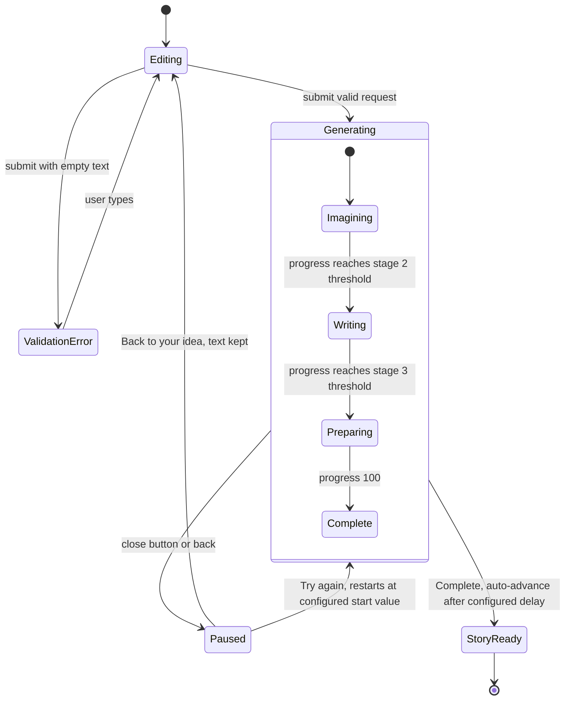
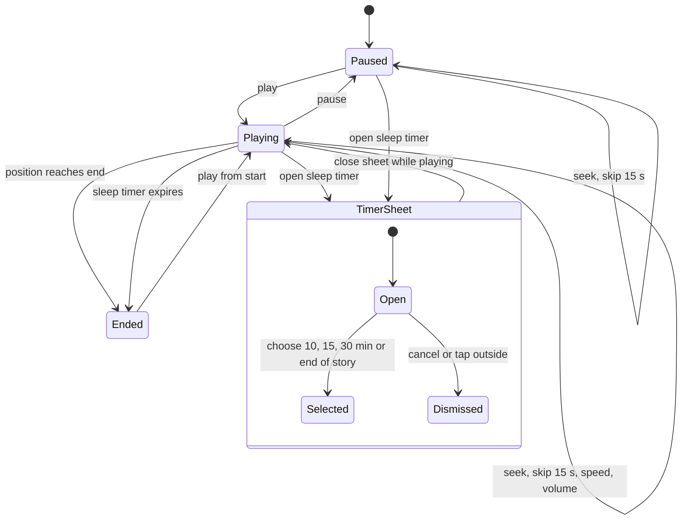
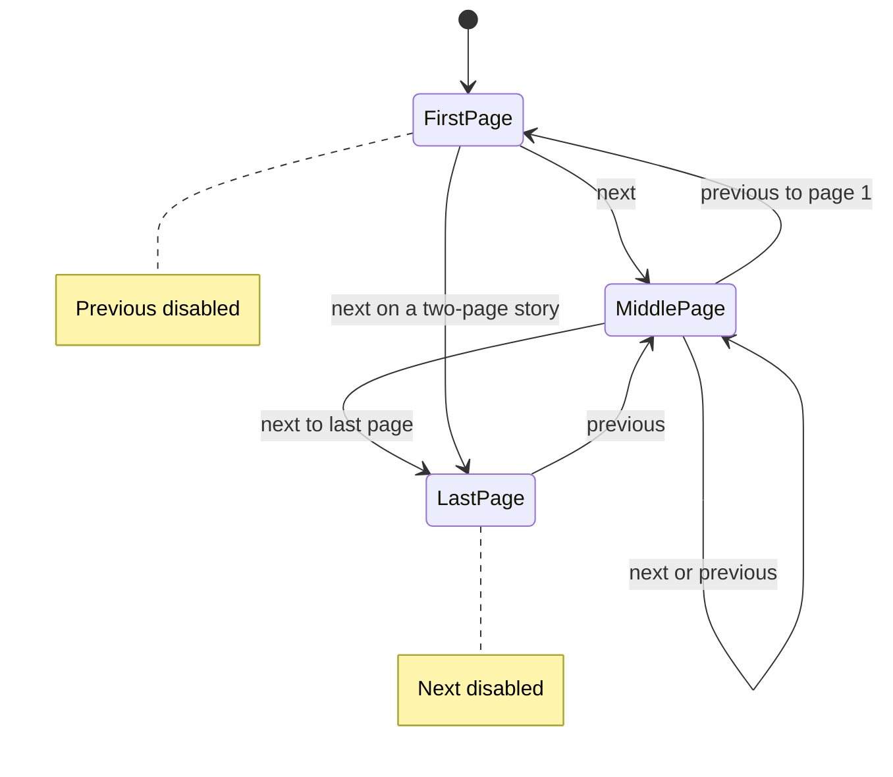
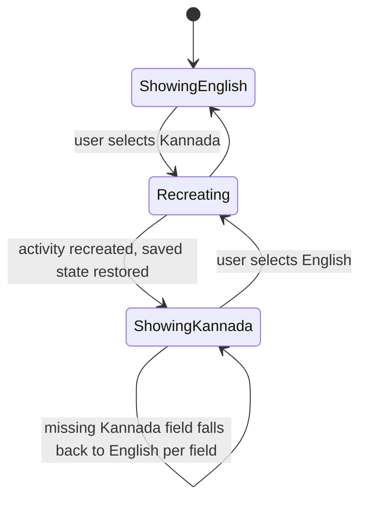

# LittleStory — Screen-State Matrix

Purpose: list, for every major screen, which states are meaningful and must be implemented and tested, with state diagrams for the stateful flows.

Status: Draft for owner review — P1, 29 Oct 2026

Sources: master orchestrator brief §6.2; `LittleStory_Figma_Design_Details.md` §3; workbook Screens sheet (States column) and Test Cases; [screen-inventory.md](screen-inventory.md). Designed states are *Needs Figma verification*; states marked **P** are Proposed (not designed).

Only meaningful states are modelled: local, synchronous operations get no artificial loading state (brief §6.2).

## Legend

| Mark | Meaning |
| --- | --- |
| D | Designed in the design pack |
| P | Required, not designed — Proposed behaviour, owner to confirm |
| R | Required by the brief for every screen (handled by architecture, verified by tests) |
| – | Not applicable |

## Matrix

| Screen | Populated | Loading | Empty | Validation error | Operation error / retry | Disabled | Back | Recreation / rotation | Language change | Font 200 % | Compact ≤360 dp | Long KN / pseudo | A11y semantics |
| --- | --- | --- | --- | --- | --- | --- | --- | --- | --- | --- | --- | --- | --- |
| SCR-01 Onboarding | D (3 slides) | – | – | – | – | – | P (previous slide) | R (slide index) | R | R | R | R | R (pager) |
| SCR-02 Setup | D | – | – | P (child name) | – | D (CTA until valid, P) | R | R (form input) | R (switch from field) | R | R | R | R |
| SCR-03 Home | D | – | P (no continue, no stories) | – | – | – | R (exit) | R | R | R | D (hero 22 sp) | R | R |
| SCR-04a Discover | D | – | – | – | – | – | R | R (query, chip) | R | R | R | R (KN search) | R |
| SCR-04b No results | – | – | D | – | – | – | R | R | R | R | R | R | R (heading) |
| SCR-05 Category | D (sorted) | – | P (0 stories) | – | – | – | R | R (sort) | R | R | R | R (plurals) | R |
| SCR-06 Story detail | D | – | – | – | P (unknown story id) | – | R | R | R | R | R | R | R |
| SCR-07 Create | D | – | – | D (empty text) | – | – | R | R (text, options) | R | R | R | R | R (error live region) |
| SCR-08 Generating | D (progress, 3 stages) | D (is the loading) | – | – | D (paused / try again) | – | P (same as close) | R (progress) | R | R | R | R | R (polite progress) |
| SCR-09 Story ready | D | – | – | – | – | – | P (to Home) | R | R (content language kept) | R | R | R | R (ribbon announced) |
| SCR-10 Reader | D (page n of N) | – | – | – | – | D (Prev on 1, Next on last) | R | R (page, scale) | R (same page) | R | R | R (KN line height) | R |
| SCR-11a Player | D (playing/paused) | – | – | – | – | – | R | R (position) | R | R | D (smaller cover) | R | R (sliders) |
| SCR-11b Sleep timer | D | – | – | – | – | – | D (dismiss) | R | R | R | R | R | R (focus trap) |
| SCR-12 My Stories | D (All tab) | – | D (2 messages) | – | – | – | R | R (tab, query) | R | R | R | R (tabs scroll) | R |
| SCR-13 Profile | D (toggles) | – | – | – | – | P (rows without destination) | R | R | R (subtitle) | R | R | R | R (separate toggles) |
| SCR-14 Child profiles | D (active/inactive) | – | – | – | – | – | R | R | R | R | R | R | R |
| SCR-15 Subscription | D (Yearly preselected) + dialog | – | – | – | – | – | R | R (plan) | R (currency) | R | R | R | R (radio group) |
| SCR-16 Reminder | D (on/off) + toast | – | – | P (no days) | – | D (when off) | R | R | R (time format) | R | R | R | R (day names) |
| SCR-17 Downloads | D | – | D | – | – | – | R | R | R (sizes) | R | R | R | R |
| SCR-18 Notifications | D (unread/read) | – | P | – | – | – | R | R | R | R | R | R | R |
| SCR-19–23 | No design (D10) | | | | | | | | | | | | |

## State diagrams

### Create → Generating → Story ready / Paused (SCR-07, SCR-08, SCR-09)

Thresholds, step size, tick interval and delay come from `AppConfig` (design values: stages change below 38 % and 76 %, +4 % per 120 ms, 0.5 s before auto-advance). The story is saved to "Created by Me" on completion (FR-10).

### Player (SCR-11a, SCR-11b)

Playback is simulated (no audio); positions advance on a configured tick. Download and favourite toggles are independent boolean states shared with other screens (FR-13, FR-15).

### Reader (SCR-10)

Text scale (0.9–1.3 in 0.1 steps) is an independent persisted setting; it combines with the system font scale. Page position is persisted as reading progress (FR-24).

### Language change on any screen (cross-cutting)

