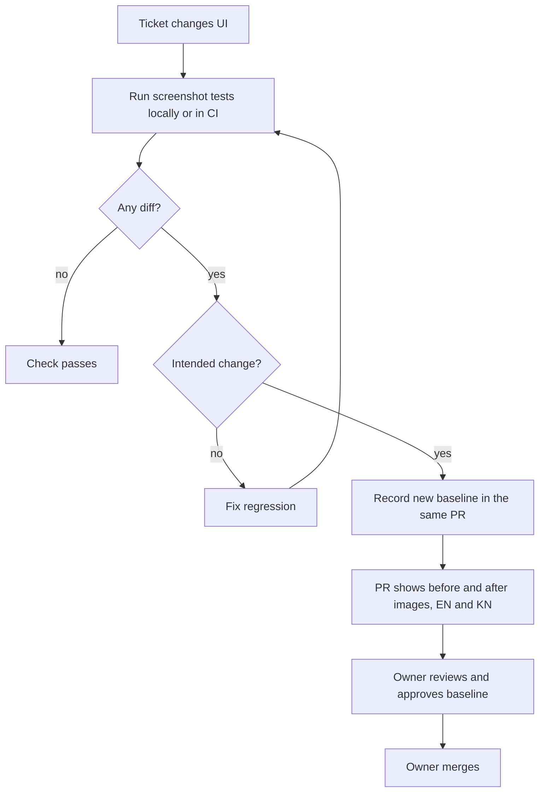

# LittleStory — Visual Regression Strategy

Purpose: define how screens are compared against the design pack and protected from visual regressions in English, Kannada and pseudo-locales.

Status: Draft for owner review — P1, 29 Oct 2026

Sources: master orchestrator brief §16, §16.1, §25; `screens/` (22 reference screenshots, 430 px wide at 2×); workbook LS-020, LS-035, LS-122, LS-124, TC-052; ADR-011 (screenshot testing, Proposed); P0 decision D7 (Roborazzi, Proposed).

## 1. Two separate activities

| Activity | Question it answers | Reference | Who approves |
| --- | --- | --- | --- |
| **Design fidelity review** (LS-124, per screen ticket) | Does the Android screen match the design? | `docs/design/screens/*.jpg` (English) | Owner, per screen |
| **Screenshot regression** (LS-122) | Did a change alter an approved screen? | Committed baseline images produced by the app itself | Owner reviews every baseline change |

The design JPEGs are never used as automated baselines: they come from a web build with different font rendering and the old brand. They are compared side by side by a person (or agent) and differences are recorded.

## 2. Tooling (Proposed, decided in ADR-011 after the LS-030 toolchain check)

| Option | For | Against |
| --- | --- | --- |
| **Roborazzi** (recommended, D7) | Runs on the JVM with Robolectric; no emulator; works in GitHub Actions and on Windows and macOS; supports locale and font-scale qualifiers | Robolectric rendering differs slightly from devices; pin versions |
| Compose Preview Screenshot Testing (AGP) | Official, preview-based | Maturity and AGP-version coupling to verify in LS-030 |
| Paparazzi | JVM, mature | Overlaps Roborazzi; pick one only |

## 3. Capture configuration

| Setting | Value |
| --- | --- |
| Device profile | Fixed phone, 430 dp wide to match the design pack; plus compact 360 dp and tall (≥900 dp height) profiles for screens with breakpoints |
| Locales | `en`, `kn`, `en-XA` (key screens), `ar-XB` (key screens, RTL) |
| Font scale | 1.0 for all; 2.0 for Home, Reader, Create, Profile |
| Data | Deterministic seed data; fixed clock; no random IDs; animations disabled |
| Theme | Light (only theme) |
| Naming | `<SCR-id>_<state>_<locale>[_<fontScale>][_<device>].png` |

## 4. Coverage

All 22 captured design states in English and Kannada, plus:

- SCR-04b no results and SCR-08 paused (specified, not captured);
- empty states (SCR-12 both messages, SCR-17, SCR-18 if designed);
- validation error (SCR-07), disabled Reader buttons, dialogs and sheets (SCR-11b, SCR-15);
- Language selection (SCR-20) once designed;
- design-system catalogue (LS-020): every component in every state.

## 5. Workflow

Rules:

- New or changed baselines are never auto-approved (brief §16.1). The PR description lists every changed image.
- A screen is reported "visually verified" only after an actual comparison with the design reference was performed and recorded (brief §25).
- Differences are classified Blocker, High, Medium or Low and become defect tickets with the locale stated.

## 6. Fidelity checklist per screen (from brief §16)

System bars and insets · spacing · typography and wrapping (both languages) · component sizes · image cropping · colour accuracy · gradients and shadows · scroll behaviour · button label fit in Kannada · selected and disabled states · keyboard appearance incl. Kannada input · dialog position · navigation and back.

## 7. Known reference limitations

- Screenshots show "LittleKatha"; compare structure, not the wordmark.
- Web font rendering (DM Sans, Manrope via Google Fonts) differs from Android; judge size, weight and spacing, not anti-aliasing.
- Tall captures include blank space below content; ignore it.
- No Kannada references exist; Kannada screenshots are checked for clipping, overflow, glyph rendering and line height, against the rules in [screen-inventory.md](screen-inventory.md).
