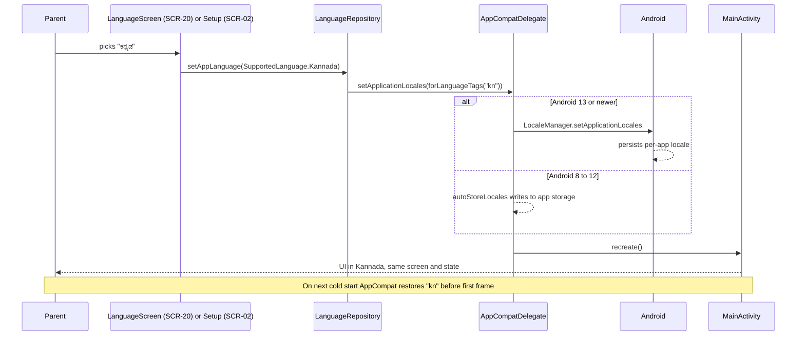
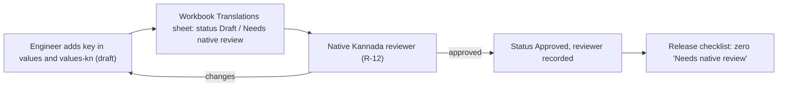

# Localization strategy

Purpose: define how LittleStory ships English and Kannada, falls back to English, switches language per app, and stays ready for future languages without feature-code changes.

Status: Draft for owner review — P1, 29 Oct 2026 (ADR-005 locale switching, ADR-006 registry, ADR-007 localized mock content, ADR-008 fonts, ADR-009 UiText — all Proposed)

Sources: brief §4.4, §8.7, §17.8 · design doc §3.2 (Setup language select), §3.13 (Profile row) · workbook FR-20, FR-21, NFR-02, NFR-03, R-02, R-03, R-04, R-12, R-13 · P0 assessment §4.

## 1. Languages

| Language | Tag | Status | Resources | Mock content | Picker label |
| --- | --- | --- | --- | --- | --- |
| English | `en` | MVP — default and fallback | `res/values/` | `stories_en.json` (authoritative for non-text fields) | English |
| Kannada | `kn` | MVP | `res/values-kn/` | `stories_kn.json` | ಕನ್ನಡ |
| Hindi, Tamil, Telugu, Marathi, Malayalam | TBD | Future — shown in the design's Setup select but **not** enabled in the MVP (R-02) | – | – | – |
| Pseudo-locales `en-XA`, `ar-XB` | – | debug builds only | generated by AGP | – | – |

## 2. Two kinds of language

| Setting | Meaning | Stored by | Default |
| --- | --- | --- | --- |
| App language (FR-20) | language of all UI text | Android per-app locale (`setApplicationLocales`) | device language if supported, else English |
| Story language (FR-21) | language of story content and simulated generation | `ChildProfile.languageTag` / Create "Story language" select | the app language |

Story IDs are identical across languages, so favourites, progress and downloads survive any change.

## 3. Fallback rules

1. UI strings: Android resolves `values-kn/` then `values/`. Lint `MissingTranslation` is an error and `checkTranslations` blocks merges, so a fallback in UI strings means a bug, not a feature.
2. Story content: `MockContentLoader` merges `stories_kn.json` over `stories_en.json` **per field**. A missing Kannada title shows the English title; the detail meta shows the resolved language.
3. Never crash, never show a raw key or an empty label.

## 4. Per-app language switching

- `res/xml/locales_config.xml` lists `en` and `kn`, referenced by `android:localeConfig` in the `:app` manifest.
- `LanguageRepository` (`:data`) calls `AppCompatDelegate.setApplicationLocales(LocaleListCompat.forLanguageTags(tag))` and exposes the current language as a `Flow`.
- On Android 13+ the system stores the choice and shows it in system settings. On Android 8–12 (minSdk 26 proposed, D5) AppCompat backports the API; the manifest must declare `androidx.appcompat.app.AppLocalesMetadataHolderService` with `autoStoreLocales=true` so the choice persists across restarts.
- `MainActivity` extends `AppCompatActivity`, so the change recreates it; ViewModels and the back stack survive (see `docs/architecture/state-management.md`).



## 5. Single source of truth: the registry

```kotlin
// :core:common — illustrative
enum class SupportedLanguage(val tag: String, val nativeName: String, val enabled: Boolean, val isDefault: Boolean) {
    English("en", "English", enabled = true, isDefault = true),
    Kannada("kn", "ಕನ್ನಡ", enabled = true, isDefault = false),
}
```

| Consumer | How it uses the registry |
| --- | --- |
| Language picker (SCR-02, SCR-20) | lists `enabled` entries, each in its own script |
| `locales_config.xml` | a unit test asserts it lists exactly the enabled tags |
| `checkTranslations` task | checks every `values-{tag}` for enabled tags |
| Mock-content test | asserts a `stories_{tag}.json` exists for each enabled tag |
| Docs | `adding-a-new-language.md` |

`nativeName` is never translated, so a user can find their language whatever the current UI language (brief §4.4 rule 7).

## 6. Text rules (summary)

- Every user-facing string, including content descriptions and errors, lives in resources ([string-resource-conventions.md](string-resource-conventions.md)).
- ViewModels emit `UiText`, never strings.
- Positional arguments and plurals; no concatenation.
- Numbers, dates, times, durations, prices and file sizes use locale-aware formatters (`NumberFormat`, `DateTimeFormatter.ofLocalizedTime`, `Formatter.formatShortFileSize`, `MeasureFormat` where needed).
- Layouts use `start`/`end`, flexible widths and `android:supportsRtl="true"` so future RTL works; `ar-XB` checks it.
- No text in images — confirmed none in the design (all art is drawn in code).

## 7. Typography

DM Sans and Manrope have no Kannada glyphs (per their published coverage), so the font families add a Kannada fallback (Noto Sans Kannada proposed, ADR-008). Details: [kannada-typography.md](kannada-typography.md).

## 8. Automated checks

| Check | Where | Fails when |
| --- | --- | --- |
| Lint `MissingTranslation`, `HardcodedText`, `SetTextI18n` as errors | every module (LS-034) | a key is missing in `values-kn` or a literal is used |
| `checkTranslations` Gradle task | root, CI (LS-041) | key sets or positional-argument counts/types differ between `values` and `values-*` |
| Registry ↔ `locales_config.xml` test | `:app` unit test (LS-040) | they disagree |
| Mock-content parity test | `:data` unit test (LS-036/LS-044) | an ID is unknown, page counts differ, or a fallback is not on the expected list |
| Screenshot tests in `en`, `kn`, `en-XA` | Roborazzi (LS-122) | unreviewed diffs, clipping |
| Native Kannada review | human (LS-047) | any string still "Needs native review" at release |

## 9. Translation workflow



Machine-drafted Kannada is allowed only as a draft and is never marked Approved (brief §4.4 rule 16). Glossary: [glossary.md](glossary.md).

## 10. Open localization questions

| # | Question | Proposal |
| --- | --- | --- |
| L1 | Setup shows 7 languages | show only registry-enabled EN and ಕನ್ನಡ (D9) |
| L2 | No language-preferences design (SCR-20) | build from existing list-row + check components (LS-046) |
| L3 | Kannada TTS for TalkBack (R-13) | test on devices with a Kannada voice; document the limitation otherwise |
| L4 | Who reviews Kannada (R-12, D12) | owner to name a fluent reviewer before P6 |
