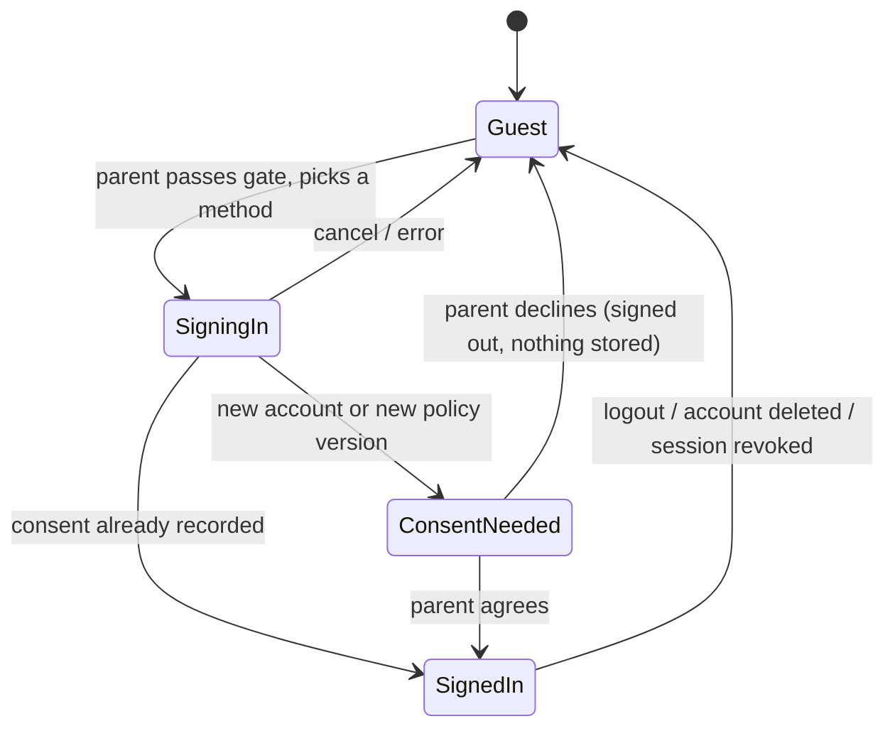

# Accounts, parent profile and subscription plan

Purpose: plan login, logout, the parent profile (with child profiles under it), account deletion, guest and offline use, and a subscription that is designed now but switched on later, and show how all of it fits the screens and the grown-ups-only gate that already exist.
Status: **Proposed — for owner decision, 31 Oct 2026.** Docs only; no code, network access, provider account or store product is created.
Related: [backend-ai-accounts-design.md](../api/backend-ai-accounts-design.md) (backend platform, AI, voice, costs; decisions D16–D20, PR #19), [future-api-contracts.md](../api/future-api-contracts.md), [play-families-compliance.md](../security/play-families-compliance.md), [child-safety-requirements.md](../security/child-safety-requirements.md), [navigation-design.md](../architecture/navigation-design.md), [screen-inventory.md](../design/screen-inventory.md).

> **Legal review required.** Consent and deletion notes are an engineering plan, not legal advice.

This document does not repeat the backend design. It takes these recommendations from [backend-ai-accounts-design.md](../api/backend-ai-accounts-design.md) as its starting point and is written so it still holds if the owner picks differently there: Firebase Auth in `asia-south1` (B1), parent-only accounts (B2), Google sign-in plus email link (B3), guest mode kept (B4), entitlements with everyone on `free` (B8).

## 1. Recommendations

| # | Topic | Recommendation |
|---|---|---|
| AC1 | Who has an account | Only the parent. Children never log in and never see a sign-in screen. Child profiles belong to the parent account |
| AC2 | When to sign in | **Never required to read.** Guest mode keeps today's app working. Sign-in is asked for only when a parent wants something that needs the server: real AI creation, sync across devices, narration downloads, or (later) a subscription |
| AC3 | Sign-in methods | Google sign-in through Android Credential Manager first; email link second. No passwords stored by us, no phone OTP at launch |
| AC4 | Logout | Behind the parental gate. Signs out **and removes that account's data from the device**, then returns to a clean guest state. Nothing is lost because it is on the server |
| AC5 | Delete account | In the app (gated) and on a public web page, as Play requires. Disabled at once, purged within 30 days |
| AC6 | Building order | Build the account screens and the domain layer first against a **fake, on-device auth repository behind a feature flag**, so UI, navigation, tests and Kannada text are ready before any backend exists |
| AC7 | Subscription | Not launched. The app reads an **`Entitlement`** (what this family may do), never a plan name. Every family is `free` and today's features stay free forever. Play Billing is a later, separate phase |
| AC8 | Modules | New `:feature:account` for sign-in, consent, parent profile and account deletion; `:feature:settings` keeps the hub rows and child profiles. Domain interfaces in `:domain`, implementations in `:data` (ADR-002 rules unchanged) |

## 2. Account states

The app is always in exactly one state. Screens read it from `SessionRepository.session: Flow<Session>`.



| State | What works | Data lives |
|---|---|---|
| **Guest** | Everything the MVP does today: catalogue, reading, simulated player, favourites, progress, local child profiles, settings | Device only (Room, DataStore) — no change from today |
| **SignedIn** | All guest features, plus sync, real AI creation, narration downloads, entitlement-based extras | Server is the record; Room is a per-account offline cache |
| **ConsentNeeded** | Only the consent screen; nothing is uploaded until the parent agrees | — |

`Session` in `:domain`: `Guest` · `ConsentNeeded(account)` · `SignedIn(account, entitlement)`. No Android or Firebase type crosses into `:domain`.

## 3. Where it fits in today's app

| Place | Today | With accounts |
|---|---|---|
| Onboarding (SCR-01) and Setup (SCR-02) | Create a child profile on the device | Unchanged. No sign-in prompt during first run (keeps the first story one minute away; avoids asking a child to "sign in"). |
| Profile hub (SCR-13) | Parent's name area, rows for children, language, reminder, notifications, downloads, subscription, privacy, help | New first row **Parent account**: "Sign in to sync and create" (guest) or the parent's name/email (signed in). Opens SCR-23 behind `ParentGated` |
| SCR-23 Account settings | **Missing design** (D10) | New `:feature:account` screens: Sign in, Consent, Parent profile, Signed-in account (devices, plan, log out, delete account). Built from existing components until the owner supplies designs |
| Child profiles (SCR-14) | Gated, local list | Same screen; when signed in, rows sync. Limit comes from the entitlement (`maxChildProfiles`) |
| Create (SCR-07) | Simulated generation | When real AI is on (P-B3) and the parent is a guest, tapping Create shows a grown-up prompt: "Ask a grown-up to sign in to create stories" → gate → Sign in. The simulated flow stays for guests while the flag is off |
| Downloads (SCR-17) | Simulated | Real downloads need sign-in (P-B2); guests see the same grown-up prompt |
| Subscription (SCR-15) | Demo plans behind `FeatureFlags.demoSubscription`, gated | Stays a demo until P-B5. Then shows real Play prices and the family's current entitlement |
| Privacy & parent controls (SCR-21) | Gated; Delete all data (device) | Guest: unchanged. Signed in: **Delete account** (server + device) and **Withdraw consent**; "Delete data on this device" becomes "Log out and clear this device" |

Every account screen is **parent-only and opens behind `ParentGated`**, registered in feature navigation exactly like Language and Privacy today, so no entry point can skip the gate. The Credential Manager sheet and any web link (deletion page, policy) open only after the gate (F-09).

## 4. Login

| Step | Behaviour |
|---|---|
| Entry | Parent account row, or a grown-up prompt from Create / Downloads. Always the parental gate first |
| Method | Google sign-in via Credential Manager (one tap, no keyboard). Email link: parent types an email, opens the link on the same device (App Links); the email field is in the parent area, never shown to a child |
| Detect a child's Google account | A supervised (Family Link) child account must not create a parent account. Open technical check (Q5); fallback is an "I am a parent or guardian, 18 or older" declaration on the consent screen |
| Consent | First sign-in, or a new policy version, shows the consent screen (EN + KN): what is stored, AI use, where data is processed, retention, how to delete. Agree records a `ConsentRecord`; Decline signs out and leaves the device as it was |
| Parent profile | Display name (optional), country (prefilled from locale, editable), UI language (from the `SupportedLanguage` registry). Email comes from the provider and is not editable here |
| Bring guest data in | If the device has guest child profiles, favourites or progress, ask once: "Add these to your account?" Yes uploads them; No keeps them on the device as guest data (not deleted). Never uploaded silently |
| Second device | Signing in downloads the account's child profiles; the parent picks which child reads on this device. Active child is per device |
| Errors | No network, cancelled sheet, provider error, account disabled: friendly `UiText` messages, stay in Guest, no partial state |

## 5. Logout

| Question | Answer |
|---|---|
| Who can log out | A parent, behind the gate, from the account screen |
| What happens | Sign out locally at once, revoke the session on the server (retried later if offline), cancel sync and download work, then **delete that account's cached data from the device**: child profiles, favourites, progress, created stories, downloaded audio, account preferences |
| What stays | Things that belong to the device: UI language, accessibility/reading preferences, first-run completed, and any guest data the parent chose not to upload |
| After logout | Guest Home. If no guest child profile exists, Home uses the existing guest owner (`AppConfig.Profiles.GUEST_ID`) and Profile offers "Add a child" — the first-run flow is not repeated |
| Unsynced changes | If something has not reached the server (for example progress made offline), warn: "Some reading progress on this device has not been saved yet" with *Log out anyway* / *Cancel* |
| Session ended elsewhere | Account deleted, disabled or session revoked on another device: on the next token refresh the app does the same local cleanup and shows a one-time notice to the parent area |

Clearing data on logout is what makes a shared family tablet safe, and it is the main reason Room becomes a per-account cache rather than the record.

## 6. Parent profile and child profiles

| Entity | Fields | Notes |
|---|---|---|
| `ParentAccount` | `id`, `email` (from provider), `displayName?`, `country`, `uiLanguageTag`, `createdAt` | No phone, address, photo or birth date |
| `ChildProfile` | Today's model (`firstName`, `age`, `avatar`, `interestIds`, `languageTag`, `defaultDurationMinutes`) plus `ownerAccountId?` (`null` = guest) and `updatedAt` | Decision D14 minimisation still applies. Backend may store an age band instead of an exact age (backend doc §3.1) |
| `ConsentRecord` | policy version, language, time, method, withdrawn-at | Server-side, immutable |
| `Entitlement` | see §9 | Server-side source of truth, cached on device |

- Child profiles stay editable only behind the gate (already true).
- Sync: last change wins per profile (`updatedAt`); deletions are tombstones so a deleted child does not come back from another device.
- The child's name is never sent to an AI provider (backend doc §4); this plan adds nothing that changes that.

## 7. Account deletion and consent withdrawal

| Action | Where | Effect |
|---|---|---|
| **Delete account** | Privacy & parent controls (gated) and a public web page (Play User Data policy, F-14) | Confirm twice (type-free: a second gated dialog). Server disables the account at once; profiles, created stories, audio, progress and entitlement purged within 30 days; a minimal record that deletion happened is kept. Device data is cleared as in logout. An active paid subscription (later) must be cancelled in Play first; the screen links to Play's subscription page behind the gate |
| **Withdraw consent** | Same screen | Stops AI creation and sync at once and deletes child data on the server; the parent may keep the account for a later re-consent, or delete it |
| **Delete data on this device** (guest) | Unchanged (`LocalDataRepository.deleteAll`) | Device only |

The web deletion page needs a URL before the first release with accounts (owner action).

## 8. Guest and offline

- **Guest** is a first-class mode, not a trial. Nothing about it expires.
- **Signed in and offline:** the app reads from the Room cache, queues writes (progress, favourites, profile edits) and syncs on reconnect. Real AI creation and new downloads show "You're offline"; already downloaded stories play.
- **Expired session while offline:** keep showing cached data; sign-out only happens when the server says so, not because the network is down.
- No sign-in, account or billing call is made while the `accounts` flag is off, so today's app (no `INTERNET` permission) is unchanged until P-B1 ships.

## 9. Subscription readiness

### 9.1 Entitlement model (built with accounts, everyone `free`)

```kotlin
// :domain — sketch, not final code
enum class PlanTier { Free, Plus }                 // ids only; names and prices come from Play later
enum class Capability { CreateStory, PremiumVoice, OfflineDownload, ExtraChildProfile }
data class Entitlement(
    val tier: PlanTier,
    val limits: Map<Capability, Int>,              // e.g. CreateStory -> 3 per week; from the server
    val source: EntitlementSource,                 // None, Play
    val validUntil: Instant?,
)
interface EntitlementRepository {
    val entitlement: Flow<Entitlement>
    suspend fun refresh()
}
```

Rules:

1. **Screens check capabilities, never plan names.** `entitlement.allows(Capability.CreateStory)` — so prices, tiers and bundles can change on the server without an app release.
2. **Guests get a local `Free` entitlement** with the same limits that do not need a server.
3. **The server enforces quotas**; the app only explains them (`429` → friendly "You've made all your stories for this week" in the parent area, never an upsell aimed at the child).
4. **Never take away.** Everything in today's app (catalogue, reading, local profiles, simulated features while they exist) stays free when a paid plan launches.
5. `SubscriptionRepository` keeps today's demo plans until P-B5; the Subscription screen stays behind `FeatureFlags.demoSubscription` and the gate.

### 9.2 Flags

| Flag (in `FeatureFlags`, later overridable by Remote Config) | Default now | Purpose |
|---|---|---|
| `accounts` | `false` | Shows the Parent account row and account screens; fake auth in debug builds |
| `realBilling` | `false` | Swaps the demo Subscription screen for Play Billing (P-B5) |
| `demoSubscription` | `true` (existing) | Illustrative plans, no payment |

### 9.3 Play Billing, when the owner switches it on (P-B5)

- Play Billing Library in `:data` behind `BillingRepository`; purchase flow only from the gated Subscription screen.
- Pass a hashed account id as `obfuscatedAccountId` so a purchase is tied to the parent account, not the device.
- Server verifies every purchase with the Play Developer API and listens to Real-time Developer Notifications; the app never grants access from the client alone.
- Handle grace period, account hold, pause, restore on a new device, refunds, and family sharing (owner decision).
- Families policy: no purchase prompts in child areas, no "limited time" pressure, clear price and renewal text in English and Kannada, gate before checkout.
- Data safety and the privacy policy are updated in the same release.

## 10. App architecture changes

| Layer | Add |
|---|---|
| `:domain` | `Session`, `ParentAccount`, `Entitlement`, `Capability`; interfaces `AuthRepository` (signIn(method), signOut, deleteAccount), `SessionRepository`, `AccountRepository` (parent profile, consent), `EntitlementRepository`; use cases `SignOutAndClearDevice`, `ImportGuestData` |
| `:data` | `FakeAuthRepository` + `FakeEntitlementRepository` (debug, on device, deterministic) first; `FirebaseAuthRepository`, remote sources and Room-per-account cache in P-B1; `PlayBillingRepository` in P-B5 |
| `:core:common` | Flags `accounts`, `realBilling`; `AppConfig.Account` (deletion grace days shown in text, sync retry timings) |
| `:feature:account` (new) | Sign in, Consent, Parent profile, Account screens; typed routes registered in `:app`, all wrapped in `ParentGated` |
| `:feature:settings` | Parent account row on Profile; Delete account / Withdraw consent on Privacy; child limit from entitlement |
| `:app` | Navigation wiring; Credential Manager needs an `Activity`, provided through a small `:app`-side bridge so features stay free of it |

Adding `:feature:account` changes ADR-002's module list; it needs an ADR amendment (owner decision, Q1).

## 11. Proposed tickets

IDs are placeholders (`AC-#`) until the owner approves and they get `LS-` numbers in the workbook.

| # | Ticket | Phase | Depends on |
|---|---|---|---|
| AC-1 | Domain: session, account, entitlement models and interfaces + tests | Now (no backend) | Owner OK on this plan |
| AC-2 | Fake auth and entitlement repositories, `accounts` flag | Now | AC-1 |
| AC-3 | `:feature:account` module: Sign in, Consent, Parent profile, Account screens (EN + KN, gated, screenshots) | Now | AC-2, designs or approval of pattern-based screens (D10) |
| AC-4 | Profile hub row, Privacy screen account actions, grown-up prompts on Create/Downloads | Now | AC-3 |
| AC-5 | Logout with device cleanup; guest data import; unsynced-changes warning | Now (fake) → P-B1 (real) | AC-3 |
| AC-6 | Firebase Auth, Google sign-in, email link, `INTERNET`, App Check | P-B1 | D16, D17 approved |
| AC-7 | Child profile sync, per-account Room cache | P-B1 | AC-6 |
| AC-8 | Account deletion (app + web page), consent withdrawal, server purge job | P-B1 | AC-6, deletion URL |
| AC-9 | Server entitlements and quotas, all `free` | P-B1/P-B3 | AC-6 |
| AC-10 | Play Billing, purchase verification, RTDN, real Subscription screen | P-B5 | Owner's growth trigger (D20) |

AC-1 to AC-5 can be built and tested today without a network or a provider account; they are the low-risk way to make "login and logout are a must" real in the app.

## 12. Children's privacy checklist for this work

- No child login, no child email, no child-facing sign-in or purchase prompt.
- Parental gate before every account, consent, deletion, billing screen and external link.
- Consent recorded before the first upload; Decline leaves nothing on the server.
- Data minimisation unchanged (D14); parent email only from the sign-in provider.
- Logout and deletion clear the device; deletion available on the web.
- Data safety form, privacy policy and `FeatureFlags.draftLegalText` updated in the same release that turns on `accounts` (play-families-compliance.md F-04, F-12, F-14).
- No analytics or tracking SDK added with Firebase (backend doc §2).

## 13. Open questions for the owner

1. **Module:** new `:feature:account` (recommended) or keep account screens inside `:feature:settings`?
2. **Build now with fake auth:** start AC-1 to AC-5 now, before the backend is chosen (recommended), or wait for D16/D17?
3. **Sign-in prompt:** only when needed (recommended), or also an optional "Sign in" step at the end of onboarding?
4. **Logout on a shared device:** clear that account's data (recommended), or keep it for faster re-login?
5. **Supervised Google accounts:** block them, or rely on the adult declaration until a technical check is confirmed?
6. **Free plan promise:** confirm that everything free today stays free after subscriptions launch.
7. **Designs:** will you add Sign in, Consent, Parent account and Delete account to the Figma Make file, or approve pattern-based screens built from existing components (D10)?
8. **Deletion window:** 30 days to purge after deletion, or shorter?
