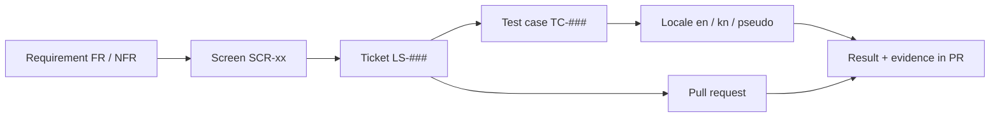

# LittleStory — Requirements Index and Traceability

Purpose: entry point to the requirement catalogues and the traceability matrix linking each requirement to screens, tickets and test cases.

Status: Draft for owner review — P1, 29 Oct 2026

Sources: workbook `docs/project-management/LittleStory_Jira_Backlog.xlsx` (Requirements, Backlog, Test Cases, Screens sheets); master orchestrator brief §7, §8, §17.6.

## Catalogues

| Document | Contents |
| --- | --- |
| [functional-requirements.md](functional-requirements.md) | FR-01…FR-25 — 15 Must, 5 Should, 5 Could |
| [non-functional-requirements.md](non-functional-requirements.md) | NFR-01…NFR-12 from the workbook + NFR-13…NFR-17 newly proposed |
| [user-journeys.md](user-journeys.md) | Journeys A–G with flow diagrams |
| [edge-cases.md](edge-cases.md) | Edge cases by screen and cross-cutting |
| [mvp-scope.md](mvp-scope.md) | In/out of scope, simulations, pending decisions |
| [../design/screen-inventory.md](../design/screen-inventory.md) | SCR-01…SCR-23 |

## Rules

- Requirement IDs, ticket keys and test-case IDs are stable and shared with the workbook. Never renumber.
- A requirement is **Confirmed** only when its source is verified and the owner approves it. Every requirement is currently *Proposed — awaiting owner review*.
- English and Kannada support is a confirmed owner instruction (brief §7); it is still recorded as Proposed until the owner signs off this catalogue.
- When a requirement changes, update this file, the catalogue and the workbook Requirements sheet in the same PR.

## How traceability flows

## Traceability matrix (Requirement → Screen → Ticket → Test case)

| Requirement | MoSCoW | Screens | Tickets | Test cases |
| --- | --- | --- | --- | --- |
| FR-01 Onboarding | Must | SCR-01 | LS-060 | TC-001, TC-002 |
| FR-02 Child profile setup | Must | SCR-02 | LS-061, LS-062 | TC-004, TC-005 |
| FR-03 Multiple child profiles | Should | SCR-14 | LS-062, LS-063 | TC-042 |
| FR-04 Personalised Home | Must | SCR-03 | LS-070 | TC-008, TC-009, TC-010 |
| FR-05 Discover | Must | SCR-04a, SCR-04b | LS-071, LS-072 | TC-011, TC-012, TC-013, TC-014 |
| FR-06 Category listing | Should | SCR-05 | LS-073 | TC-015 |
| FR-07 Story detail | Must | SCR-06 | LS-074 | TC-016 |
| FR-08 Create story form | Must | SCR-07 | LS-080, LS-081 | TC-019, TC-020, TC-021, TC-022 |
| FR-09 Simulated generation | Must | SCR-08 | LS-082, LS-083 | TC-024, TC-025, TC-026, TC-027 |
| FR-10 Story ready | Must | SCR-09 | LS-082, LS-084 | TC-028, TC-029 |
| FR-11 Reader | Must | SCR-10 | LS-090 | TC-030, TC-031 |
| FR-12 Simulated audio player | Should | SCR-11a, SCR-11b | LS-092, LS-093 | TC-034, TC-035, TC-037 |
| FR-13 Favourites | Must | SCR-03, SCR-04a, SCR-05, SCR-06, SCR-09, SCR-10, SCR-11a | LS-075 | TC-017, TC-018 |
| FR-14 My Stories library | Must | SCR-12 | LS-100 | TC-038, TC-039 |
| FR-15 Offline downloads (simulated) | Could | SCR-17 | LS-101 | TC-040 |
| FR-16 Settings hub | Must | SCR-13 | LS-110 | TC-041 |
| FR-17 Bedtime reminder settings | Could | SCR-16 | LS-111 | TC-043, TC-044 |
| FR-18 Notifications inbox (mock) | Could | SCR-18 | LS-112 | TC-045 |
| FR-19 Demo subscription | Could | SCR-15 | LS-113 | TC-046 |
| FR-20 App language EN / ಕನ್ನಡ | Must | SCR-02, SCR-20 | LS-004, LS-040, LS-045, LS-046 | TC-006, TC-007, TC-048, TC-049 |
| FR-21 Story language EN / ಕನ್ನಡ | Must | SCR-06, SCR-07, SCR-09, SCR-10 | LS-036, LS-044, LS-081 | TC-023 |
| FR-22 Privacy & parent controls | Should | SCR-21 | LS-004, LS-114 | – |
| FR-23 Help & about | Could | SCR-22 | LS-004, LS-115 | – |
| FR-24 Progress & resume | Should | SCR-03, SCR-10, SCR-11a, SCR-12 | LS-070, LS-091 | TC-033 |
| FR-25 Launch & first-run routing | Must | SCR-19 | LS-004, LS-051 | TC-057 |
| NFR-01 No hardcoding | Must | All | LS-005, LS-010, LS-011, LS-012, LS-033, LS-034, LS-050, LS-125, LS-150 | TC-051 |
| NFR-02 Localization completeness | Must | All | LS-005, LS-011, LS-034, LS-040, LS-041, LS-043, LS-047 | TC-003, TC-050 |
| NFR-03 Future languages | Must | All | LS-040, LS-042, LS-048 | TC-052 |
| NFR-04 Accessibility | Must | All | LS-012, LS-015, LS-016, LS-017, LS-019, LS-094, LS-110, LS-123 | TC-032, TC-053, TC-054, TC-055 |
| NFR-05 Architecture | Must | All | LS-008, LS-031, LS-037, LS-120 | – |
| NFR-06 Deterministic data | Must | All | LS-036 | – |
| NFR-07 Privacy & child safety | Must | All | LS-038, LS-061, LS-114, LS-126 | TC-047 |
| NFR-08 Performance | Should | All | – | – |
| NFR-09 Cross-platform development | Must | – | LS-001, LS-005, LS-030, LS-132 | TC-056 |
| NFR-10 Visual fidelity | Must | All | LS-002, LS-010, LS-013, LS-018, LS-020, LS-122, LS-124 | – |
| NFR-11 Reliability | Must | All | LS-038 | TC-058 |
| NFR-12 Honest simulations | Must | SCR-08, SCR-11a, SCR-15, SCR-17 | LS-082, LS-092, LS-101, LS-113 | TC-036 || NFR-13 Locale-aware formatting (NEW) | Must | SCR-03, SCR-08, SCR-11a, SCR-13, SCR-15, SCR-16, SCR-17 | LS-040, LS-092, LS-101, LS-111, LS-113 | TC-034, TC-044 |
| NFR-14 RTL and text-expansion readiness (NEW) | Must | All | LS-013, LS-016, LS-019, LS-042 | TC-052 |
| NFR-15 Configurability (NEW) | Must | All | LS-033, LS-125, LS-150 | TC-051 |
| NFR-16 Compatibility and device matrix (NEW) | Must | All | LS-030, LS-132 | – (to add) |
| NFR-17 Build verifiability (NEW) | Must | – | LS-030, LS-130 | TC-056 |

## Gaps found while tracing

| Gap | Affected | Proposed action |
| --- | --- | --- |
| No test cases yet | FR-22, FR-23, NFR-05, NFR-06, NFR-08, NFR-10 | Add TC rows in the P1 workbook update (architecture rule test, mock-data determinism test, design-fidelity screenshot cases) |
| Requirement depends on missing design | FR-20 (SCR-20), FR-22 (SCR-21), FR-23 (SCR-22), FR-25 (SCR-19) | Decision D10 |
| NFR-08 has no tickets | Performance | Cover in LS-120/LS-121 reviews; add a baseline-profile ticket only if a measured need appears (brief §8.2) |
