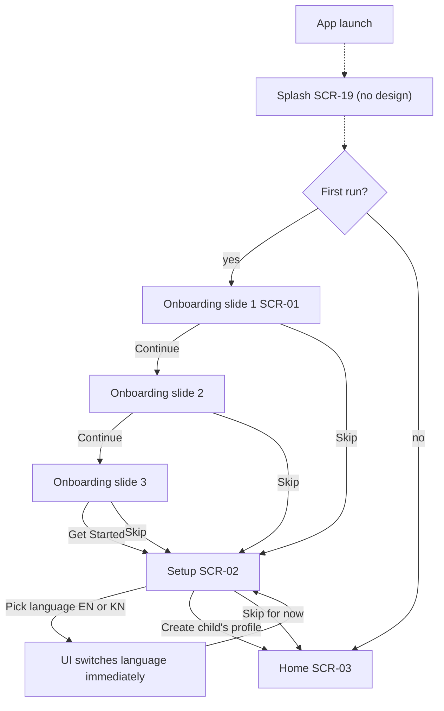
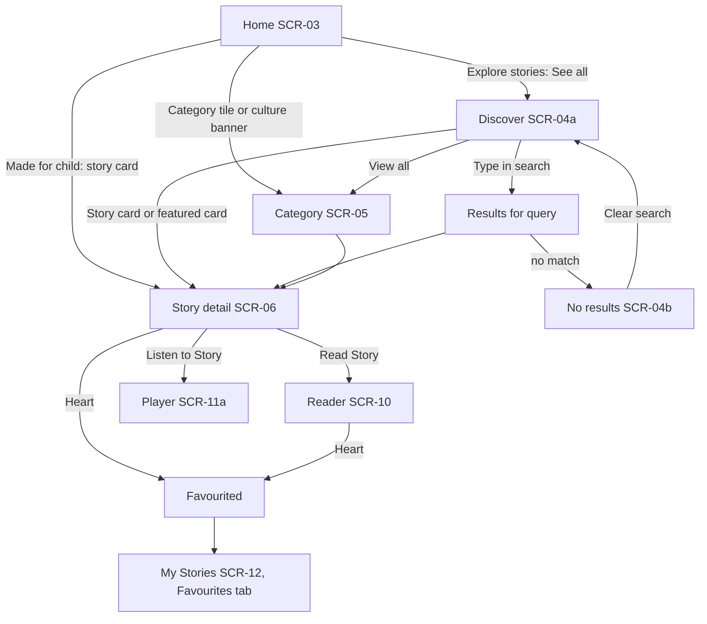
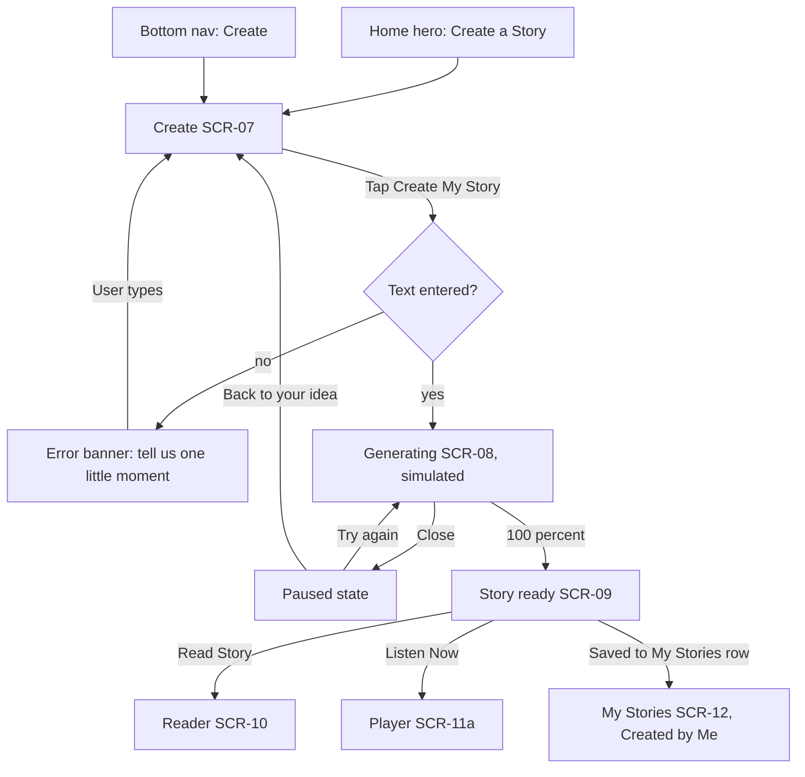
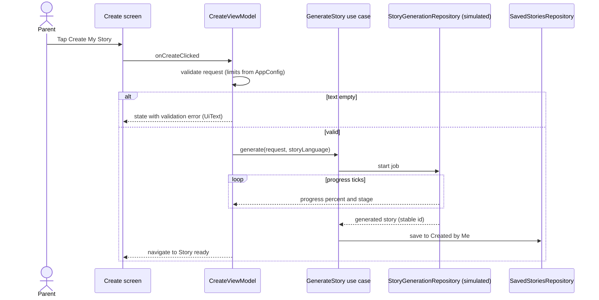
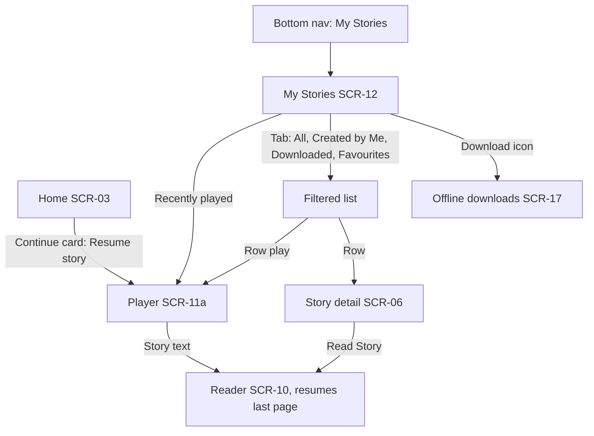
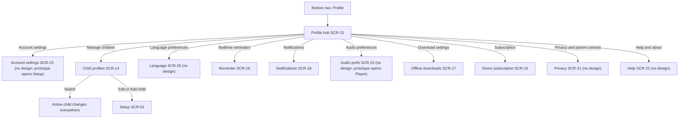
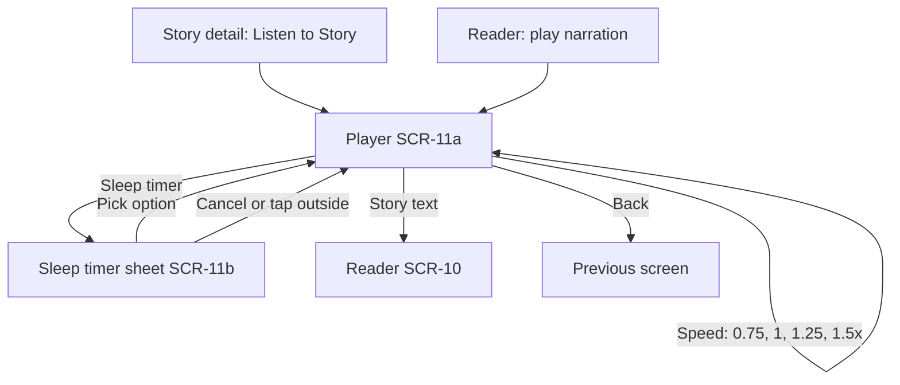
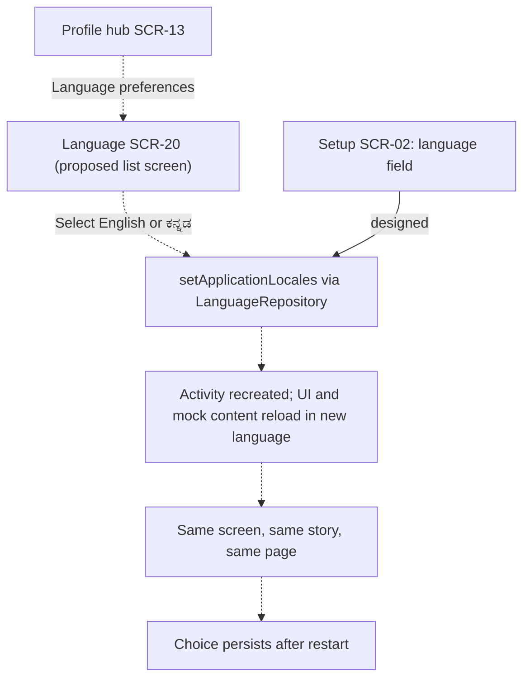
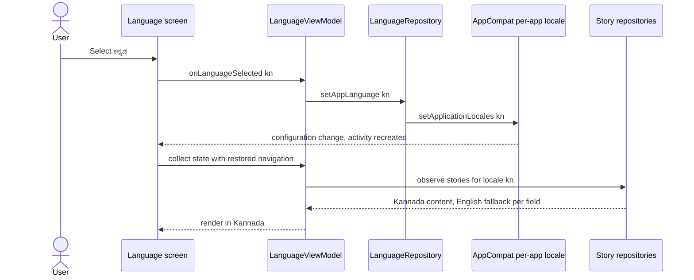

# LittleStory — User Journeys

Purpose: map journeys A–G from the brief onto the screens that exist in the design pack, show each as a flow, and record where the design is silent.

Status: Draft for owner review — P1, 29 Oct 2026

Sources: master orchestrator brief §6.1; `docs/design/LittleStory_Figma_Design_Details.md` §3 (interactions per screen); workbook Screens sheet (entry and exit paths). The live Figma Make prototype could not be re-read during P0, so every path below is *Needs Figma verification* against the prototype.

## Coverage summary

| Journey | Brief path | Covered by design? | Screens | Requirements |
| --- | --- | --- | --- | --- |
| A First-time experience | Launch → Welcome/onboarding → (language) → Child profile → Home | Mostly. Splash missing; language is a field inside Setup, not a step | SCR-19 (missing), SCR-01, SCR-02, SCR-03 | FR-01, FR-02, FR-20, FR-25 |
| B Discover and read | Home → Discover → Story details → Read → Save → My Stories | Yes. "Save" is the favourite heart; saved stories appear in My Stories ▸ Favourites | SCR-03, SCR-04a/b, SCR-05, SCR-06, SCR-10, SCR-12 | FR-04–FR-07, FR-11, FR-13, FR-14 |
| C Create a story | Create → validation → simulated generation → result → Reader → Save | Yes. Save is automatic ("Saved to My Stories") | SCR-07, SCR-08, SCR-09, SCR-10, SCR-12 | FR-08–FR-11, FR-21 |
| D Revisit saved stories | Home → My Stories → saved story → Reader → progress | Yes. Continue card on Home and Recently played in My Stories resume the Player; list rows open Player or Detail | SCR-03, SCR-12, SCR-11a, SCR-10 | FR-14, FR-24 |
| E Parent controls | Profile area → Parent settings → language, safety, privacy | Partly. Hub exists; Privacy, Help, Language, Account and Audio rows route to placeholders | SCR-13, SCR-14, SCR-16, SCR-18, SCR-15, SCR-20–23 (missing) | FR-03, FR-16–FR-19, FR-22, FR-23 |
| F Simulated audio | Detail or Reader → Player → controls → back to Reader | Yes | SCR-06, SCR-10, SCR-11a, SCR-11b | FR-12 |
| G Change language | Settings → Language → EN / ಕನ್ನಡ → UI and content update → persists | **No design.** Profile's "Language preferences" row routes to Setup in the prototype | SCR-13, SCR-20 (missing), SCR-02 | FR-20, FR-21 |

Legend for the diagrams: solid arrows are designed transitions; dotted arrows (`-.->`) are proposed behaviour with no design, pending decision D10.

## Journey A — First-time experience

Notes:

- Splash and the first-run decision have no design (SCR-19, FR-25, decision D10). Proposal: Android SplashScreen API with the LittleStory symbol, then route on a persisted first-run flag.
- The onboarding scene is identical on all three slides; there is no swipe or back between slides in the prototype (open question R-09).
- The Setup language select shows seven languages in the design. Proposed (D9): show only registry-enabled English and ಕನ್ನಡ, each in its own script, and apply the choice at once.
- "Skip for now" creates no profile. What Home shows with no profile is undesigned (edge case, see [edge-cases.md](edge-cases.md)).

## Journey B — Discover and read

Notes:

- The brief's "Save story" maps to the favourite heart; the design has no separate save action. Confirm with the owner (open question below).
- Featured "Listen now" opens Story detail in the prototype, although the label suggests the Player (open question in Screens sheet).
- The Category screen is hardcoded to Indian Tales in the prototype; the implementation must be data-driven for every category (LS-073, R-18).

## Journey C — Create a story

Notes:

- Generation is a deterministic simulation (FR-09, NFR-12); the same input gives the same story. Timing values live in `AppConfig`, not in screens.
- The created story is generated in the selected story language (English or ಕನ್ನಡ, FR-21) and saved automatically to "Created by Me".
- The placeholder example sentence is gendered ("helped his friend") and must be rewritten as neutral, translatable copy (R-06).

## Journey D — Revisit saved stories

Notes:

- Reading and listening progress must persist across restarts (FR-24, TC-033). Whether the Reader resumes at the last page is not shown in the design; proposed yes.
- Downloads are simulated in the MVP and must be labelled as such (NFR-12).

## Journey E — Parent controls

Notes:

- In the prototype, toggles sit inside row buttons; they must be separate touch targets (TC-041).
- Privacy & parent controls (FR-22) and Help & about (FR-23) are Blocked tickets (LS-114, LS-115) until designs or an approved pattern exist.
- Demo subscription sits behind a feature flag and states that no payment is processed (FR-19, NFR-12).

## Journey F — Simulated audio

Notes:

- Playback is simulated: there is no audio file or TTS. The Player must show that narration is simulated (TC-036); where it is shown is an open design question.
- The 15-second rewind/forward glyphs overlap in the design (LS-094, R-20).

## Journey G — Change language (no design)

Notes:

- No language screen exists in the design. Proposal (D9/D10): a simple list built from existing settings-row components, each language in its own script with a check mark, reading the `SupportedLanguage` registry.
- Story IDs are identical across languages, so favourites, progress and created stories survive a language change (TC-048).
- Open question: one setting for app language and default story language, or two? (Screens sheet SCR-20.)

## Open questions

| # | Question | Journey | Owner decision |
| --- | --- | --- | --- |
| Q1 | Is "save" the favourite heart, or should a separate save exist? | B | Owner |
| Q2 | Splash design and first-run routing | A | D10 |
| Q3 | Language screen design; one or two language settings | G, E | D9, D10 |
| Q4 | Does the Reader resume at the last page? | D | Owner |
| Q5 | Where is "simulated narration" disclosed on the Player? | F | Owner |
| Q6 | What does Home show after "Skip for now" with no profile? | A | Owner |
