# Dependency and parallelization map

Which tickets must wait for which, which can run in parallel, and who owns the high-conflict files.

Status: Draft for owner review — P1, 29 Oct 2026

Sources: docs/project-management/LittleStory_Jira_Backlog.xlsx, P0 Discovery Assessment (29 Oct 2026)

## Lanes

The foundation runs in sequence under one owner; once LS-050 (typed navigation graph) and LS-037 (domain contracts) are merged to `main`, the seven feature modules run in parallel.

```mermaid
flowchart LR
  subgraph SPINE["Sequential spine - one owner"]
    direction TB
    S1["LS-030 Build baseline"] --> S2["LS-031 Modules + build-logic"] --> S3["LS-010-012 Tokens"] --> S4["LS-040 Localization base"] --> S5["LS-033 AppConfig + flags"] --> S6["LS-037 Domain contracts"]
  end
  subgraph SHARED["Parallel shared work"]
    direction TB
    P1["LS-013-019 Components"]
    P2["LS-036 / LS-044 Mock data EN + KN"]
    P3["LS-034 / LS-041 Lint + translation check"]
    P4["LS-035 Test infrastructure"]
    P5["LS-130 CI workflow"]
  end
  S3 --> SHARED
  S6 --> NAV["LS-050 Typed navigation graph"]
  SHARED --> NAV
  subgraph FEAT["Parallel feature modules"]
    direction TB
    F1["onboarding: LS-060-062, LS-045"]
    F2["home: LS-070"]
    F3["discover: LS-071-075"]
    F4["create: LS-080-084"]
    F5["reader: LS-090-094"]
    F6["library: LS-100-101"]
    F7["settings: LS-110-113, LS-046, LS-063"]
  end
  NAV --> FEAT
  FEAT --> QA["P7 hardening: LS-120-126, LS-047"]
```

## High-conflict files and owners

| Files | Single owner |
|---|---|
| Root Gradle files, `gradle/libs.versions.toml`, `build-logic/` | Build engineer |
| Manifest, `locales_config.xml`, `SupportedLanguage` registry, shared strings in `:core:ui` | Localization engineer |
| Theme and tokens in `:core:designsystem` | Design-system engineer |
| `:domain` models and repository interfaces | Domain/data engineer |
| Root NavHost, route registry and Hilt graph in `:app` | Orchestrator |
| `.github/`, `CLAUDE.md`, `.github/copilot-instructions.md` | Orchestrator |

Each feature module owns its own `values/strings.xml` and `values-kn/strings.xml`, so feature lanes never edit the same string file.

## Ticket dependencies

From the workbook's *Dependencies* sheet (module column re-mapped to the proposed 7-feature structure in the workbook update).

| Ticket | Summary | Depends on | Critical predecessor | Parallel | Conflict risk | Start when |
|---|---|---|---|---|---|---|
| LS-001 | Read-only repository & toolchain discovery | None | – | Yes | Low | Approval A |
| LS-002 | Extract Figma Make design: screen inventory, tokens, specs | None | – | Yes | Low | Approval C |
| LS-003 | Requirements catalogue, user journeys A–G and edge cases | LS-001, LS-002 | LS-002 | Yes | Low | Deps merged to main; Approval B |
| LS-004 | Resolve design gaps & open product decisions | LS-002 | LS-002 | Yes | Low | Deps merged to main; Approval B |
| LS-005 | CLAUDE.md and .github/copilot-instructions.md | LS-001 | LS-001 | Yes | Medium | Deps merged to main; Approval B |
| LS-006 | Prompt library (prompts/00–21) and per-ticket prompts | LS-003, LS-008 | LS-008 | Yes | Low | Deps merged to main; Approval B |
| LS-007 | Commit backlog workbook and design reference pack to docs/ | LS-001 | LS-001 | Yes | Low | Deps merged to main; Approval B |
| LS-008 | Architecture ADRs (ADR-001…015) | LS-001, LS-002 | LS-002 | Yes | Low | Deps merged to main; Approval B |
| LS-010 | Colour tokens → Compose theme | LS-031 | LS-031 | After deps | High | Deps merged to main; Approval C |
| LS-011 | Typography: DM Sans + Manrope + Kannada fallback, type scale | LS-031 | LS-031 | After deps | High | Deps merged to main; Approval C |
| LS-012 | Shape, spacing, elevation and motion tokens | LS-031 | LS-031 | After deps | High | Deps merged to main; Approval C |
| LS-013 | Icon set (21 line icons) as vector drawables | LS-031 | LS-031 | Yes | Low | Deps merged to main; Approval C |
| LS-014 | LittleStory brand mark composable (default + light) | LS-010, LS-011 | LS-011 | Yes | Low | Deps merged to main; Approval C |
| LS-015 | Buttons and IconButton components | LS-010, LS-011, LS-012 | LS-012 | After deps | Low | Deps merged to main; Approval C |
| LS-016 | Form components: text field, select, chips, segmented, toggle, search, tabs | LS-015 | LS-015 | After deps | Low | Deps merged to main; Approval C |
| LS-017 | Feedback components: bottom sheet, dialog, toast, empty state, notes banner, progress bars | LS-015 | LS-015 | After deps | Low | Deps merged to main; Approval C |
| LS-018 | Story components: StoryArt, StoryCard, ListStoryRow, ContinueCard, SectionHeader, Avatar | LS-010, LS-012, LS-015 | LS-015 | After deps | Low | Deps merged to main; Approval C |
| LS-019 | Navigation chrome: TopBar, BottomNav, sticky action bars | LS-013, LS-015 | LS-015 | After deps | Medium | Deps merged to main; Approval C |
| LS-020 | Design-system catalogue & screenshot baselines (EN/KN) | LS-015, LS-016, LS-017, LS-018, LS-019, LS-035 | LS-035 | After deps | Low | Deps merged to main; Approval C |
| LS-030 | Project baseline: Gradle wrapper, version catalog, JDK toolchain, .gitattributes | LS-001, LS-008 | LS-008 | No | High | Deps merged to main; Approval C |
| LS-031 | Module structure + build-logic convention plugins | LS-030, LS-008 | LS-008 | No | High | Deps merged to main; Approval C |
| LS-032 | Dependency injection (Hilt) and Application entry | LS-031 | LS-031 | After deps | High | Deps merged to main; Approval C |
| LS-033 | Central configuration & feature flags (AppConfig) | LS-031 | LS-031 | After deps | Medium | Deps merged to main; Approval C |
| LS-034 | Lint & static analysis rules (hardcoding, translations) | LS-031 | LS-031 | After deps | Medium | Deps merged to main; Approval C |
| LS-035 | Test infrastructure (unit, UI, screenshot) | LS-031 | LS-031 | After deps | Medium | Deps merged to main; Approval C |
| LS-036 | Mock data sources: per-language JSON assets + loader | LS-037 | LS-037 | After deps | Low | Deps merged to main; Approval C |
| LS-037 | Domain models & repository interfaces | LS-031 | LS-031 | After deps | High | Deps merged to main; Approval C |
| LS-038 | Local persistence (DataStore + Room per ADR-004) | LS-037 | LS-037 | After deps | Medium | Deps merged to main; Approval C |
| LS-040 | Localization foundation: EN/KN resources, locale switching, language registry, UiText | LS-031 | LS-031 | After deps | High | Deps merged to main; Approval C |
| LS-041 | Translation completeness check (key & format-arg parity) in Gradle/CI | LS-040 | LS-040 | After deps | Low | Deps merged to main; Approval C |
| LS-042 | Pseudo-locales & RTL readiness | LS-040 | LS-040 | Yes | Low | Deps merged to main; Approval C |
| LS-043 | Kannada UI strings (draft) + glossary | LS-040 | LS-040 | Yes | Low | Deps merged to main; Approval C |
| LS-044 | Kannada mock story content | LS-036 | LS-036 | Yes | Low | Deps merged to main; Approval C |
| LS-045 | Language selection in Setup (registry-driven) | LS-040, LS-061 | LS-061 | After deps | Low | Deps merged to main; Approval C |
| LS-046 | Language preferences screen (from Profile) | LS-004, LS-040, LS-110 | LS-110 | After deps | Low | Deps merged to main; Approval C |
| LS-047 | Native Kannada review & sign-off | LS-043, LS-044, LS-122 | LS-122 | After deps | Low | Deps merged to main; Approval C |
| LS-048 | 'How to add a new language' guide + prompt | LS-040, LS-041 | LS-041 | Yes | Low | Deps merged to main; Approval B |
| LS-050 | Navigation graph with typed routes for all screens | LS-019, LS-031 | LS-031 | No | High | Deps merged to main; Approval C |
| LS-051 | Splash screen & first-run routing | LS-004, LS-050, LS-038 | LS-038 | After deps | Low | Deps merged to main; Approval C |
| LS-052 | Edge-to-edge & system bar styling | LS-050 | LS-050 | After deps | Low | Deps merged to main; Approval C |
| LS-060 | Onboarding – 3 slides | LS-050, LS-017, LS-014 | LS-014 | Yes | Low | Deps merged to main; Approval C |
| LS-061 | Setup – child profile form | LS-016, LS-062, LS-050 | LS-050 | After deps | Low | Deps merged to main; Approval C |
| LS-062 | Profile repository & active-child state | LS-038 | LS-038 | After deps | Low | Deps merged to main; Approval C |
| LS-063 | Child Profiles – list, switch, edit, add | LS-062, LS-061 | LS-061 | Yes | Low | Deps merged to main; Approval C |
| LS-070 | Home screen | LS-018, LS-050, LS-062, LS-036 | LS-036 | After deps | Low | Deps merged to main; Approval C |
| LS-071 | Discover – search, featured, filters, grid, rows | LS-018, LS-016, LS-036, LS-050 | LS-050 | Yes | Low | Deps merged to main; Approval C |
| LS-072 | Discover – no-results empty state | LS-071, LS-017 | LS-017 | After deps | Low | Deps merged to main; Approval C |
| LS-073 | Category screen (generic, sortable) | LS-018, LS-036, LS-050 | LS-050 | Yes | Low | Deps merged to main; Approval C |
| LS-074 | Story Detail screen | LS-018, LS-036, LS-050, LS-075 | LS-075 | Yes | Low | Deps merged to main; Approval C |
| LS-075 | Favourites (shared, persisted) | LS-038 | LS-038 | After deps | Low | Deps merged to main; Approval C |
| LS-080 | Create a Story – form | LS-016, LS-062, LS-033, LS-050 | LS-050 | After deps | Low | Deps merged to main; Approval C |
| LS-081 | Create – more options & validation | LS-080, LS-040 | LS-040 | After deps | Low | Deps merged to main; Approval C |
| LS-082 | Simulated generation repository & use case | LS-037, LS-036, LS-033 | LS-033 | Yes | Low | Deps merged to main; Approval C |
| LS-083 | Generating screen + paused state | LS-082, LS-017 | LS-017 | After deps | Low | Deps merged to main; Approval C |
| LS-084 | Story Ready screen | LS-083, LS-018 | LS-018 | After deps | Low | Deps merged to main; Approval C |
| LS-090 | Reader screen | LS-018, LS-036, LS-050 | LS-050 | Yes | Low | Deps merged to main; Approval C |
| LS-091 | Reading & listening progress persistence | LS-038 | LS-038 | After deps | Low | Deps merged to main; Approval C |
| LS-092 | Simulated audio player | LS-018, LS-017, LS-091, LS-033 | LS-033 | After deps | Low | Deps merged to main; Approval C |
| LS-093 | Sleep timer bottom sheet | LS-092 | LS-092 | After deps | Low | Deps merged to main; Approval C |
| LS-094 | Fix overlapping 15 s rewind/forward glyphs | LS-092, LS-013 | LS-013 | After deps | Low | Deps merged to main; Approval C |
| LS-100 | My Stories library | LS-018, LS-016, LS-075, LS-091 | LS-091 | After deps | Low | Deps merged to main; Approval C |
| LS-101 | Simulated downloads + Offline Downloads screen | LS-038, LS-018, LS-017 | LS-017 | Yes | Low | Deps merged to main; Approval C |
| LS-110 | Profile / settings hub | LS-016, LS-050, LS-062 | LS-062 | After deps | Low | Deps merged to main; Approval C |
| LS-111 | Bedtime Reminder settings | LS-110, LS-038, LS-004 | LS-004 | Yes | Low | Deps merged to main; Approval C |
| LS-112 | Notifications inbox (mock) | LS-050, LS-036 | LS-036 | Yes | Low | Deps merged to main; Approval C |
| LS-113 | Demo subscription (feature-flagged) + dialog | LS-017, LS-033, LS-004 | LS-004 | Yes | Low | Deps merged to main; Approval C |
| LS-114 | Privacy & parent controls screen | LS-004, LS-110 | LS-110 | After deps | Low | Deps merged to main; Approval C |
| LS-115 | Help & about screen | LS-004, LS-110 | LS-110 | After deps | Low | Deps merged to main; Approval C |
| LS-120 | Unit-test coverage gate for ViewModels & use cases | LS-070…LS-113 | LS-113 | After deps | Low | Deps merged to main; Approval C |
| LS-121 | End-to-end journey tests A–G (EN & KN) | LS-060…LS-113 | LS-113 | After deps | Low | Deps merged to main; Approval C |
| LS-122 | Screenshot regression suite – 22 design states × EN/KN | LS-035, LS-060…LS-113 | LS-035 | After deps | Low | Deps merged to main; Approval C |
| LS-123 | Accessibility audit & fixes | LS-060…LS-113 | LS-113 | After deps | Low | Deps merged to main; Approval C |
| LS-124 | Visual fidelity review vs design pack | LS-122 | LS-122 | After deps | Low | Deps merged to main; Approval C |
| LS-125 | Maintainability review – hardcoded values audit | LS-034, LS-060…LS-113 | LS-034 | After deps | Low | Deps merged to main; Approval C |
| LS-126 | Security & privacy review + threat model | LS-060…LS-115 | LS-115 | After deps | Low | Deps merged to main; Approval C |
| LS-130 | GitHub Actions PR workflow | LS-030, LS-034, LS-041 | LS-041 | After deps | Medium | Deps merged to main; Approval C |
| LS-131 | Branch strategy, PR template, CODEOWNERS | LS-001 | LS-001 | Yes | Low | Deps merged to main; Approval B |
| LS-132 | Build & run docs (Windows + macOS), release checklist, known limitations | LS-030 | LS-030 | Yes | Low | Deps merged to main; Approval B |
| LS-133 | Release-readiness report | LS-121, LS-122, LS-123, LS-126, LS-047 | LS-047 | After deps | Low | Deps merged to main; Approval B |
| LS-140 | Proposed future API contracts (incl. language negotiation) | LS-037 | LS-037 | Yes | Low | Deps merged to main; Approval B |
| LS-141 | AI generation flow & multilingual child-safety plan | LS-082 | LS-082 | Yes | Low | Deps merged to main; Approval B |
| LS-150 | Configuration docs & 'How to change X' guide | LS-033, LS-010, LS-040 | LS-040 | Yes | Low | Deps merged to main; Approval B |
| Parallel lanes (after P2 foundation) | – | – | – | – | – | – |
| Sequential foundation (single owner) | – | LS-030 → LS-031 → LS-037 / LS-040 / LS-010–012 → LS-050 (root Gradle, catalog, tokens, registry, nav graph) | – | – | – | – |
| Lane A – Onboarding & profiles | – | LS-060, LS-061, LS-062, LS-045, LS-063 | – | – | – | – |
| Lane B – Discovery | – | LS-070, LS-071, LS-072, LS-073, LS-074, LS-075 | – | – | – | – |
| Lane C – Creation | – | LS-080, LS-081, LS-082, LS-083, LS-084 | – | – | – | – |
| Lane D – Reader, player, library | – | LS-090, LS-091, LS-092, LS-093, LS-094, LS-100, LS-101 | – | – | – | – |
| Lane E – Settings & parent | – | LS-110, LS-111, LS-112, LS-113, LS-046, LS-114, LS-115 | – | – | – | – |
| Anytime (docs / content) | – | LS-003–LS-008, LS-043, LS-044, LS-131, LS-140, LS-141, LS-150 | – | – | – | – |
