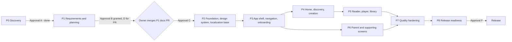

# Roadmap

Phases P0–P8 for the LittleStory Android MVP, their gates and current status.

Status: Draft for owner review — P1, 29 Oct 2026

Sources: master orchestrator brief (sections 2.3 and 23), docs/project-management/LittleStory_Jira_Backlog.xlsx (*Roadmap* sheet), P0 Discovery Assessment (29 Oct 2026)

## Phase flow

Every arrow is a gate the project owner controls. Approval for one level never implies the next (A Discovery · B Documentation · C Implementation · D Push/PR · E Merge · F Release).

## Phases

| Phase | Goal | Key tickets | Entry | Exit | Status (29 Oct 2026) |
|---|---|---|---|---|---|
| P0 | Read-only repo, toolchain and design audit | LS-001, LS-002 | Session start | Assessment delivered | Done — assessment delivered 29 Oct 2026 |
| P1 | Requirements, ADRs, backlog, prompts, agent instructions | LS-003–008, LS-131 | Approval A | Docs PR merged by owner | In progress (Approval B granted) |
| P2 | Buildable, linted, tested skeleton with tokens, components, EN/KN infrastructure, CI | LS-010–020, LS-030–042, LS-130, LS-150 | Approval C, build environment decided (D3) | Build + unit tests + lint + translation check green in CI | Not started |
| P3 | Navigation graph, splash, onboarding, setup, profile persistence | LS-045, LS-050–052, LS-060–062 | P2 merged | Journey A verified EN/KN | Not started |
| P4 | Home, Discover, Category, Detail, Create, Generating, Ready | LS-044, LS-070–075, LS-080–084 | P3 merged | Journeys B, C verified | Not started |
| P5 | Reader, simulated player, sleep timer, My Stories, progress | LS-090–094, LS-100 | P4 contracts merged | Journeys D, F verified | Not started |
| P6 | Settings hub, profiles, reminder, notifications, downloads, subscription, language, privacy, help | LS-043, LS-046, LS-063, LS-101, LS-110–115 | P3 merged | Journeys E, G verified | Not started |
| P7 | E2E, screenshots EN/KN, accessibility, security, maintainability, native Kannada review | LS-047, LS-120–126 | P3–P6 merged | All Must tests pass with evidence | Not started |
| P8 | CI stable, release docs, backend plan, readiness report | LS-048, LS-132, LS-133, LS-140, LS-141 | P7 done | Owner sign-off | Not started |

## Milestones

| Milestone | Contents | Gate |
|---|---|---|
| M1 — P1 documentation | `docs/` set, `prompts/`, `CLAUDE.md`, `.github/copilot-instructions.md`, PR template, CODEOWNERS, ADR files, workbook update | Approval D to push and open the PR; owner merges |
| M2 — Walking skeleton | LS-030, 031, 010–012, 040, 033, 034, 041, 035, 130: one tokenised screen in English and Kannada with the language switch, CI green | Approval C |

## Blocking prerequisites

- **D2 repository hygiene:** gitflow-style branches: `development` is the default branch and PR target, `staging` is the release candidate, `main` is stable (see [branching strategy](branching-strategy.md)). Owner sets the default branch and branch protection and deletes the old `claude/*` branches (R-22).
- **D3 build environment:** allow `dl.google.com` in the cloud environment and/or add GitHub Actions CI before any P2 PR can show a passing build (R-21, ADR-017).
