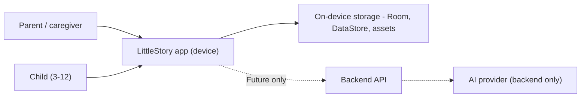

# Privacy threat model

Purpose: identify what personal data LittleStory handles, the threats to it, and the mitigations for the MVP and a future backend.
Status: Draft for owner review — P1, 29 Oct 2026
Sources: master orchestrator brief §8.5, §18; design details §3.2, §3.13, §3.14 (SCR-02, SCR-13, SCR-14); workbook Risks R-11, R-15, R-24 and ticket LS-126; P0 assessment D13, D14.

## 1. Scope and trust boundaries

MVP: everything stays on the device; no network calls, analytics or third-party SDKs. Dotted links are future and need separate approval.

## 2. Data inventory

| Data | Source screen | Purpose | MVP storage | Sensitivity | Decision |
| --- | --- | --- | --- | --- | --- |
| Child first name | SCR-02, SCR-14 | Personalise stories ("Stories for {child}") | Room (device) | Personal data of a child | Keep; first name only |
| Child age (3–12) | SCR-02 | Age-appropriate content | Room | Personal data of a child | Keep |
| Avatar choice | SCR-02 | Visual identity (no photo) | Room | Low | Keep; no camera or photo upload |
| Interests | SCR-02 | Personalisation | Room | Low | Keep, optional |
| Story language, duration | SCR-02, SCR-07 | Preferences | DataStore | Low | Keep |
| Parent name | SCR-02, SCR-13 | Greeting on Profile | Room | Personal data | **D14: proposed drop or make optional** |
| Parent email | SCR-13 (`meera@example.com`) | Account display | – | Personal data | **D14: proposed drop from MVP** (no accounts exist) |
| Create-story text ("What happened today?") | SCR-07 | Simulated generation input | Memory; not persisted after generation unless the story is saved | May contain names, school, places of a child | Minimise; never logged |
| Favourites, progress, downloads | SCR-03, 10, 12, 17 | Library features | Room | Low | Keep |
| Reminder time and days | SCR-16 | Bedtime reminder UI | DataStore | Low (reveals routine) | UI only in MVP (D13) |
| Subscription choice | SCR-15 | Demo only | Memory | None | No payment data at all |

## 3. Threats (STRIDE-lite)

| ID | Category | Threat | Impact | Mitigation (MVP) | Future |
| --- | --- | --- | --- | --- | --- |
| T-01 | Information disclosure | Child data in Logcat or crash logs | High | No PII in logs; release builds strip debug logging; Lint/Detekt rule for `Log.*` with user data | Backend logs scrubbed |
| T-02 | Information disclosure | Device backup / transfer exposes child profiles | Medium | Define `dataExtractionRules` / `fullBackupContent` explicitly; exclude or include deliberately (owner decision) | – |
| T-03 | Information disclosure | Secrets committed to the public repository (R-24) | High | No secrets exist in MVP; secret scanning in CI; `.gitignore` for `local.properties`, keystores | Backend secret store |
| T-04 | Tampering | Malformed mock JSON or injected content crashes app | Low | Defensive parsing; fallback to EN; tests with corrupt files | Server-side validation |
| T-05 | Spoofing | Demo subscription perceived as real purchase (R-15) | Medium (trust) | Visible "Illustrative pricing only" text; no billing library (TC-047) | Play Billing review |
| T-06 | Elevation of privilege | Unneeded permissions (notifications, storage, internet) | Medium | Manifest has no dangerous permissions; `INTERNET` not declared in MVP unless needed | Per-feature permission review |
| T-07 | Information disclosure | Exported components / deep links open screens with child data | Medium | Only the launcher activity exported; no deep links in MVP | Verified App Links if added |
| T-08 | Repudiation / misuse | Child changes settings meant for parents | Medium | Parent area entry pattern to be decided (parental gate is an open question) | Account-level controls |
| T-09 | Information disclosure | Debug-only features (pseudo-locales, test menus) shipped in release | Medium | Pseudo-locales enabled only in debug; release checklist item | – |
| T-10 | Denial of service | Excessive generation requests | Low (local) | Simulator only | Quotas and rate limits (see `docs/api/ai-generation-flow.md`) |

## 4. Review result

The P7 review (LS-126, 30 Oct 2026) checked every threat above against the code. T-02 was fixed with explicit data-extraction rules. T-08 (parental gate) is open for the owner. Details: [security-review.md](security-review.md).

## 5. Open questions

1. D14: which parent fields, if any, are collected in the MVP.
2. Should the parent area (settings, subscription) sit behind a parental gate?
3. Backup policy for child profiles (include in Android backup or not).
4. Retention and deletion UX: "Delete child profile" and "Delete all data" flows (needs design, SCR-21).
