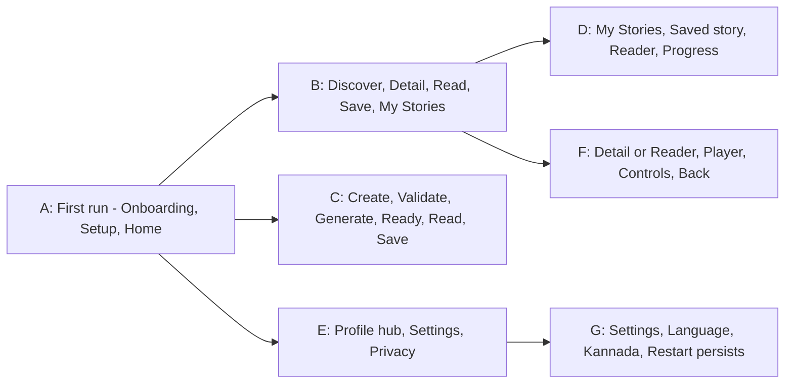

# Integration test plan

Purpose: list the cross-layer and end-to-end tests that prove the journeys work, in English and Kannada.
Status: Draft for owner review — P1, 29 Oct 2026
Sources: master orchestrator brief §6.1 (journeys A–G), §17.3, §17.4; workbook Test Cases (Integration rows), tickets LS-062, LS-075, LS-091, LS-121; ADR-004.

## 1. Layer integrations

| ID | Combination | What it proves | Test case(s) | Tooling |
| --- | --- | --- | --- | --- |
| IT-01 | ViewModel + fake repositories | State transitions for each screen with controlled data | per feature | JUnit, Turbine |
| IT-02 | Favourites use case + Room (in-memory) | One favourite state across Home, Discover, Detail, Player | TC-017, TC-018 | Robolectric + Room |
| IT-03 | Generation simulator + saved stories | Generated story auto-saved to "Created by Me" | TC-029 | JVM |
| IT-04 | Progress repository + Home continue card | Resume reading/listening from last position | TC-033 | Robolectric + Room |
| IT-05 | Profile repository + active child | Switching child changes Home personalisation | TC-042 | Robolectric |
| IT-06 | Language repository + catalog loader | Changing language reloads content with same IDs; saved and progress data survive | TC-007, TC-048 | Robolectric |
| IT-07 | Catalog loader fallback | Story without Kannada falls back to English fields, no crash, no raw key | TC-049 | JVM |
| IT-08 | Process death | Active child, favourites and progress restored after process recreation | TC-058 | Robolectric / instrumented |
| IT-09 | Room migrations | Schema migrations preserve data (from first release onward) | new | Room testing |

## 2. End-to-end journeys (LS-121)

Each journey runs in `en` and `kn` on an emulator (CI job or local).

| Journey | Steps (abridged) | Key assertions |
| --- | --- | --- |
| A | Launch → Onboarding 3 slides or Skip → Setup → Home | First-run routing (TC-057); profile created; Home greets the child |
| B | Home → Discover → search/filter → Detail → Read → favourite → My Stories | Search works in both scripts (TC-011, TC-012); favourite visible in library |
| C | Home → Create → empty submit error → enter text → generate → Story ready → Read | Validation (TC-019/020); deterministic stages (TC-025); auto-save (TC-029) |
| D | My Stories → saved story → Reader → leave mid-story → Home continue card | Progress restored (TC-033) |
| E | Profile → settings rows → Privacy (once designed, SCR-21) | Toggles independent of rows (TC-041) |
| F | Detail → Listen → play/pause, ±15 s, speed, sleep timer → back | Simulation disclosed (TC-036); timer label updates (TC-037) |
| G | Profile → Language → ಕನ್ನಡ → UI and stories switch → kill and relaunch | Selection persists; no lost state (TC-048) |

## 3. Rules

- Integration tests use deterministic seed data from [test-data.md](test-data.md).
- No real network; MockWebServer only after a network layer is approved.
- Database tests only once Room is introduced (LS-038).
- A dependent ticket is never reported as integration-tested against an unmerged change (brief §15.5).
