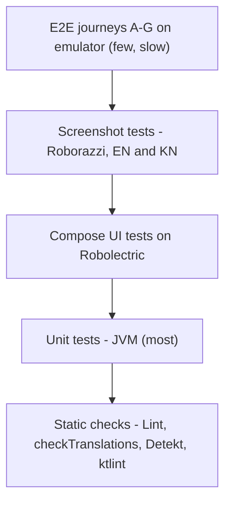

# Test strategy

Purpose: define the test pyramid, tools and where each kind of check runs for LittleStory.
Status: Draft for owner review — P1, 29 Oct 2026
Sources: master orchestrator brief §17, §16.1, §19; P0 assessment §2 and §8; workbook Test Cases sheet (TC-001…TC-058), tickets LS-035, LS-041, LS-120…LS-126, LS-130; ADR-011.

> No test has been written or run yet. Tool choices are proposals; versions are chosen in LS-030.

## 1. Pyramid

| Layer | Tools (proposed) | Typical subjects | Runs on |
| --- | --- | --- | --- |
| Static | Android Lint (HardcodedText, MissingTranslation = error), `checkTranslations` Gradle task, Detekt + ktlint (if approved, D15) | Hardcoded values, key and format-argument parity | CI + local |
| Unit | JUnit, MockK, kotlinx-coroutines-test, Turbine | Use cases, validation, ViewModel state, registry, fallback loader, generation simulator, player math | CI + local (JVM) |
| Compose UI | Compose test APIs on Robolectric | Rendering, actions, validation messages, dialogs, empty/error states, language switch | CI + local (JVM) |
| Screenshot | Roborazzi (recommended, ADR-011) | 22 design states + components in `en`, `kn`, `en-XA` | CI + local (JVM) |
| Integration | ViewModel + fake repos; Room in-memory; nav with controlled state | Favourites, progress, language change mid-journey, process death | CI + local |
| E2E | Instrumented tests on an emulator | Journeys A–G in EN and KN | CI emulator job or local device |
| Accessibility | Compose semantics assertions + manual TalkBack | Touch targets, labels, focus order, font scale | CI (automated part) + manual |

## 2. Principles

1. Deterministic: seeded mock data, no clocks or random IDs in assertions or screenshots; inject `Clock` and dispatchers.
2. Locale-independent selectors: test tags or resource IDs, never English literals — every UI test runs in `en` and `kn`.
3. Behaviour, not appearance only: each screen has state and interaction tests alongside screenshots.
4. Fakes over mocks for repositories; MockK for collaborators that are awkward to fake.
5. No network: MockWebServer is not introduced until a network layer exists.
6. Baselines are human-reviewed; never auto-approve screenshot changes.
7. A result is only reported as passing when the command actually completed (brief §17.7).

## 3. Where checks run

| Environment | Can run | Notes |
| --- | --- | --- |
| Cloud agent workspace | Nothing Android-specific today | Blocked from `dl.google.com` (R-21). Becomes JVM-capable once that host is allowed (D3). No emulator. |
| GitHub Actions (LS-130) | Static, unit, Robolectric UI, Roborazzi, assemble; emulator job optional | The shared, authoritative runner for PR checks |
| Owner's Windows / macOS machines | Everything incl. emulator, TalkBack, Kannada keyboard | Reference for manual and device checks (TC-056 build on both OSes) |

## 4. Coverage targets

| Area | Target |
| --- | --- |
| ViewModels and use cases | ≥ 80 % line coverage (LS-120 gate) |

| Every Must FR | ≥ 1 automated test case linked in the workbook |
| Every screen | EN + KN screenshot of each designed state |
| String resources | 100 % key parity `values/` ↔ `values-kn/` |

The LS-120 gate is enforced by Kover from `RootConventionPlugin`: every module reports coverage, the root aggregates it, and `./gradlew check` runs `koverVerify` over classes named `*ViewModel` plus everything in `com.littlestory.domain`. Hilt factories are excluded. Reports: `build/reports/kover/html/index.html` and `report.xml` (uploaded by CI). Line coverage of the gated code was 95 % when the gate was introduced (30 Oct 2026). Raise the threshold in `RootConventionPlugin.MIN_LINE_COVERAGE`; never lower it without owner approval.

## 5. Traceability

Requirement → Screen → Ticket → Test case → Locale → Result → Evidence is tracked in the workbook (Test Cases and Git-PR-CI sheets). Defects record locale, expected/actual result, severity (Blocker/High/Medium/Low) and ticket.

Related plans: [test-plan.md](test-plan.md), [ui-test-plan.md](ui-test-plan.md), [integration-test-plan.md](integration-test-plan.md), [screenshot-test-plan.md](screenshot-test-plan.md), [localization-test-plan.md](localization-test-plan.md), [test-data.md](test-data.md).
